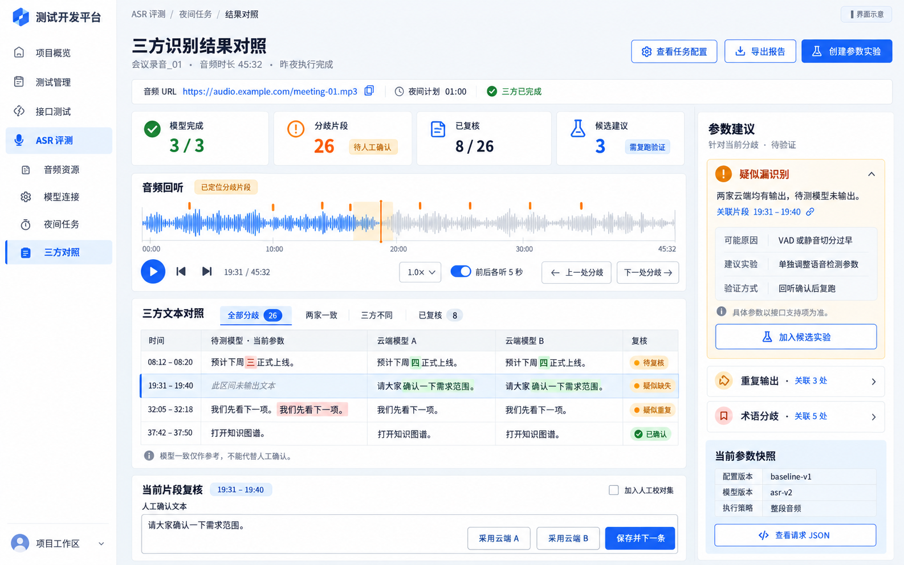

<!-- ASR 评测开发方案：定义业务范围、界面文案、技术设计、实施顺序与验收口径；供前后端开发及联调使用。本文是待实施方案，不代表功能已接入。 -->
# ASR 夜间对照评测开发方案

日期：2026-11-02。状态：待实施。项目：`/Users/a1/Desktop/ai-test-project`。

## 1. 目标与已确认需求

用户已有音频 URL，单条音频全部超过半小时。待测 ASR 接口的同一个请求中包含音频 URL 和模型参数。平台需要接入一个待测模型和两个云端参考模型，夜间执行，次日集中对比文本、回听差异，并获得可验证的调参建议。目前没有标准转写文本。

交付闭环：音频链接 → 接口连接与参数方案 → 夜间三方识别 → 文本对齐 → 差异回听 → 人工确认 → 调参建议 → 候选参数复跑。

产品名称采用「ASR 评测」，详情页采用「识别结果对比」。云端模型始终称为「参考模型」，人工确认前不得称其输出为正确答案。

### 1.1 本期范围

- 音频 URL 单条及批量导入，不要求用户重新上传大文件。
- 可配置的 JSON HTTP 接口：同一请求体填充 URL、模型参数；支持同步返回与提交后轮询。
- 一个待测模型、两个参考模型组成一次对照；同一配置可测试多个音频。
- 立即执行、指定时间执行、每日夜间执行；默认显示 Asia/Shanghai，可修改。
- 后台持久化队列、限流、租约、恢复、部分成功、取消及提交状态待核实。
- 三方文本对齐、差异筛选、播放定位、人工确认与校对集积累。
- 基于真实差异、参数定义和人工结论生成建议，创建候选参数复跑。
- 任务结果及复核记录导出，项目权限与密钥保护。

### 1.2 后续范围

首期不包含训练超参数优化、模型训练、本地 GPU 推理部署、流式 WebSocket ASR 压测、说话人分离质量评分、任意脚本适配、云厂商 SDK 全覆盖、无时间戳音频的强制对齐。Webhook 回调在后续阶段接入；首期异步服务必须能轮询或通过已部署网关提供轮询契约。

首期不把 ASR 结果硬塞入现有 `TestRun`、`CaseExecution` 的成功率统计，也不修改 Agent 工作流。提供公开结果服务及独立详情入口，后续再扩展统一报告和统一任务关联。

## 2. 现有平台与复用边界

以下为本次只读检查确认的路径；开发前以当时工作区为准。

| 能力 | 当前路径 | 使用方式 |
|---|---|---|
| 后端路由装配 | `backend/app/main.py` | 新增 feature router，沿用 `/api/v1` |
| 项目权限 | `backend/app/platform/projects/services/access_service.py` | service 层检查组织、项目和写权限 |
| HTTP 执行与出站策略 | `backend/app/execution/http/` | 复用公开执行器与授权；扩展有界大响应能力 |
| 密钥加解密 | `backend/app/core/security/crypto.py` | 复用 `encrypt_secret`、`decrypt_secret` |
| 文本模型调用 | `backend/app/llm/` | 使用现有结构化生成接口，不另建 LLM SDK 调用链 |
| 当前任务 Worker | `backend/app/orchestration/tasks/runtime/worker.py` | 作为租约设计参考，不导入其私有处理器 |
| 现有结果对比 | `backend/app/features/test_management/services/compare_service.py` | 仅作产品模式参考，ASR 字符对齐独立实现 |
| 前端路由与菜单 | `frontend/src/app/App.tsx`、`frontend/src/app/layouts/ConsoleLayout.tsx` | 增加懒加载路由和导航，不重建全局壳层 |
| API 客户端与作用域 | `frontend/src/shared/api/client.ts`、`frontend/src/app/providers/` | 复用认证、项目切换、查询取消与缓存边界 |
| 迁移装配 | `backend/alembic/env.py` | 显式发现 ASR 模型；迁移只新增领域表 |

现有 TaskWorker 依赖 Agent、TaskRun 和固定工作项类型，不是可直接注册任意 ASR 任务的通用定时器。首期选择 ASR 领域队列和独立进程，避免改变已存在的任务状态机。复用其所有者、租约代次、短事务等设计原则，不复制整个任务模块。

当前工作区已有大量其他功能的未提交修改，实施时必须保留；不回退、不覆盖，不把它们当成本需求的改动。

## 3. 前端布局与最终文案

### 3.1 原型使用规则

参考图：`docs/assets/asr-evaluation-review-reference.png`。



用户认可原型的整体布局、配色和区域划分；文字允许优化。保留左侧导航、中部播放器与三方文本、底部人工确认、右侧建议的结构。原图为示意数据，图中文字以本节为准，不复制示例统计或伪造波形到正式页面。

原型图由内置 ImageGen 生成，原始文件保留在 `/Users/a1/.codex/generated_images/01a19a51-ed8c-7df3-a614-c7e573c44a49/exec-177fc05f-af77-4e48-ad8d-3f0fee0bef41.png`，本方案将其复制到仓库。生成描述要点：中文企业测试平台、浅色蓝色主题、夜间三方 ASR 文本对照、音频回听、人工确认和有证据的参数建议；本次只归档原图，不重新生成图片。

### 3.2 文案替换表

| 原型文字 | 开发采用文字 | 说明 |
|---|---|---|
| 三方识别结果对照 | 识别结果对比 | 页面主标题 |
| 三方对照 | 结果对比 | 页签或导航 |
| 音频资源 | 音频列表 | 用户直接理解的资产入口 |
| 模型连接 | 接口配置 | 包含地址、鉴权、字段映射和参数 |
| 夜间任务 | 评测任务 | 夜间是执行方式，不限制立即执行 |
| 模型完成 | 识别进度 | 示例：3 个模型已完成 / 共 3 个 |
| 分歧片段 | 待确认差异 | 排除已确认项，按当前对比版本统计 |
| 已复核 | 人工已确认 | 同时展示已确认数 / 本版本差异总数 |
| 候选建议 | 调参建议 | 数量为有效、未过期建议数 |
| 音频回听 | 音频播放 | 保留定位、倍速、上下文播放 |
| 全部分歧 | 全部差异 | 其他筛选：待测与两家参考不同、三方不同、人工已确认 |
| 待测模型·当前参数 | 待测模型（参数方案名） | 展示实际连接别名 |
| 云端模型 A / B | 参考模型 A / B | 副标题展示实际模型名与版本 |
| 疑似缺失 | 疑似漏识别 | 推测标签，不作为已确认结论 |
| 当前片段复核 | 确认本段文本 | 支持“暂无法确认”，不可强迫选一方 |
| 人工确认文本 | 确认后的文本 | 允许手动编辑和确认空文本 |
| 加入人工校对集 | 保存到校对集 | 必须明确勾选；不自动将云端文本变成标准 |
| 加入候选实验 | 加入调参方案 | 只创建草稿，不自动覆盖当前参数 |
| 创建参数实验 | 新建参数对比 | 明确进入参数复跑流程 |
| 当前参数快照 | 本次请求参数 | 可查看脱敏的请求 JSON |
| 模型一致仅作参考，不能代替人工确认 | 三方结果仅供参考，请回听后确认。 | 固定说明 |

未完成、缺数据的卡片展示「识别中」「暂无结果」或「待配置」，不展示伪造的 0。统计口径与筛选结果必须一致；「全部差异」页签不能混入三方一致行，人工抽样通过单独的「一致片段抽查」入口展示。

### 3.3 页面与路由

导航建议在当前「资产」分组增加「ASR 评测」入口，进入工作区后显示域内页签；不强行替换现有全局导航为原型的演示菜单。

| 路由 | 页面 | 关键内容 |
|---|---|---|
| `/console/asr/audio` | 音频列表 | 名称、URL、时长、标签、可用性、导入与筛选 |
| `/console/asr/connections` | 接口配置 | 待测/参考角色、HTTP 模板、响应映射、参数定义、调试 |
| `/console/asr/jobs` | 评测任务 | 执行计划、音频数、三方状态、进度、取消、重试、结果入口 |
| `/console/asr/jobs/:job_id` | 评测任务详情 | 按音频列出运行结果，批次不可只展示一个总状态 |
| `/console/asr/comparisons/:comparison_id` | 识别结果对比 | 本文原型对应页面，三方对照、播放、确认及建议 |
| `/console/asr/experiments` | 参数对比 | 基线、候选参数、音频集、对比结果及运行证据 |

校对集先以音频详情抽屉和对比页操作呈现，避免首期增加大量空页面。

### 3.4 新建评测任务

分步表单：①选择音频；②选择一个待测和两个参考连接；③选择待测参数方案；④选择立即、指定时间或每日执行；⑤预览调用次数与保存。

展示三个模型各自的请求参数，不要求不同接口字段名相同。明确一个音频默认产生三次识别提交；云端计费金额未知时只展示调用数，不编造金额。调试按钮明确提示会真实调用接口。

创建后快速返回任务 ID，前端轮询状态，不占用 30 分钟以上的页面 HTTP 请求。刷新或关闭页面不影响已持久化任务。

### 3.5 结果页交互

- 顶部展示音频、执行批次、三方独立状态、配置版本、对比版本；重试或新配置不覆盖历史结果。
- 播放器支持播放/暂停、倍速、前后各听若干秒、上一/下一差异、时间轴标记和快捷键；输入框聚焦时不劫持按键。
- 中间三列默认等宽；长文按对齐块分页或窗口化加载，不能一次渲染整篇所有字符。1366px 下建议栏可折叠，三列区域允许横向滚动。
- 点击差异，滚动到对应文本并定位音频；当前选中状态同步到右侧建议。
- 原文和归一化文本可切换，默认保留原文。差异高亮区分“不同”“参考侧有内容”“重复候选”，不能暗示绿色一定正确。
- 人工动作：采用待测/参考 A/参考 B、手动编辑、确认无语音、暂无法确认、保存并下一条。保存采用版本校验，冲突提示刷新；保留操作者和修改历史。
- 对齐结果生成新版本后，旧复核仍保留关联旧版本；重新匹配的内容必须显式标注来源，不静默沿用确认状态。
- 三方一致片段可以抽查；三家相同也可能共同出错。

## 4. 音频播放与时间定位

音频默认按原始 URL 交给三家服务，平台不强制切分、不自动转码或去静音。任何预处理都必须形成独立音频版本和参数快照。

每个结果块记录 `timing_source` 和可用时间范围：

| 来源 | 展示与行为 |
|---|---|
| `PROVIDER` | 来自对应模型返回的时间戳，仍是模型输出，不保证人工级精度 |
| `REFERENCE_ANCHOR` | 由参考模型时间戳和文本对齐推算；显示「参考定位」，不能标成待测模型精确时间 |
| `UNAVAILABLE` | 无时间戳、无可靠锚点；时间显示「未定位」，允许手动跳转；不提供假的精确播放按钮 |

逐字时间戳不是首期必需；句级时间戳可支持主要回听流程。没有可靠时间戳时仍能文本对比，但不能承诺自动准确定位疑似缺失的位置。后续强制对齐单独立项。

优先使用浏览器原生 audio 的流式播放和真实差异时间轴。真实波形可通过已具备的音频预处理能力生成有界峰值数据；未具备解码工具时先显示进度条与标记，不伪造波形，也不在浏览器一次性解码整条长音频。

URL 不支持 CORS、鉴权或拖动时，提供受项目权限约束的后端媒体代理作为兼容路径，流式传输并正确处理 Range/206/416；上游不支持范围读取时明确不能任意拖动。不得用通用 JSON 执行器把整个音频加载到内存。代理可缓存但不默认为公网重托管服务，也不把只对本平台有效的代理链接交给云端。

## 5. 接口配置与参数合同

### 5.1 每个连接配置

- 名称、项目、提供方标识、模型 ID/版本、适配器类型及启用状态。
- 提交地址、HTTP 方法、鉴权引用、请求头模板、JSON 请求体模板。
- 音频 URL 注入路径、模型参数绑定路径及字段类型。
- 响应全文路径、分段数组路径、段文本/开始/结束时间路径、时间单位。
- 异步任务 ID 路径、轮询地址模板、状态路径、成功/失败状态集合、结果地址映射。
- 连接/读取超时、任务截止时间、提交并发、远端在途上限、轮询间隔、退避规则。
- 能力声明：时间戳、异步查询、取消、幂等键、版本是否固定、参数定义来源。

JSON 字段使用受限路径解析（例如 JSON Pointer），不执行用户 Python、JavaScript、模板代码或任意表达式。首期不追求兼容所有签名算法；特殊云厂商签名通过具名适配器或用户已有网关接入。

示例仅说明待测接口结构，不代表真实接口字段：

```json
{
  "audio_url": "{{audio.url}}",
  "model": "{{connection.model_id}}",
  "parameters": "{{experiment.parameters}}"
}
```

整值占位符必须保留原类型：这里 `parameters` 渲染后是对象，不是包含 JSON 的字符串。采用受限的已命名变量替换，参考现有模板能力，避免又实现一套任意表达式语言。

### 5.2 参数定义与请求快照

每项参数记录实际字段路径、显示名、类型、默认值、范围/枚举、互斥依赖、说明、来源版本和是否可调。未知参数仍允许作为合法 JSON 配置传递，但不产生带具体数值的自动修改建议。

参数方案不可变版本化。运行引用连接版本、参数版本、音频版本，保存脱敏可展示快照和加密的执行敏感配置引用。历史任务不随连接编辑而改变，凭据轮换和音频链接刷新另外记录修订。

鉴权密钥使用现有加密能力，接口只回 `has_secret` 和掩码。签名 URL 的查询串同样按敏感值处理，不写入日志、导出或大模型提示；后台仍须保留可执行的加密原值。用户可通过受鉴权的播放接口使用音频，列表与报告默认展示脱敏链接。

### 5.3 两个云端服务的落地方式

目前尚未指定厂商。先完成通用同步 JSON、异步轮询适配和测试契约；拿到实际接口后分别保存三个连接并联调。若厂商需要专有签名，增加具名适配器，不能将通用模板的存在当作该厂商已经接入。

未知接口、无凭据不阻断通用页面、队列、对齐和测试实现；真实联调单独标为待验证。不得创建固定示例结果冒充云端返回。

## 6. 后台执行与夜间计划

### 6.1 运行单元

一个评测批次包含多个音频；每个音频有三个独立模型运行。一个模型失败不丢弃其余成功文本。三方齐备后生成正式三方对比；只有两方结果时显示「结果不完整」，可做两方预览，但不生成两家参考一致的结论。

建议数据库持久化 + 独立 ASR Worker 进程，不首期新增 Redis、Celery 或 APScheduler。计划入口为 `backend/scripts/run_asr_worker.py`，供持续运行的进程托管；不是定时启动浏览器，也不是 Codex 桌面自动化。Web 服务和 Worker 的启停相互独立。

### 6.2 调度规则

- 支持一次性指定时间和每日本地时刻；保存 IANA 时区，下一次时间转换后以 UTC 存储。
- 每次触发使用 `(schedule_id, scheduled_for)` 唯一约束，事务内创建批次并推进下一次触发时间。
- 默认错过时刻不补跑，标记「已错过」；可显式配置有限补跑窗口。服务停机一周不自动补齐一周的收费任务。
- 默认同计划不重叠，上批未结束则记录本次跳过原因。参数对比需另外显式创建。
- 首期每日计划绑定音频 ID 列表与配置版本；新导入音频不会自动扩大当晚执行范围。修改计划产生新版本。
- 前端展示下一次执行时间与时区。到达截止时间后停止新增提交；已提交的任务继续查询至配置的远端截止时间。
- Worker 必须运行、机器不能睡眠、网络可用；页面提供最近 Worker 心跳及「后台执行器离线」状态，不能仅保存计划就宣称必会夜间运行。

### 6.3 领取、恢复与幂等

工作项按 `available_at` 领取，采用短事务、行锁/`SKIP LOCKED`、所有者、租约到期和代次。心跳使用独立 Session；旧代次响应不得覆盖新运行。不要在外部 HTTP 等待期间持有数据库行锁或长事务。

提交前持久化提交意图和稳定的幂等键，提交成功后立即落库远端任务 ID。重启优先继续查询该 ID，不重新提交。提交可能成功但响应丢失时，若不能按幂等键找回，则转 `RECONCILIATION_REQUIRED`（待核实提交状态），不能盲目重试产生重复识别与费用。

同步服务超时同样不代表远端未执行。仅对可证明安全的失败或支持幂等的提交自动重试；轮询 GET 可以退避重试。429 遵循 Retry-After 并设上限；永久性鉴权和参数错误直接失败。

轮询是可重新领取的短工作项，保存 `next_poll_at`，不要用 sleep 占住所有执行线程。远端在途额度单独持久化计数；不能因为释放轮询线程而无限提交远端任务。支持全局、项目和连接级并发上限。

取消停止新提交和新工作；已提交服务按其能力请求取消或显示「本地已停止跟踪，远端可能继续执行」。取消与完成竞争必须事务化，不允许迟到响应使已取消任务重新变成成功。

每次实际提交前重新校验账号状态、项目授权、连接启用状态和出站策略；计划创建时的权限不能永久授权未来执行。

### 6.4 状态合同

| 对象 | 状态 |
|---|---|
| 批次 | `QUEUED / RUNNING / COMPLETED / PARTIAL_FAILED / FAILED / CANCELLED / RECONCILIATION_REQUIRED` |
| 模型运行 | `PENDING / SUBMITTING / REMOTE_RUNNING / FETCHING / SUCCEEDED / FAILED / CANCELLED / RECONCILIATION_REQUIRED` |
| 对齐处理 | `PENDING / RUNNING / SUCCEEDED / DEGRADED / FAILED` |
| 人工确认 | `UNREVIEWED / CONFIRMED / UNRESOLVED` |
| 建议 | `DRAFT / ADOPTED / DISMISSED / STALE` |

批次完成与建议生成分开：三方成功但 LLM 不可用，识别批次仍完成，建议区显示失败原因及重试。`RECONCILIATION_REQUIRED` 优先于普通失败；具体状态归并编写显式转换表与测试，不能只按三个布尔值推断。

对外进度只展示确定事实，例如「已完成 2/3 个模型，参考 B 识别中」。远端未提供进度时不编造百分比或完成时间。

## 7. 三方对齐、差异与评估口径

### 7.1 对齐流程

1. 保存完整原始响应与原始文本；校验时间单位、顺序、空文本及响应完整性。
2. 按版本化规则生成归一化文本，并保存到原文字符的映射；标点、数字、大小写规则可选，不能不可逆地覆盖原文。中文默认按字对齐，数字归一化不擅自改变业务含义。
3. 有时间戳时以时间交集和文本锚点联合分块；无时间戳时按稳定文本锚点分块，使用序列对齐映射三方内容，不能按句号或数组下标直接配对。
4. 在块内做字符差异对齐，得到原文位置、三方文本、插入/删除候选、定位来源和算法版本。
5. 相邻差异按配置合并供回听，保留底层编辑明细；避免一句话里多个字造成十几条独立播放任务。

不对整条长音频构造三维动态规划矩阵；即便两两对齐也要通过锚点、分块和资源上限控制复杂度。极端重复文本、锚点失败时输出 `DEGRADED`，保留未对齐全文并展示原因，不能把未处理尾部算作模型漏识别。

### 7.2 标签与指标

差异标签包括：待测与两家参考不同、三方不同、疑似漏识别、疑似重复、数字分歧、术语候选。后四项是规则/模型推测，可重叠，不是人工确认的错误类别。

无标准文本阶段展示：

- 本对比版本的差异块总数、待确认数、已确认数、暂无法确认数。
- 三组两两字符差异比例：`编辑距离 / max(两文本字符数)`；双方均空时为 0，一方空时为 1。明确其是文本差异，不能称准确率、CER 或 WER。
- 三方一致/不一致块数及覆盖范围，明确分块规则；不将三方一致当作真实正确。
- 已知的提交/排队/远端完成/取回/后处理耗时。云端没有真实推理耗时则只展示端到端耗时，不把轮询间隔算成模型速度劣化。

人工校对集可计算 CER/WER，但只限已确认且边界明确的样本，记录归一化与分词版本。总分以总编辑数/总参考字词数汇总，单独说明空参考插入计数规则。以差异为主的选择性标注存在偏差，不能外推整段准确率；配合一致片段抽样后再形成更有代表性的评估集。

## 8. 调参建议与复跑

### 8.1 建议生成

确定性程序负责对齐、计数和状态；LLM 负责解释和组织候选建议。夜间可先生成「待确认建议」，人工确认后可重新生成。发送给 LLM 的内容限于差异块、上下文、已确认结论、脱敏参数定义及版本，不直接塞入数小时全文或签名 URL。

每条建议至少包含：

```text
关联比较与差异块 ID、当前配置版本、观察现象、证据摘录、人工确认状态、
可能原因、证据强度说明、可调参数路径、当前值、候选值或候选方向、
参数说明来源、可能副作用、验证步骤、生成模型/提示词版本、建议状态。
```

程序验证参数存在、类型/范围正确、互斥依赖成立；没有已知参数语义时只给排查方向。单条音频及一次运行只能提供假设，不能据此宣称参数有因果效果、最优值或改善概率。

建议不得自动修改当前连接或立即提交新的收费任务；用户已选择的执行计划可以按其明确配置自动执行候选方案。LLM 失败时仍保留所有转写、对比和人工操作，界面可显示标注为规则生成的排查方向，不能伪装为模型分析。

### 8.2 参数对比实验

选择基线版本和若干候选版本，默认一次只改一个参数或一个明确关联的参数组；记录变化，预算按调用数预览。每个候选都必须保存实际请求快照，不只保存“调低阈值”的自然语言描述。

同一音频的 K 组待测参数，在参考结果可复用时只需 K+2 次提交。复用键至少包含：项目、音频内容版本、参考连接及模型版本、完整参数摘要、预处理版本；缺少可靠内容指纹或模型版本时，不默认跨批次复用，可显式引用旧参考结果并显示其日期与限制。URL 相同不能证明内容相同，临时签名变化也不等于音频内容变化。

评估顺序：人工校对片段上的变化 → 新增/消失的差异 → 完整音频的长段重复、尾部输出及运行稳定性 → 耗时和调用成本。不得将「更接近两个云端」直接写成「更准确」。

片段复跑只有在接口支持范围输入或平台确实产出了对应音频资源时才开启；整段识别中的上下文可能影响结果，最终候选必须回到完整长音频验证。未确认音频裁切能力前，不把时间范围塞进 URL 假装已裁切。

## 9. 数据模型建议

以下是逻辑实体，可根据实现合并窄表，不能省略审计、版本和幂等关系。统一包含主键、项目归属及必要的创建/更新信息；时间采用带时区 UTC。

| 实体/建议表名 | 主要字段与约束 |
|---|---|
| `asr_audio` | 名称、加密 URL、脱敏 URL、已知时长、来源信息、内容版本、可选内容指纹、标签、可用性 |
| `asr_connection` | 名称、角色能力、启用状态、当前版本引用；不得明文存凭据 |
| `asr_connection_version` | 不可变模板、字段映射、能力、加密敏感配置、模型版本、说明来源 |
| `asr_parameter_set` | 连接版本、方案名、版本号、参数 JSON、摘要；版本唯一 |
| `asr_schedule` | 音频 ID 列表与版本、三方配置、IANA 时区、规则、下一次触发、补跑及重叠策略 |
| `asr_job` | 计划/实验来源、批次状态、scheduled_for、截止时间、运行摘要、创建者；计划触发唯一 |
| `asr_model_run` | 批次、音频版本、角色、参数/连接快照、远端任务 ID、提交意图、幂等键、状态和实际耗时 |
| `asr_work_item` | 运行/处理阶段、available_at、lease_owner、lease_generation、lease_expires_at、尝试计数和错误 |
| `asr_artifact` | 模型运行、原始响应/全文/分段或峰值文件的受控存储引用、完整性、大小与摘要 |
| `asr_comparison` | 音频和三个运行引用、归一化/算法版本、状态、指标、对比版本 |
| `asr_diff_block` | 对比版本、块顺序、各方原文范围、时间来源及范围、标签 |
| `asr_review` | 差异/抽样块引用、状态、确认文本（允许空）、版本、人工修改审计；防并发覆盖 |
| `asr_reference_sample` | 明确边界的人工校对文本、音频版本、来源复核版本和操作者；不由云端自动创建 |
| `asr_suggestion` | 对比/复核版本、证据块、结构化建议、参数校验结果、生成信息及状态 |
| `asr_experiment` | 基线/候选版本、音频版本集合、参考复用来源、运行及比较摘要 |

大响应和逐段文本可放独立 JSONB 或受控文件存储，列表只读摘要。首期可采用配置化本地制品目录，但 Web 与 Worker 必须共享该目录；不同机器部署时改为共享存储，不依赖 Worker 私有临时路径。制品读取经授权、目录校验和大小限制，不提供任意路径下载。

## 10. API 草案

所有接口前缀 `/api/v1/asr`，wire 字段 snake_case，错误沿用 `{code, message, request_id}`，列表沿用平台分页。以下端点为设计草案，不代表当前存在。

| 资源 | 接口与用途 |
|---|---|
| 音频 | `GET/POST /audio`、`POST /audio/import`、`GET/PATCH /audio/{id}`、`POST /audio/{id}/check` |
| 播放 | `GET /audio/{id}/media`；受鉴权、流式/Range；可选 `GET /audio/{id}/peaks` |
| 连接 | `GET/POST /connections`、`GET/PATCH /connections/{id}`、`GET /connections/{id}/versions` |
| 接口调试 | `POST /connections/{id}/checks` 返回异步调试 ID，不在请求内等待整条识别 |
| 参数 | `GET/POST /parameter-sets`、`GET /parameter-sets/{id}`；修改创建新版本 |
| 计划 | `GET/POST /schedules`、`PATCH /schedules/{id}`；启用/停用及下次执行预览 |
| 任务 | `GET/POST /jobs`、`GET /jobs/{id}`、`POST /jobs/{id}/cancel`、`POST /jobs/{id}/retry` |
| 运行 | `GET /jobs/{id}/runs`、`GET /runs/{id}`；分页读取分段与脱敏快照 |
| 对比 | `GET /comparisons/{id}`、`GET /comparisons/{id}/blocks`；筛选和分页；重新对齐新建版本 |
| 确认 | `PUT /comparisons/{id}/reviews/{block_id}`；携带 expected_version；返回冲突不覆盖 |
| 建议 | `POST /comparisons/{id}/suggestion-jobs`、`GET /comparisons/{id}/suggestions`、`PATCH /suggestions/{id}` |
| 校对集 | `GET/POST /reference-samples`，记录人工来源与确定的音频边界 |
| 参数对比 | `GET/POST /experiments`、`GET /experiments/{id}`；新建草稿与执行必须显式区分 |
| 导出/健康 | `POST /comparisons/{id}/exports`、`GET /exports/{id}`、`GET /runtime-status` |

远端提交、分析、导出等长操作返回 202 和资源 ID；具体查询端点在合同实现阶段补齐。导出包含三方原文、差异、人工确认、参数摘要及建议证据，默认 JSON/CSV；有有效时间戳再提供 SRT，不能造字幕时间。

权限建议：viewer 可读所属项目结果；member 可导入音频、创建任务、确认、创建参数实验；editor 可维护共享连接与计划、管理他人任务。本人任务的取消/重试允许创建者在当前仍具写权限时执行。所有端点服务层独立校验，定时执行也重新校验；跨项目引用统一 404。

## 11. 工程落地与安全边界

建议目录：

```text
backend/app/features/asr_evaluation/
  models/          # 领域模型，唯一归属
  schemas/         # 资源输入输出和状态合同
  router/          # 薄 HTTP 适配与聚合入口
  services/        # 权限、版本、业务与事务
  providers/       # 通用 JSON、轮询和具名厂商适配
  runtime/         # 领域队列、调度、租约和工作处理
  alignment/       # 归一化、原文映射与有界对齐纯算法
  prompts/         # 调参建议提示词和输出 schema
backend/scripts/run_asr_worker.py
frontend/src/features/asr-evaluation/
  api/ contracts.ts components/ hooks/ lib/
frontend/src/pages/console/ASREvaluation/
docs/asr-evaluation-progress.md
docs/asr-evaluation-delivery.md
```

按实际职责逐步创建文件，不预建大量空模块。路由只在 main.py 统一挂载；新 ORM 模型在 Alembic 显式发现，不加入 core 基线模型。迁移编号根据实施时当前 head 确定，不预占 0032 或改写已有迁移。

HTTP 特别注意：当前共享执行器有约 200,000 的响应截断边界，长音频分段/词级时间戳可能超出。必须提供向后兼容的显式响应大小选项和截断状态，ASR 使用配置化上限；默认行为保持原调用方兼容。发生超限时明确失败或保存完整受控制品，不得把截断的 JSON/尾部文本作为成功识别再参与对比。媒体二进制走共享层的有界流式接口，不能套用文本响应接口。

所有提交、轮询、结果下载、音频检查和媒体代理均执行项目出站策略。重定向逐跳校验，限制 schema、目标、解析后地址及读取大小；不自动把任意 URL 加到白名单，不绕过现有私网授权规则。云端拉取 URL 的可达性要与平台可访问性分开记录，HEAD 不支持也不直接判定音频无效。

前端使用既有 api 实例、React Query 和项目作用域；query key 包含资源实际 project_id、比较版本、过滤与分页。身份切换取消在途请求；深链详情以资源归属项目为准。请求参数和长期凭据不存浏览器 localStorage。

文本差异、外部响应和 LLM 建议按纯文本渲染，禁止危险 HTML。建议模型不得执行文本中的指令或请求外部资源。导出 CSV 对公式开头内容做安全转义，下载链接仍受项目权限限制。

## 12. 分阶段实施与验收

以下 A0–A6 是本期完整闭环的内部检查点，不是每完成一阶段就要求用户重新授权。涉及真实厂商、密钥或音频 URL 缺失时，继续完成不依赖它们的实现与测试，真实联调明确保留待验证。

| 阶段 | 实施内容 | 可验收结果 |
|---|---|---|
| A0 合同与迁移 | 对照规范和当前代码、登记已有修改；定义 DTO/状态/权限/参数版本；新增领域迁移与入口 | 空库升级、已有库升级、降级和重新升级；不改变旧执行链 |
| A1 资产与连接 | URL 导入、连接配置、同步/异步模板、参数表单、鉴权、长响应处理、异步调试 | 同请求正确传递音频 URL 和对象参数；敏感值不回显；错误可定位 |
| A2 夜间执行 | 领域 Worker、一次性/每日计划、队列租约、查询恢复、并发、取消与提交核实 | 重启能恢复查询，重复调度不重复创建批次；收费提交不盲重试 |
| A3 对比与播放 | 结果归一化、分块对齐、指标、原文映射、三列页面、原生音频与条件代理 | 长音频结果不截断；时间来源真实；缺一方显示不完整 |
| A4 人工确认 | 文本编辑、版本冲突、审计、校对集、一致片段抽查 | 确认刷新后可恢复；空文本与未确认不同；旧版确认不污染新版 |
| A5 建议与参数复跑 | 结构化 LLM 建议、字段验证、候选草稿、基线对比、参考复用、导出 | 每条建议可追溯证据；无法映射参数时不给伪数值；复跑不覆盖基线 |
| A6 联调与交付 | 三个实际接口、一条 >30 分钟音频、夜间执行、故障恢复、浏览器验收 | 给出真实调用记录、页面截图、未验证项、启动与回退说明 |

### 12.1 必须覆盖的测试

1. 受限模板能同时注入 URL 和嵌套参数，保留 bool/number/object/null 类型；非法映射、类型和范围明确报错。
2. 所有 ASR 资源、制品与媒体的跨项目引用被拒绝；密钥、URL 查询串不出现在日志、错误、导出及 LLM 输入。
3. >30 分钟模拟响应和超 200k 的真实结构测试；超限不生成半条成功结果；长音频全文能完整分页获取。
4. 调度时区跨日、同刻多个 Worker、重复 tick、停机错过、计划重叠、当前权限撤销均有确定结果。
5. 提交前/响应丢失后/保存远端 ID 后重启；安全轮询重试与不确定提交区分；旧租约代次不能写回。
6. 一个模型失败、三方都失败、取消竞争、远端仍在运行、429 退避、LLM 单独失败、Worker 离线均有真实 UI 状态。
7. 中文、标点、数字、中英混合、长重复、双方空文本、参考一致但待测不同的对齐样本；原文高亮映射正确，资源上限降级不误报尾部丢失。
8. 无时间戳、仅参考时间戳、毫秒/秒转换、无 Range、URL 过期等播放状态不伪造定位。
9. 多人同时确认、确认空文本、改对比版本、采样三方一致片段及校对覆盖统计；不产生虚假的整段准确率。
10. LLM 给不存在参数、越界值或无证据结论时被校验/降级；建议生成失败不影响结果；候选实验只改所选参数并保留基线。
11. 内容版本、模型版本或预处理变化使参考缓存失效；未知内容和模型版本不自动跨批次命中缓存。
12. 前端加载、失败、空态；项目/身份切换、深链刷新、任务轮询、差异定位、编辑确认和导出；示意数字不能出现在生产接口。

算法、任务恢复和真实集成是必要验证；不为简单文案变更写镜像实现的测试。先运行 ASR 定向测试，最终按仓库规范完成后端回归、前端 test/lint/typecheck/build 和迁移验证。数据库仅使用隔离测试库，不能重置开发库。

### 12.2 交付和回退

- 更新实施进度、最终交付文档、docs 索引、启动指南与非敏感配置示例；记录实际命令、结果和未验证能力。
- 文档给出 Web 与 ASR Worker 的分别启动方式、后台托管方式、共享制品目录、下次触发时间及心跳检查方法。
- 截图覆盖配置页、任务状态、完整三方结果、人工确认和参数实验；真实记录与测试 Fake 数据分开标记。
- 回退顺序：停用计划、停止新提交、处理已提交任务、停 Worker、回退应用；新增数据表优先保留。需要 downgrade 时先导出 ASR 数据，不能通过重建主库回退。

## 13. 真实联调待补资料

| 资料 | 缺失时可做什么 | 不能宣称什么 |
|---|---|---|
| 待测接口脱敏请求/响应和参数含义 | 完成通用模板、参数定义 UI 与测试 | 真实参数已正确映射或建议有效 |
| 两家云端服务名称、鉴权和协议 | 完成同步/轮询适配及连接表单 | 两个特定厂商已经接入 |
| 可授权读取的长音频 URL、有效期与必要鉴权 | 完成合成结果、权限和播放兼容测试 | 实际长音频已跑通或夜间已完成 |
| 可用的现有文本模型配置 | 完成规则证据与可注入 Fake Provider 测试 | AI 建议服务已经真实验证 |

本开发方案不要求现在提供凭据，也不在文档中保存凭据。开发阶段通过现有配置入口填写，真实联调前确认授权和预算即可。
