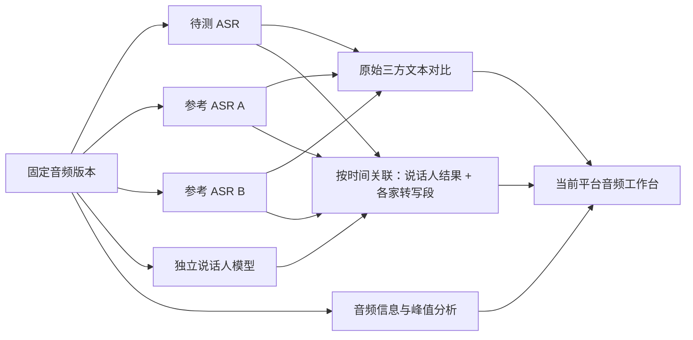

<!-- 当前平台优化方案：基于本仓库与只读 studio 样例，规划说话人分段接入、音频工作台及右侧信息抽屉；供前后端实施与验收使用。本次不修改业务代码、不连接模型、不执行迁移。 -->
# ASR 说话人分段接入与音频工作台优化方案

日期：2026-11-02。状态：待实施。实施项目：`/Users/a1/Desktop/ai-test-project`。

## 1. 目标、范围与建议结论

用户后续将接入一个说话人模型，希望当前平台能展示说话人、时间片段和对应文本；参考 `/Users/a1/Desktop/studio` 及两张截图优化页面。图二的音频参数通过按钮打开右侧面板查看。

建议在当前平台增加「单模型音频工作台」，保留既有「三方识别结果对比」：

- 工作台：顶部统一播放器，下方展示全文/对话、说话人时间片段和精简执行信息。
- 三方对比：仍展示待测模型与两家参考模型，可按说话人筛选和回听，不再额外挤入第四列。
- 说话人模型：作为可选独立处理阶段，同一个音频版本默认调用一次，再分别与三家的转写结果关联。
- 图二内容：由「音频信息」按钮打开右侧 Drawer；「请求参数」另设按钮，不混淆音频属性与模型配置。
- 长音频波形和文件信息优先后台生成，避免浏览器为显示波形下载、解码整条录音。

本方案将「说话人拆分」按**说话人分段（diarization，即谁在何时说话）**理解。它不等于输出每个人的独立音轨，也不自动识别真实身份。若未来模型输出的是人声独立音轨，需要额外增加音轨资源、播放切换和源时间映射，不应强套本次分段协议。

实施只修改当前平台。studio 是只读参考，不迁移其数据库，不运行其服务，不导入其真实音频、业务 URL、声纹或凭据。当前平台继续使用中文、React 18、React Router、antd 与现有后端分层，不沿用样例的英文 UI、TanStack Router、React 19 或 Tailwind 技术栈。

## 2. 已检查代码与实际差距

本节是代码检查结果，不代表新能力已实现。

| 当前位置 | 当前行为 | 需要优化 |
|---|---|---|
| [generic_json.py:213](../backend/app/features/asr_evaluation/providers/generic_json.py#L213) | 分段只提取 text、start_seconds、end_seconds | 保留说话人、段 ID、可用置信度、声道与可选字词级时间 |
| [assets_service.py:63](../backend/app/features/asr_evaluation/services/assets_service.py#L63) | 响应映射摘要只允许少量固定字段 | 扩展映射展示、校验和版本快照，不能前端配置了 speaker_pointer 却不生效 |
| [assets_service.py:84](../backend/app/features/asr_evaluation/services/assets_service.py#L84) | 所有连接按 ASR 校验，并要求文本输出映射 | 时间区间型说话人模型不一定返回文本，需独立能力与结果适配 |
| [schemas.py:48](../backend/app/features/asr_evaluation/schemas.py#L48) | role 仅 TEST/REFERENCE，无处理类型 | 区分「转写连接」与「说话人处理连接」，后者不参与三方数量校验 |
| [asr_models.py:119](../backend/app/features/asr_evaluation/models/asr_models.py#L119) | AsrModelRun 将 segments 放入单个 JSON 字段 | 建立可分页、可过滤的转写段与说话人区间，保留原始 JSON |
| [comparison_service.py:35](../backend/app/features/asr_evaluation/services/comparison_service.py#L35) | 按字符串包含关系回找分段时间 | 改为明确的段 ID/原文偏移映射，重复短句不能跨多次出现取 min/max |
| [comparison_service.py:221](../backend/app/features/asr_evaluation/services/comparison_service.py#L221) | 历史详情使用当前音频资源与媒体地址 | 播放、说话人处理、原始文本、校对结果必须绑定相同音频版本 |
| [media_service.py:53](../backend/app/features/asr_evaluation/services/media_service.py#L53) | 已有项目授权与 Range 音频代理 | 在版本绑定基础上复用，补充音频解析、峰值和缓存能力 |
| [contracts.ts](../frontend/src/features/asr-evaluation/contracts.ts) | 没有完整转写段、说话人、分离运行与音频信息合同 | 前后端一起增加 DTO，而非只加一个徽标 |
| [JobsPage.tsx:320](../frontend/src/pages/console/ASREvaluation/JobsPage.tsx#L320) | 批次详情直接列出三家全文 | 保留批次概览，增加单模型工作台入口，不让用户反复滚动三篇长文本 |
| [ComparisonsPage.tsx:250](../frontend/src/pages/console/ASREvaluation/ComparisonsPage.tsx#L250) | 原生播放器、上下差异、单块三列文本 | 抽出共享播放器；增加全局时间游标、说话人过滤及区间关联 |
| [ComparisonsPage.tsx:294](../frontend/src/pages/console/ASREvaluation/ComparisonsPage.tsx#L294) | 差异预览仅截取待测文本前 100 字 | 结合三方片段、说话人和时间范围，不能把待测为空的片段变成不可理解的空行 |

本次用不访问网络的合成响应检查了当前 `_segments`：输入包含 `speaker_id`，输出键仍只有 `text / start_seconds / end_seconds`。因此仅在前端增加说话人标签无法接通数据链。

### 2.1 studio 中可借鉴的部分

| 样例路径（相对于 `/Users/a1/Desktop/studio`） | 借鉴点 | 当前平台的调整 |
|---|---|---|
| `frontend/src/features/jobs/job-detail-page.tsx` | 全文、片段、执行信息分区，共享 audioRef 与 currentTime | 用当前 antd 组件实现；任务含多个音频/模型，必须先明确当前查看对象 |
| `frontend/src/features/jobs/transcript-panel.tsx` | 时间按钮、speaker_id 徽标、播放区间高亮 | 增加说话人筛选、自动跟随开关与长列表窗口化 |
| `frontend/src/lib/job-segments.ts` | 按说话人统计片段数 | 样例先拉全量再统计；当前改为后端全量聚合，不能统计当前页冒充全部 |
| `frontend/src/features/jobs/audio-player.tsx` | 统一播放控制、音量、倍速、波形与信息按钮 | 保留一个播放器实例，切视图、开抽屉不重载音频 |
| `frontend/src/features/jobs/audio-info-sheet.tsx:165` | 右侧信息面板，仅在打开时刷新播放快照 | 使用 antd Drawer，按来源分组，关闭时清理事件/定时器 |
| `frontend/src/lib/audio-info.ts` | 区分原文件信息、解码 PCM 与信号统计 | 元数据与波形以后台任务产出为主，不默认在浏览器整段分析 |
| `backend/src/app/models/asr_segment.py` | 独立 segment_index、start_ms、end_ms、speaker_id | 采用当前 Column 风格，补充结果作用域、稳定段 ID 与多说话人关联 |

### 2.2 不直接复制的实现

样例 `audio-waveform.tsx:42–65` 会 fetch 整条音频、转 ArrayBuffer，再用 8 kHz AudioContext 解码。图二的解码 PCM 约为 114 MiB，且这不是浏览器的全部内存开销；多个模型面板同时做会重复下载与解码。当前长音频场景不采用该默认路径。

样例有独立的全局 Speaker/voiceprint 模型，这是跨录音身份与声纹管理，不是展示 spk_0 所必需的条件。本期不照搬全局声纹库，也不把「说话人 1」推断为姓名、性别、客服或客户。

## 3. 页面结构与交互

### 3.1 单模型音频工作台

新增 `/console/asr/runs/:run_id`，从批次内的每家模型卡片进入。批量任务先按音频分组，再选择待测/参考 A/参考 B，避免将不同录音的转写混在同一时间轴中。

```text
音频名称 · 音频版本 · 当前模型 · 参数版本
[切换模型] [三方结果对比] [说话人分析] [音频信息 ⓘ] [请求参数]

┌───────────────────────────────────────────────────────────────┐
│ 播放/暂停  33:28 / 1:02:19  进度条  音量  倍速  下载           │
│ 真实波形（可降级） + 差异标记 + 说话人时间轨                    │
└───────────────────────────────────────────────────────────────┘

┌────────────────────┬─────────────────────────┬────────────────┐
│ 全文 / 对话         │ 说话人片段              │ 执行概况       │
│ 原始 / 人工确认     │ 全部 / 说话人1 / 2 /未知 │ 转写状态       │
│ 搜索、复制、导出    │ 片段数、发言时长、重叠   │ 说话人状态     │
│                    │ 00:02.120–00:04.360      │ 模型与耗时     │
│ 当前播放句高亮      │ [说话人1] 文本……        │ 尝试/错误      │
│                    │ 点击定位 / 确认说话人    │ 可折叠         │
└────────────────────┴─────────────────────────┴────────────────┘

点击「音频信息」→ 右侧抽屉：源文件 / 原文件参数 / 分析数据 / 播放状态
```

桌面宽屏保留三块。1366px 下执行概况默认可折叠；约 1100–1300px 的内容宽度不足时移到折叠卡片，不能压住三方列或片段列表。抽屉建议宽度 560–720px，并受视口可用宽度限制。

### 3.2 说话人展示

- 显示「说话人 1」「说话人 2」，辅助展示原始标签 spk_0，颜色仅在本次结果内稳定。
- 顶部统计展示总人数、每人片段数、发言时长、未知与重叠区间；由后端按完整结果聚合。
- 提供按说话人、多选说话人、未知归属、重叠发言、待人工确认筛选。
- 每行展示时间、说话人、文本及归属来源；来源分为模型原生、独立模型关联、人工修正。
- 同时说话显示多个徽标或重叠轨道；一句话覆盖多个先后说话人时显示「混合归属」，不能与同时说话混为一谈。
- 允许修改本次录音内的显示名、确认某段归属；合并标签单独作为显式操作。模型原始标签与原始区间保持只读，人工修改留审计。
- 不默认建设“真实身份库”。跨录音同名或同色不代表同一个人；跨模型的 spk_0 也不能直接比较。

### 3.3 播放与片段联动

一个 audioRef/播放状态控制器管理播放时间、当前片段、当前说话人、循环片段及自动跟随。

1. 点击片段，跳到起点；可选择前后各听若干秒，边界限制在音频时长内。
2. 正常播放时高亮全部当前活跃区间，支持重叠说话；不能只用 find 返回第一条。
3. 默认可自动滚动跟随，但用户主动滚动或编辑后暂停跟随，点击「跟随播放」再恢复。
4. 点差异时，联动到三方对比；选说话人时保留该人相关差异，不清空未保存的人工文本。
5. 时间数据未知时显示「未定位」；可以看全文，不能假造句级或字级定位。
6. 音频源错误、格式不支持、链接过期、后端代理拒绝、波形生成失败分别提示；波形失败不阻断原生播放。
7. 前端以 AudioElement 的时间为事实来源；列表刷新、抽屉开关和颜色变化不重新挂载播放器。

### 3.4 三方对比页的兼容优化

保留当前三列，页头增加「说话人视图 / 全部」「当前选中区间」和打开工作台按钮。每列允许显示本模型原生归属，或显示同一独立分段结果的关联归属，并明确来源。

三家共用一个说话人结果是展示增强，不能据此声称三家模型各自识别说话人的能力相同。若将来评测各家原生说话人能力，应使用各自结果并先做标签匹配；不能把标签字面值不同当成归属错误。

切换共享说话人结果版本，应新建关联版本，不改变原始三方全文、文本差异指标或既有人工文本结论。说话人归属有独立复核版本，避免改昵称就重做全文对齐。

### 3.5 图二：音频信息按钮与右侧抽屉

播放器右端增加 `InfoCircleOutlined` 按钮，标题/可访问名称为「音频信息」。点击打开 antd Drawer，默认关闭，不长期占用结果区。右侧执行栏只展示运行摘要。

抽屉标题「音频信息」，副标题「原文件、分析结果与当前播放状态分别显示」。建议分组如下：

| 分组 | 字段 | 事实来源与展示要求 |
|---|---|---|
| 来源与文件 | 名称、音频版本、脱敏源地址、当前播放地址、响应类型、文件大小、Last-Modified、ETag | 服务端读取记录与浏览器当前源分别标注；代理地址不冒充原始地址 |
| 原文件参数 | 容器、编解码器/配置、采样率、声道/布局、码率、时长、可报告的样本位数、编码器 | 后台解析；未知为 null，显示「未报告」，不从文件后缀推断格式 |
| 分析用 PCM | 分析端、采样率、声道、格式、帧数、分析时长、处理范围 | 明确是分析用数据，与原文件采样率/位深分开；不能把服务端数据写成浏览器 Web Audio |
| 信号统计 | 每声道峰值、RMS、DC 偏移、满幅样本数和统计覆盖范围 | 仅确实计算过才显示；重采样后的统计不能直接证明原录音削波 |
| 当前播放 | 时长、当前时间、暂停/结束/跳转状态、倍速、音量、静音、保留音调 | AudioElement；只在抽屉打开时订阅事件/按需采样 |
| 加载与可跳转范围 | readyState、networkState、buffered、seekable、played、媒体错误 | 浏览器实际值；不支持或未报告要明确显示 |

「音频信息」与「请求参数」分开：后者展示当前 ASR/说话人连接版本、可调参数和脱敏请求快照，可复用同一抽屉壳的另一个页签，但不能让用户把文件采样率误认为本次识别请求设置。

必须保证：

- 206 响应 Content-Length 是本次范围长度，不能展示成原文件总大小；总大小取经验证的 Content-Range 总量或文件解析结果。
- 浏览器播放源可能是平台代理；展示代理与源文件的区别，禁止回显签名查询串和鉴权。
- 有损编码未必有固定 PCM 位深。图二里的“16 bits”不能直接当成所有 AAC 文件的原始 PCM 位深；保留解析字段及语义，未知/不适用分别显示。
- 数字 0 与未知不同，例如 RMS=0、静音=false、零个未知片段均不能用 truthy 判断丢掉。
- 高级分析尚未执行时显示「尚未分析」，不自动触发浏览器下载整个文件；提供明确的「分析音频」入口和任务状态。
- 打开/关闭抽屉不暂停或重置播放；关闭后移除 500ms 采样定时器/监听，切换音频时取消旧请求并核验资源版本，防止信息串台。

## 4. 后端处理流程

### 4.1 默认采用“一个分段结果关联三份转写”



启用独立说话人模型时，一条音频基线为三次 ASR + 一次说话人请求；本地媒体分析不计为模型调用。不开启则维持原来的三方 ASR。参数实验只调整 ASR 时，在音频及分段模型配置不变且版本可信的前提下复用说话人结果，不能每组参数都重复收费分析。

同一 ASR 本身已返回 speaker_id 时，同时保留“原生说话人”结果。工作台可选择查看原生或独立模型归属，不用独立结果覆盖原字段，也不无条件额外调用模型。

### 4.2 两种说话人响应必须分开适配

| 返回形态 | 处理方式 |
|---|---|
| 仅返回时间与说话人 | 接收 turns；与带时间的 ASR 字词/句段关联，不要求该模型返回 transcript |
| 返回带说话人的文本段 | 保留其原文与时间；可直接用于该模型视图，关联其他 ASR 时仍需独立映射 |

如果 ASR 只有整篇文本且无可靠时间，分段模型只给“谁在何时说话”还不够把每句话准确配给人。先显示说话人时间轨，并提示“转写未对齐”；后续接入可选强制对齐服务。不能按文字长度或标点平均分配时间来冒充结果。

支持整段长音频的模型优先整段输入。若服务要求分片，必须有跨片段聚类/说话人映射能力；不能把每个片段的 spk_0 直接当成同一个人再拼接。

### 4.3 连接与后台任务改造

推荐扩展现有连接资源的 `task_type`，默认 `TRANSCRIPTION`，新类型为 `DIARIZATION`。它与现有 TEST/REFERENCE 角色正交：

- 转写连接保持原 role 与现有请求合同不变。
- 说话人连接不设置三方 role；数据库 role 对该类型允许空，Pydantic 采用类型判别校验。
- 旧列表接口默认只返回转写连接；新增 `task_type` 筛选。前端说话人配置使用独立页签，不把空 role 混入原三方选择器。
- ASR 三方校验同时限制 task_type，始终一个 TEST、两个 REFERENCE；人数、文本数量和调用数不把处理模型算成第四家 ASR。
- 说话人请求仍使用安全的 URL/JSON 模板和参数定义；校验器按任务类型选择字段要求，不强制说话人模型具有 ASR text_pointer。

`AsrModelRun` 继续表示转写。新增独立 `AsrProcessingRun` 持久化说话人/媒体处理阶段，保存 `available_at`、租约、代次、remote_task_id、提交意图、重试/截止时间与结果引用。首期不改造旧 `AsrWorkItem.run_id` 为含多个空外键的多态资源。

共享窄的租约/HTTP/脱敏能力，按处理类型分派，不复制整套 Worker。说话人远端调用必须有独立限额、原子领取和终态写入；媒体解析在有界进程/子进程中执行，不占满所有远端轮询线程。

状态分别保存：`transcription_status / diarization_status / media_analysis_status / fusion_status`。保留旧批次状态语义；需要工作流总状态时，另按任务声明的必需阶段汇总。

示例：转写成功、说话人失败时显示「转写已完成；说话人分析失败，可单独重试」，已有全文和三方对比继续可用。说话人重试不重新提交三家 ASR，媒体解析失败也不把识别改为失败。

前端按各资源自己的终态停止轮询，不能因 job.status=COMPLETED 就永远停止读取仍在处理的说话人结果。

## 5. 标准结果、时间坐标与关联规则

### 5.1 说话人结果协议建议

以下是平台内部规范，不是尚未提供的真实模型接口：

```json
{
  "schema_version": "1.0",
  "audio_version_id": 12,
  "source": {"model_id": "configured-model", "model_version": "configured-version"},
  "timeline": "original_audio",
  "time_unit": "milliseconds",
  "speakers": [{"source_label": "spk_0"}, {"source_label": "spk_1"}],
  "turns": [
    {"turn_index": 0, "start_ms": 1200, "end_ms": 3400, "speaker_label": "spk_0", "channel": null},
    {"turn_index": 1, "start_ms": 3000, "end_ms": 4200, "speaker_label": "spk_1", "channel": null}
  ],
  "warnings": []
}
```

两个 turn 在 3000–3400ms 重叠是允许的。speaker_id 为数字 0 时需规范为字符串“0”，不能因 falsy 丢失。未知说话人保存 null，不强行分给人数最多者。

统一新内部区间使用整数毫秒 `[start_ms, end_ms)`，保留原始单位及原值用于追溯。旧 `start_seconds/end_seconds` 响应暂不删除，通过兼容序列化提供，前端迁移后再评估移除。

所有结果必须处于同一原始音频时间轴。裁切、去静音或拼接过的输入要附时间映射；无法还原时不得自动融合。仅重采样而时长不变，不应按采样率比例错误缩放已经以秒返回的时间。若返回 sample index，须使用实际采样率换算。

### 5.2 文本与说话人关联

1. 优先保留 ASR 原始 segment_id/index、字词时间和原文偏移，之后才生成用于展示的句段。
2. 有字词时间时逐字词与说话人区间求交，再聚合为对话片段；有句级时间时计算区间覆盖，只给出该精度支持的归属。
3. 记录覆盖比例/分配规则版本，不把区间覆盖比例写成模型置信度。
4. 同一句先后跨多个说话人但没有可用词边界时，标记混合归属，不能将文本按比例切开。
5. 真正重叠区间保留多个说话人候选；无交集、证据不足或冲突时标记未知/待确认。
6. 对齐关系按段 ID 与偏移连接，不再用相同文字到全文中找首次出现。没有时间的文本仍完整可读。
7. 人工文本、人工说话人及模型原始输出分别保存。改说话人归属不改变 ASR 原文与文本差异统计。

原文偏移单位须定义清楚，例如 Unicode code point；前端高亮统一转换，不能直接混用 JavaScript UTF-16 索引导致 emoji/非 BMP 字符错位。

### 5.3 说话人作用域与版本

本期一个 speaker 只在某次说话人结果内有意义，唯一键建议 `(diarization_result_id, source_label, channel)`。显示编号可按首次出现排序生成，不能声称重跑后编号仍代表同一个人。

共享说话人结果关联三家转写时，三家视图使用同一 canonical speaker_id；原生归属另设 scope 为对应 model_run。切换关联版本时展示来源，不将不同 scope 下同名标签自动合并。

人工改名、片段改归属和标签合并使用独立版本与审计；旧版本可追溯。重新跑分段模型产生新结果，旧人工确认不静默移植到可能完全不同的分段上。

## 6. 数据模型与存储

新增的是逻辑实体，实施时按职责合并窄表；不为未实现的身份识别或声纹管理预建空系统。

| 实体 | 核心字段与约束 |
|---|---|
| `asr_audio_version` | audio_id、版本号、加密定位地址、可选内容指纹、来源/创建信息；历史不被 URL 更新覆盖 |
| `asr_transcript_segment` | model_run_id、segment_index、原文 text、原文偏移、start_ms/end_ms、native_speaker_label、可选 confidence/channel；稳定主键与顺序唯一 |
| `asr_processing_run` | task_type、audio_version_id、连接/参数快照、状态、提交意图、remote_task_id、租约代次、available_at、截止时间、错误、耗时、结果版本 |
| `asr_diarization_result` | processing_run 或 native_model_run 来源、音频版本、模型/参数/结果 schema、时间轴、原始制品引用、警告 |
| `asr_speaker` | result_id、原始标签、显示编号/名称、可选人工角色、首次出现时间；无自动身份或声纹字段 |
| `asr_speaker_turn` | result_id、turn_index、speaker_id、start_ms/end_ms、声道、原生可选置信度；允许区间重叠 |
| `asr_speaker_assignment` | fusion_version、ASR segment/word 引用、speaker/turn 引用、覆盖比例、归属状态、算法来源；支持多归属 |
| `asr_speaker_review` | assignment/turn/speaker 引用、expected_version、人工结论、操作者与历史；不覆盖原始模型结果 |
| `asr_media_analysis` | audio_version_id、分析配置与工具版本、状态、原文件信息、分析 PCM、信号统计、覆盖范围、时间 |
| `asr_media_artifact` | 分辨率级别、峰值文件引用、摘要/大小/时长、分析来源；制品受项目权限保护 |

已有 AsrModelRun.segments 先保留原始兼容字段，新增子表成为分页读模型；旧记录可按需幂等回填，缺失说话人时是 unknown，不伪造。保存同一原始结果与规范化段时需要原子性/幂等导入键，避免中断后重复段。

大规模逐字时间、原始响应和峰值文件放受控制品存储，列表只读摘要。端点不能从一条巨大 JSON 反复读入全部分段再 Python 过滤。

索引至少覆盖：`model_run_id + segment_index`、`result_id + start_ms + turn_index`、`result_id + speaker_id + start_ms`、`processing status + available_at`。分页采用平台现有 envelope，最大 page_size=200；稳定排序和唯一 ID 支持下一页及按时间定位。

speaker 总人数不含未知；每人发言时长按该人区间并集计算，不能简单加重叠 turn 长度。不同说话人的时长总和可以超过录音时长，需要标明重叠口径。服务端同时返回全量 segment_count，不能只统计当前筛选/当前页。

## 7. 音频分析、波形与信息来源

### 7.1 建议后台媒体处理

- 当前代码没有音频解析、峰值或信号分析模块；当前 shell PATH 也未发现 ffmpeg/ffprobe，部署不能假定工具存在。
- 先提供能力检查，配置受控 ffprobe/ffmpeg 可执行路径及版本。工具缺失时媒体分析状态为不可用，播放器仍可使用。
- 复用项目出站策略将已授权资源有界下载到受控缓存；限制大小、时间与并发。不要将任意用户 URL 直接交给 ffmpeg/ffprobe，让它们绕过出站策略自行联网或跟随重定向。
- 对受控本地输入运行 ffprobe 读取容器与音轨信息；ffmpeg 解码时限制协议和资源，使用参数数组，不拼接 shell 命令。
- 峰值、RMS、DC 与满幅样本统计采用流式 PCM 累计；不能为每条 1 小时音频在 Python 或浏览器保留完整 float32 数组。
- 输出多档峰值，例如总览 2048/8192 bins，缩放时按区间请求更细数据；保留声道，避免先混音造成相消后误报幅度。
- 以可信音频内容版本/指纹、分析配置、工具版本作为缓存键；不只用 URL 字符串。
- 原文件内容不可取得或签名过期时明确失败；历史版本不能默默改读最新 URL。是否保留实际音频缓存由项目存储策略决定，未缓存不承诺历史永远可播放。

ffprobe 官方支持结构化文件/音轨信息输出；可据其 `show_format/show_streams` 建立平台字段映射，而不依赖浏览器解码猜测原文件参数。[FFmpeg 官方文档](https://www.ffmpeg.org/ffprobe.html)

### 7.2 来源与精度必须可见

媒体结果至少记录 `source / analyzer_version / analyzed_at / audio_version_id / scope`。如果只分析了片段，展示覆盖范围，不能称全文件 RMS 或全文件峰值。

图二中的原文件 16 kHz、分析 PCM 8 kHz 与 float32 是不同信息：float32 是分析内存格式，不是原文件位深。界面按实际分析端显示「服务端分析 PCM」或「浏览器解码 PCM」，没有浏览器解码就不展示虚构的浏览器 PCM 数据。

元数据 DTO 可分为 `source_info / original_format / analysis_pcm / signal_statistics / warnings`；当前播放快照由前端读取，不需要每 500ms 写回服务器。

未知字段返回 null，加明确的不可用原因；保留音频时长可能来自“用户填写”“文件解析”“浏览器报告”的来源，不能用其中一方覆盖另一方而不留记录。

## 8. API 增量建议

沿用 `/api/v1/asr`、项目权限与 snake_case。以下是建议新增接口，当前不存在的能力不得标为已接入。

| 接口 | 用途 |
|---|---|
| `GET /runs/{run_id}` | 单模型工作台摘要：固定音频版本、模型、参数、转写/处理状态 |
| `GET /runs/{run_id}/segments` | 转写段分页；支持范围、说话人、未知/混合筛选，并返回选用的关联版本 |
| `POST /audio/{audio_id}/versions/{version_id}/diarization-runs` | 用所选连接/参数创建说话人任务，202 返回处理 ID |
| `GET /processing-runs/{id}` | 分段、融合或媒体处理状态及安全错误 |
| `POST /processing-runs/{id}/retry` | 仅重试明确安全的处理阶段，不隐式重提三家 ASR |
| `GET /diarization-results/{id}/speakers` | 全量说话人摘要与统计口径 |
| `GET /diarization-results/{id}/turns` | 按说话人、时间范围分页读取区间 |
| `POST /runs/{run_id}/speaker-assignments` | 选择结果创建版本化关联任务，202；校验音频版本一致 |
| `PUT /speaker-assignments/{id}/review` | expected_version 人工修正；版本冲突 409 |
| `PATCH /diarization-results/{id}/speakers/{speaker_id}` | 修改当前录音内显示名/人工角色，留审计 |
| `GET /audio/{audio_id}/versions/{version_id}/media` | 固定音频版本播放与 Range |
| `POST /audio/{audio_id}/versions/{version_id}/analysis-runs` | 显式创建有界媒体分析任务，202 |
| `GET /audio/{audio_id}/versions/{version_id}/metadata` | 右侧抽屉需要的持久音频信息及状态 |
| `GET /audio/{audio_id}/versions/{version_id}/peaks` | 指定级别或时间范围读取真实峰值 |
| `POST /runs/{run_id}/exports` | 选择原文/人工确认、关联版本、是否包含说话人；大导出后台生成 |

连接列表/创建增加 task_type 与能力过滤；计划增加可选说话人连接/参数版本。媒体分析及说话人启用项写入计划快照，后续更改不影响已排队任务。具体新增迁移编号以实施时 Alembic head 为准，不改写 0032 历史迁移。

跨项目的 audio/run/diarization/assignment 引用统一按 404 拒绝。viewer 只读；member 可创建已授权任务、确认片段；editor 维护共享模型连接与默认计划。执行时重新核验授权，不能只在创建任务时检查。

## 9. 前端与后端代码改造清单

| 层次 | 建议位置 | 改动 |
|---|---|---|
| 协议 | `backend/app/features/asr_evaluation/providers/` | 转写段扩展、DiarizationProvider、同步/轮询适配及能力校验 |
| DTO | 同领域 `schemas` 与前端 `contracts.ts` | 音频版本、说话人、turn、assignment、媒体信息与处理状态；旧合同兼容 |
| 模型 | 同领域 `models/` | 新实体、索引、检查约束、结果引用和审计 |
| 服务 | 同领域 `services/` | segment_query、diarization、speaker_assignment、media_analysis 等按职责拆分 |
| 运行时 | 同领域 `runtime/` | 类型分派、阶段依赖、独立配额、原子终态、分析子进程治理 |
| 对齐 | 同领域 `alignment/` | 时间关联与原文偏移；保留现有纯文本差异算法职责 |
| 媒体 | `media_service.py` 与共享 HTTP 层 | 固定版本、Range、受控解析缓存，复用现有白名单和流式接口 |
| 前端 API | `frontend/src/features/asr-evaluation/api/` | 分段、说话人、状态、metadata、peaks 与导出合同 |
| 域内组件 | `frontend/src/features/asr-evaluation/components/` | AudioPlayer、AudioInfoDrawer、TranscriptReader、SpeakerSegments、SpeakerSummary、ExecutionSummary |
| 状态/逻辑 | 同 feature `hooks/`、`lib/` | 单一播放控制器、活动区间索引、格式化、缓存 key、按时间定位 |
| 路由页 | `frontend/src/pages/console/ASREvaluation/` | 新 RunDetailPage；JobsPage 保留概览并加入口；ComparisonsPage 复用组件 |
| 装配 | 现有 `app/App.tsx` 与 main.py | 新路由懒加载和领域 router，不建立第二套全局壳 |

不要把所有新逻辑继续堆进当前 ComparisonsPage.tsx 或 comparison_service.py。组件放所属 feature，pages 负责页面组合；底层共享 UI 不反向依赖 ASR。

query key 必须包含资源真实 project_id、audio_version_id、model_run_id、diarization_result_id、fusion_version、过滤和分页。深链以资源归属为准；当前对比页借用顶栏项目作为 key 的模式应一并校正，防止项目切换后把同一个深链误算入另一项目缓存。

长列表使用窗口化和按需分页；当前播放行若未加载，按时间定位接口找到其页/锚点，不依赖扫描全部录音。总统计由聚合接口返回。播放器时间高频变化只更新必要组件，波形底图不逐帧重绘。

导出支持 JSON/TXT 中的时间和说话人，CSV 的外部文本继续公式转义；有可靠时间才能导出 SRT。模型原文、人工文本、归属来源和版本必须分清，不能把人工改正后的文字当原 ASR 输出。

## 10. 依赖顺序与验收

### 10.1 实施顺序

| 阶段 | 内容 | 完成条件 |
|---|---|---|
| S0 正确性基础 | 修复此前验收的定时导入缺失、对齐丢文、500 块尾部、任务删除/落库事务、历史音频版本及轮询截止；修复重复短句定位 | [已有验收报告](2026-11-02-asr-evaluation-verification-report.md) 的阻断项复现用例转为通过，未完成项如实列出 |
| S1 数据合同 | 音频版本、规范转写段、原生 speaker 字段、task_type、分段结果及分页 | 用合成响应证明字段从 Provider→数据库→API→前端均未丢失；旧三方流程不变 |
| S2 页面基础 | 工作台、共享播放器、全文/对话、说话人片段、信息按钮与抽屉 | 没有独立模型也可显示原生说话人；未知字段不造值；开关抽屉播放不中断 |
| S3 独立模型 | 分段调用、状态恢复、版本化关联、未知/混合/重叠、人审 | 模型失败不丢转写；不同模型标签不乱合并；只重试该阶段 |
| S4 媒体分析 | 工具能力检查、后台 metadata/peaks/信号、缓存与配额 | 1 小时级音频无需浏览器整段解码；峰值失败可正常播放；来源信息可信 |
| S5 评测整合 | 说话人筛选、三方关联、参数建议证据、导出、长音频真实联调 | 三方对比和新工作台互通，参数复跑不重复无关分段任务，有截图和运行记录 |

页面设计可与 S0 的修复并行推进，但不能跳过版本/时间正确性就做自动说话人归属。用户未提供模型接口时，先完成可配置协议、DTO、UI 和隔离测试，不假设厂商 SDK 或凭据。

### 10.2 必要验收场景

1. 原生 speaker_id 字符串、数字 0、空值、未知、无说话人字段均能正确往返；旧响应兼容。
2. 独立模型只返回时间区间也能成功；不要求伪造全文；真正的失败和未知提交分开。
3. ASR 无时间戳时只能显示可证明的内容，不按字数平均划时间；重复短句各自定位正确。
4. 多说话人先后切换、真正重叠、一个句段跨多人、零交集、极短插话、无语音和多声道分别显示。
5. 重跑后 speaker 标签顺序改变，不自动搬移身份或旧人工结论；三家模型同名 spk_0 不按字面值合并。
6. 说话人分析重试只产生该阶段调用；同音频三方参数实验能安全复用同一分段版本。
7. 更新音频链接不更换旧对比/说话人/校对集的音频版本；过期源不能自动回退到最新文件。
8. 数千片段分页/窗口化，统计为全量；播放游标进入未加载区域可定位，用户手动滚动不被持续抢回。
9. 抽屉关闭无持续 500ms 定时器；切换音频、项目、身份时旧响应不会回写；播放器不会重置。
10. 原文件采样率、服务端分析采样率、浏览器播放状态互不冒充；有损位深不适用、字段未知、零值分别正确。
11. 音频大于半小时/1 小时、Range/206/416、缓存未命中、工具缺失、下载中断、波形失败均有可用降级。
12. 后台工具不直接读取任意远端 URL；制品路径、导出、说话人引用均执行项目权限，日志与抽屉不泄漏签名。
13. Worker 在提交、保存远端 ID、保存结果、生成关联阶段退出后能恢复；不因媒体任务抢占而阻塞所有识别。
14. 1366px 与 1101–1300px 视口三块内容无重叠，键盘可操作，抽屉关闭后焦点回到按钮。
15. 人工说话人修正有版本冲突保护；修改归属不覆盖 ASR 原文；导出明确来源与确认状态。

没有人工时间/说话人标注时，不计算声称真实质量的 DER 或“说话人准确率”。可展示人数、未知/混合/重叠比例、处理耗时与人工确认数；有标签的验证集另行按明确规则做评估。

分段结果和文本时间戳需要关联，不是只加一列 speaker_id。某些模型提供普通与 exclusive 两种分段，后者可辅助文本关联；这是协议能力的参考，不指定用户必须使用该模型。[pyannote 官方模型说明](https://huggingface.co/pyannote/speaker-diarization-community-1)

## 11. 后续接入需要的最小资料

- 模型请求/响应脱敏示例：返回时间区间、带文本段，还是独立音轨；同步/异步与状态查询方式。
- 时间单位及时间轴：原文件、裁切后或去静音后；是否支持整段超过半小时输入。
- 原始 speaker 标签、是否支持重叠、多声道、可选置信度、是否提供词级信息；实际可调参数说明。
- 获取原音频信息及部署媒体解析工具的可用条件；浏览器本身不能保证读出完整原始编码信息。

以上资料缺失不阻断本方案或基础开发，但真实联调完成前不能承诺说话人识别效果。当前文档仅为优化方案，studio 与当前平台业务代码均未在本次修改。
