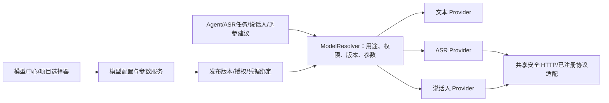

<!-- 统一模型中心优化方案：依据当前推理模型配置、ASR 与说话人连接实现，定义统一管理、分类适配、参数方案、授权和兼容迁移；供后续开发实施。本次仅编写方案，不改业务代码或执行迁移。 -->
# 统一模型中心优化方案

日期：2026-11-02。状态：待实施。项目：`/Users/a1/Desktop/ai-test-project`。

## 1. 建议结论

将当前「模型配置」升级为统一模型中心，管理文本推理、ASR 转写和说话人分段三类模型；按模型类别与实际调用协议展示对应表单，统一维护接入地址、凭据、能力、版本和可用范围。

评测模块只选择「模型版本 + 参数方案 + 本次角色」，不再各自保存一份模型地址和密钥。文本分析继续调用文本模型，ASR 转写调用 ASR 模型，说话人分析调用分段模型；统一管理不等于共用聊天接口或同一种响应解析器。

最关键的四项调整：

1. 模型类别、供应商、调用适配器、能力和评测角色分别建模。
2. ASR 的语言、热词、VAD、时间戳等参数使用每个模型自己的参数定义，不套用 temperature/max_tokens 表单。
3. 待测/参考是任务选择，不能固化在模型连接上；同一模型可以在不同实验中担任不同角色。
4. 平台共享模型与项目私有模型进入同一管理体系，但权限、凭据、默认项和历史版本保持各自边界。

首期完成三类模型的管理与已有调用能力迁移。TTS、向量模型、音频增强、独立音轨分离等可按相同合同扩展，本期不创建无实际调用方的空模块。

## 2. 当前代码现状

本次检查包含当前已新增的 0033 说话人工作台，未按早期 ASR 基线假设其不存在。

| 位置 | 当前行为 | 不适合多 ASR 的原因 |
|---|---|---|
| [core/models/configuration.py](../backend/app/core/models/configuration.py) | ModelConfiguration 是平台级大模型配置，固定 api_base、api_key、temperature、max_tokens、Token 成本及全局默认项 | 没有类别、分段能力、异步任务、上传方式或音频计费单位 |
| [model_configuration/schemas.py](../backend/app/platform/model_configuration/schemas.py) | 供应商列表按文本模型维护；未知供应商归一为 openai-compatible | 自研 ASR 或新供应商可能被误标；供应商名称不能代替协议实现 |
| [model_config_service.py](../backend/app/platform/model_configuration/services/model_config_service.py) | 启用必须有 API Key、全局单默认、最多三个备用模型 | 内网无鉴权 ASR 不应被迫填假 Key；默认和备用不能跨能力混用 |
| [model_configuration/router.py](../backend/app/platform/model_configuration/router.py) | `/model-configs` 主要读写仅管理员可用 | 项目成员缺少专用的已授权模型选择合同；不能为选模型直接放开管理接口 |
| [ModelConfigs.tsx](../frontend/src/pages/admin/ModelConfigs.tsx) | 单一 640px 弹窗，固定 Token、温度、Key 等字段 | 大量 ASR 接口和高级映射配置难维护，类别切换也会误提交无关字段 |
| [asr_models.py](../backend/app/features/asr_evaluation/models/asr_models.py) | AsrConnection 保存项目、task_type、role、地址、密钥和 config_json，当前已支持 TRANSCRIPTION/DIARIZATION | 与平台模型配置重复，且连接角色被固定为待测/参考 |
| [ASR assets_service.py](../backend/app/features/asr_evaluation/services/assets_service.py) | 同名连接新版本不能改变角色；列表按任务类型最多读取 1000 行 | 同一服务换角色要重复建连接；大量模型缺少稳定的资源与版本管理入口 |
| [ASR job_service.py](../backend/app/features/asr_evaluation/services/job_service.py) | 创建批次时待测使用参数方案，两家参考的 parameters 为 `{}` | 两个云端参考模型不能各选一套实验参数；把值塞进请求模板又使版本和调参不可见 |
| [llm/providers/openai_compatible.py](../backend/app/llm/providers/openai_compatible.py) | 从旧 ModelConfiguration 加载文本 Provider 最小配置 | 新 ASR 不能只添加到同一表后交给此 Provider |
| [ASR comparison_service.py](../backend/app/features/asr_evaluation/services/comparison_service.py) | 调参建议使用旧文本模型授权及 Provider | ASR 与“分析 ASR 的文本模型”必须在选择器中区分 |

旧 `domain_id` 已被组织 `allowed_model_ids` 和模型路由引用，不能改名重建；旧整数 ID 也不能直接替换成新表里数值相同但含义不同的 ID。

## 3. 产品结构

### 3.1 模型中心的页面

保留 `/admin/model-configs` 地址，页面标题改为「模型中心」，避免现有书签与导航失效。内容分为「模型资源」「调用模板」「凭据」「调用诊断」；参数方案可从模型详情进入，不需要首期拆成大量全局导航。

```text
模型中心                                   [导入配置] [新增模型]

[全部] [文本推理] [ASR 转写] [说话人分段]
搜索名称 / 模型标识   供应商   接入方式   作用域   状态   标签

名称 | 类别 | 供应商 | 接口协议 | 关键能力 | 当前版本 | 可用范围 | 状态 | 操作
自研 ASR 测试      ASR       自研    JSON/同步    URL/句级时间戳   v3  项目A
云端 ASR A        ASR       云端A   JSON/轮询    长音频/热词     v2  已授权项目
云端 ASR B        ASR       云端B   JSON/轮询    字级时间戳      v1  已授权项目
说话人服务        说话人分段 自研    JSON/轮询    重叠/区间输出   v1  项目A
文本分析服务      文本推理   已配置  兼容聊天协议 结构化调用       v4  原组织授权

操作：[详情] [编辑草稿] [复制] [参数方案] [验证连接] [授权] [停用]
```

示例名称与能力仅说明布局，不是预置接入或厂商支持承诺。

平台管理页可管理共享资源；项目工作区增加「模型与参数」入口，查看已授权资源、维护项目私有模型和参数方案。ASR 原「接口配置」入口改成项目模型页的兼容入口，不保留第二套凭据写入表单。

### 3.2 新增/编辑流程

采用独立详情编辑页或大 Drawer 分步配置，普通配置先完成四步，高级内容按需展开：

1. **选择类别与接入模板**：文本推理 / ASR 转写 / 说话人分段；再选已实现的适配器。
2. **服务连接与鉴权**：供应商、模型名称、部署环境、地址、区域/部署标识、鉴权及可用范围。
3. **默认参数与能力**：根据模型和模板生成表单，配置默认参数方案，说明已声明/已验证能力。
4. **校验并发布**：本地校验、请求预览、可选真实诊断、发布新版本。

「高级接入」中配置请求模板、响应映射、提交/查询/结果地址、轮询状态和超时。默认不让用户面对三大段 JSON；有需要时可切换结构化表单和 JSON 预览，二者共享同一数据源。

编辑已发布配置生成草稿；发布新版本不覆盖历史任务。复制模型时可沿用非敏感配置，凭据引用必须显式确认可复用且目标范围匹配，不把原密钥明文填回页面。

## 4. 模型类别、协议与能力必须分开

| 维度 | 示例 | 用途 |
|---|---|---|
| `model_type` | `TEXT_GENERATION / ASR / DIARIZATION` | 决定调用合同、参数表单和输出类型 |
| `provider_key` | 自研、已接入云厂商、兼容服务、自定义标识 | 供应商元数据；不凭名称决定能否调用 |
| `adapter_key` | 文本兼容适配、通用同步 JSON、通用异步 JSON、具名厂商适配 | 服务端真正实现的协议与归一化逻辑 |
| `transport` | HTTP、WebSocket | 传输协议，由适配器声明支持范围 |
| `execution_mode` | SYNC、ASYNC_POLL、STREAMING | 调用生命周期，不能把 HTTP 流式响应等同实时 ASR |
| `capabilities` | 音频 URL、上传、热词、句/字时间戳、原生说话人、重叠 | 用来筛选场景与验证请求，不等于质量承诺 |
| 任务中的角色 | TEST、REFERENCE_A、REFERENCE_B、DIARIZATION、SUGGESTION | 本次评测分工，不写死在模型资源上 |

首期注册并复用已实现的文本兼容调用、ASR 同步/轮询 JSON 以及说话人区间适配。multipart、WebSocket、厂商签名等只有实现对应适配器并验证后才能选择启用；不能仅增加下拉选项就标为可用。

未识别的 provider 可以作为自定义元数据保留，但未注册的 adapter 必须报错，禁止悄悄回退为聊天接口。

实际服务的生命周期确实不同，例如 Azure Speech 批量转写采用异步任务；FunASR 的转写、VAD、标点和说话人组件也有各自配置。此处用于说明分类必要性，不要求本期选用这些供应商。[Azure 官方说明](https://learn.microsoft.com/en-us/azure/ai-services/speech-service/batch-transcription)、[FunASR 官方参数说明](https://github.com/modelscope/FunASR/blob/main/docs/python_api.md)

## 5. 各类模型的配置字段

### 5.1 公共字段

名称、模型稳定引用、作用域与项目归属、供应商、服务端模型名称、部署环境、适配器及版本、发布状态、启用状态、连接信息、鉴权引用、能力描述、默认参数方案、并发/速率限制、计费规则及说明。

模型资源代表一个可调用的部署配置。同一底层模型部署到测试/生产、不同区域或不同 endpoint，可建多个资源并使用环境标签区分；同一部署只因参数不同，优先创建参数方案。

### 5.2 分类字段

| 类型 | 表单与可调参数 | 特别规则 |
|---|---|---|
| 文本推理 | temperature、最大输出、结构化输出相关能力及适配器定义字段 | 保留当前默认行为；是否支持严格结构化输出以适配器和验证为准 |
| ASR | 语言/自动语言、热词、VAD、标点、数字规整、解码、时间戳、原生说话人及模型实际开放字段 | 不要求 max_tokens 或 temperature；能力未知不填写猜测的默认值 |
| 说话人分段 | 人数或人数范围、重叠策略、阈值等实际开放字段 | 不强制返回文本；不能把 speaker 标签当实名或声纹身份 |

对 ASR 另记录可接受输入类型、采样率/声道约束、单文件大小/时长、批次限制、时间单位和结果时间轴。未知限制用 null 表示；“支持长音频”应有供应商说明或真实验证记录，不能以请求超时大于 30 分钟推导。

同一请求中的音频 URL 和参数继续支持类型安全的嵌套对象注入。模型/endpoint/鉴权字段不能被实验参数覆盖；参数定义不执行用户代码、外部 schema 引用或任意表达式。

### 5.3 参数定义与方案

使用「模型版本中的参数定义 + 独立版本化参数方案」，每个字段记录：路径、类型、默认值、范围/枚举、单位、显示控件、必需条件、互斥/依赖、说明来源以及是否可调。

前端按定义生成基础表单，高级 JSON 保留未知字段的显式透传区。服务端仍校验；不能只靠前端范围限制。未知参数允许在适配器明确支持时透传，但标记“未验证”，不生成带具体数值的调参建议。

参数方案包含默认方案、长音频方案、术语方案及候选实验方案。修改产生新版本；运行固定引用具体版本，并保存有效参数摘要与脱敏请求快照。

每个任务槽位都能选择参数方案，包括参考 A、参考 B 和说话人模型；不再将参考 parameters 固定为空对象。调参建议使用的文本模型也单独选择，并按 TEXT_GENERATION 能力过滤。

## 6. 评测配置与默认项

### 6.1 任务选择结构

```json
{
  "audio_version_ids": [12],
  "selections": [
    {"slot": "TEST", "model_ref": "model_example_test", "revision": 3, "profile_ref": "profile_test_v2"},
    {"slot": "REFERENCE_A", "model_ref": "model_example_a", "revision": 1, "profile_ref": "profile_a_v1"},
    {"slot": "REFERENCE_B", "model_ref": "model_example_b", "revision": 2, "profile_ref": "profile_b_v3"},
    {"slot": "DIARIZATION", "model_ref": "model_example_spk", "revision": 1, "profile_ref": "profile_spk_v1"}
  ],
  "suggestion_model_ref": "model_example_text"
}
```

这是目标内部合同示例，引用均为占位符。三方转写仍要求三个 ASR 槽位；SUGGESTION 不是第四家 ASR。为了保留有意义的三方对照，默认不允许三个槽位选择完全相同的模型/版本/参数组合；有意做同源参数比较时应进入参数实验并明确标注。

### 6.2 默认与备用按用途生效

不再新增“全平台任意类型唯一默认”字段。新增默认绑定按作用域和用途区分，例如文本分析、ASR 批量转写、说话人分段；实时 ASR 仅在实际支持时开放。

显式任务选择优先，其次项目已授权默认，再到已授权的平台默认；没有可用项就报缺配置。不能为了找到可用模型跨类别兜底，也不能自动启用未授权模型。

旧 is_default 保持旧文本默认语义，兼容迁移时映射为相应文本用途，不自动将新 ASR 设为旧 Provider 默认。

**评测默认关闭自动切换模型。** 某家失败就记录失败，不能偷偷替换成另一模型影响对比。确需业务容灾时另开策略，校验同类能力、授权和环路；记录请求模型、实际模型及切换原因。异步提交不确定时先核实原任务，不能通过 fallback 变相重复收费提交。

## 7. 权限、凭据与运行策略

### 7.1 管理与使用分离

- 平台共享资源由管理员创建、发布与维护；项目使用需要明确授权。
- 项目私有资源由项目 editor 维护，保留当前 ASR 项目隔离；不会因进入模型中心变成全局可见。
- member 可使用已授权模型执行任务及创建允许的参数实验；viewer 只读结果和安全摘要。
- 普通成员使用专门的项目可用模型列表，而不是开放管理员 `/model-configs` 响应或复制凭据。
- 选择器过滤不是安全边界：服务端在保存方案、创建任务、实际提交、重试和 fallback 前重新校验。

保留旧组织 `allowed_model_ids` 与 Agent 相关开关的既有语义。ASR 项目授权另经公共解析服务处理，不要求为了使用 ASR 就开启 Agent。旧成员文本模型授权不能在迁移时自动扩成所有音频模型权限。

### 7.2 鉴权类型与密钥

新资源支持由适配器声明的 `NONE / BEARER / API_KEY_HEADER / CUSTOM_HEADER / SIGNED_ADAPTER`，不强制所有模型都有 API Key。NONE 只表示该接口本身无鉴权，仍需项目/平台出站授权。当前旧 LLM 启用必有 Key 的校验在兼容接口保留，直到相应新合同迁移验证完成，不要求用户填假密钥。

凭据加密存储，返回仅有是否配置、掩码、可用范围及版本；导入导出只带引用。密钥轮换与模型参数发布分开：在途任务继续使用已保存 remote_task_id，凭据续期按相同绑定和适配器策略记录实际版本，不能因为轮换而重新识别。

复制或修改 endpoint 时重新校验凭据可用目标，防止将共享 Key 发到其他地址。请求、轮询、结果下载和诊断都要校验出站目标；项目模型继续采用项目白名单。平台旧文本调用的目标策略须单独梳理兼容，不以迁移为由自动授权任意网络目标。

### 7.3 运行控制与健康检查

按模型连接/账号、项目和全局分别管理并发、QPS、远端在途任务数。共享账号下多个模型还要受账号配额约束。必须持久化/原子核验，不以每个 Worker 的线程数当平台全局限制。

区分连接超时、单请求读超时、异步任务截止时间、轮询间隔与退避。长音频耗时不能靠放大前端 Axios 超时解决，诊断和实际识别均采用后台运行。

配置有效、资源启用、最近连通、最近成功识别是不同事实：

- 本地校验只验证模板、参数与合同，不进行模型调用。
- 真实诊断先选择音频/参数并显示预计提交次数，明确可能计费；不会每次打开配置页就请求云端。
- 对供应商没有无费用健康接口的情况，不用一个成功的 HEAD 冒充识别验证。
- 记录验证时间、协议版本、样本时长、输入方式和返回能力；验证短音频不自动标记长音频已验证。
- 健康状态可过期；一次失败不自动清空配置或将模型永久停用。

### 7.4 计费

文本模型保留输入/输出 Token 计价，ASR/说话人支持按音频秒/分钟/小时、按请求或自定义说明。新规则使用 Decimal/Numeric、币种、价格生效版本和计费取整方式；本期不内置实时厂商价格。

价格未知用 null，不显示为免费。预计成本、供应商实报费用、实际平台耗时分开；旧 0 成本字段迁移保留原值与来源，不能据此宣称该服务免费。

## 8. 数据与服务设计

### 8.1 不把所有字段塞入旧核心表

推荐在现有 `backend/app/platform/model_configuration/` 内扩展领域模型和服务，新增通用资源表；旧核心 ModelConfiguration 作为兼容表保留。不把几十个 ASR 字段加到九张核心基线表，也不把业务类型直接塞进无约束 config_json。

| 实体 | 职责 |
|---|---|
| `model_resource` | 稳定引用、类别、归属、标签、启用态、当前发布版本；无本次测试角色 |
| `model_resource_revision` | 不可变 endpoint、adapter 版本、协议、能力、参数 schema、默认值、限制和计费快照 |
| `model_credential` | 加密凭据及绑定范围/版本/撤销状态；不经普通读 API 回传 |
| `model_parameter_profile` | 绑定模型版本的参数方案、有效值、版本及来源 |
| `model_resource_grant` | 共享资源的显式项目/组织可用范围；不能因可见就获得凭据维护权 |
| `model_default_binding` | 按用途与作用域的默认版本/参数引用，唯一约束避免竞争默认 |
| `model_validation_run` | 后台诊断事实、时间、样本范围、结果摘要和安全错误 |
| `model_legacy_binding` | 旧 ModelConfiguration/AsrConnection/ParameterSet 引用到新资源/版本的显式映射与迁移状态 |

凭据、诊断、默认和引用映射可根据最终实现合并窄实体，但职责与唯一约束不能省略。新 ORM 归 platform/model_configuration/models，不注册到 `core/models/__init__.py` 的基线集合；迁移编号以实施时 head 为准，当前已存在 0033。

### 8.2 调用边界



`ModelResolver` 返回适用调用方的窄配置对象：文本、转写、分段分别有合同，不返回一个含所有密钥和字段的万能字典。配置模块不执行 ASR 文本对齐，ASR 模块不维护平台凭据，LLM 模块不解释音频分段。

供应商目录、适配器 manifest、模型资源和参数方案分开。manifest 描述实际已实现的输入输出、表单和协议；任意自定义供应商名称不产生动态安装代码或运行用户脚本的能力。

## 9. API 与前端改造

### 9.1 新 API

新管理 API 可采用 `/api/v1/model-resources`，旧 `/model-configs` 继续作为文本配置兼容入口。所有错误和分页沿用当前平台合同。

| 接口 | 用途 |
|---|---|
| `GET /model-resources` | 分页、多类/供应商/状态/作用域/能力筛选；按管理权限返回 |
| `POST /model-resources` | 创建资源及配置草稿 |
| `GET /model-resources/{ref}` | 安全详情、当前发布版和引用概览 |
| `POST /model-resources/{ref}/revisions` | 创建新草稿，带来源版本避免覆盖 |
| `POST /model-resources/{ref}/revisions/{revision}/publish` | 校验后发布不可变版本 |
| `POST /model-resources/{ref}/clone` | 复制非敏感配置，凭据引用重新授权 |
| `GET/POST /model-resources/{ref}/parameter-profiles` | 参数方案与版本 |
| `POST /model-resources/{ref}/validation-runs` | 202 创建真实诊断；GET 运行状态另提供 |
| `GET /model-adapters` | 已实现适配器、类别、参数和配置 schema |
| `GET /projects/{id}/available-models` | 当前用户在项目内可用的安全摘要，按用途/能力筛选 |
| `PUT /projects/{id}/model-defaults/{purpose}` | 项目用途默认绑定，校验版本与可用授权 |
| `POST /model-resources/import-preview` | 只解析导入、报告逐行错误，不启用或调用模型 |
| `POST /model-resources/import-batches` | 使用幂等批次 ID 导入验证过的配置草稿 |

启停、归档、凭据引用维护和授权修改使用明确合同及审计；存在运行/计划引用的版本不物理删除。删除已发布版本前需处理引用，而不是让旧任务读空配置。

### 9.2 大量 ASR 配置的效率

- 支持按供应商/项目/标签分组，折叠历史版本，列表分页，避免把所有版本当独立模型堆在一起。
- 支持从已有模型复制、从受控模板创建、批量导入非敏感配置；导入预检展示错误字段和重复资源，不直接启用。
- 同账号多模型可以复用已授权凭据引用，同模型多参数方案可以复用连接；两种复用不混淆。
- 模型详情显示哪些项目、计划和实验在使用，便于判断停用或新版本发布的影响。
- 表单按类别只提交适用字段。切换类别时重置不兼容字段并明确提示，不能隐含保留旧 token/温度或 ASR 映射。
- 长 JSON 映射放高级编辑器/右侧配置 Drawer，主列表只显示模型、协议、能力、版本、验证和状态。

扩展现有 `frontend/src/features/model-configuration/` 与 admin/ModelConfigs 页面，拆分列表、分类表单、参数、版本、诊断组件；不另造平行的全局模型客户端。ASR ConnectionsPage 逐步改为引用和参数选择页，RunWorkbenchPage 的请求参数抽屉读取运行固定快照。

## 10. 兼容迁移方案

### 10.1 先统一入口，后切换事实来源

不能把旧推理表与 ASR 表直接拼在列表后就宣布统一，也不能一次删除重建所有旧记录。分阶段执行：

| 阶段 | 事实来源与写入策略 |
|---|---|
| 迁移准备 | 旧表仍权威，统一查询门面可读取两类旧资源并带 source 标识；新通用表不开放独立生产写入 |
| 资源回填 | 根据显式映射幂等回填模型、版本、凭据引用和参数；旧整数 ID、domain_id 及任务引用保持可解析 |
| 类型切换 | 按类别切换开关：切换前旧表写入；切换后只通过新服务写入，并在同事务维护必要兼容投影 |
| 调用切换 | 文本/ASR/说话人分别通过 Resolver 读取新版本；旧 API 经映射回传原合同 |
| 收尾 | 核对所有调用方和计划后停用旧写路径；旧表先保留为历史/兼容投影，不在本期默认删除 |

每个阶段每种资源只有一个写入入口，不允许 UI 同时直接写新旧两套配置。兼容投影的来源、写入方向、失败回滚和终止条件必须有代码与测试，不保留长期无约束双写。

### 10.2 旧推理配置

1. 原 id/domain_id 不变；新资源稳定引用保留旧 domain_id，通过 legacy_binding 关联旧整数 ID。
2. 原 `/model-configs` 路径、响应、Key 留空保留规则及默认文本语义兼容；不得将新 ASR 项混入旧 Provider 无类别过滤的默认查询。
3. 原组织 allowed_model_ids、Agent 绑定、备用顺序保持可解释；新模型类别授权不会自动扩权。
4. 原 Token 价格及参数按来源迁移，不凭空判断新增结构化/多模态能力。
5. 核心基线迁移依赖当前 ORM 元数据，避免随意给旧核心模型添加字段导致空库基线和后续 add_column 重复；本方案优先新增独立表。

### 10.3 ASR 和说话人连接

1. 每个项目现有连接迁移为同项目私有资源；同名不同 version 合为一个稳定资源的多个修订。
2. 旧 TEST/REFERENCE 角色迁移到原计划/任务槽位映射，不成为新资源永久属性；原来为两种角色复制的连接仅在协议和权限确实相同且显式确认时合并，不跨项目自动去重。
3. 原参数方案关联到对应模型版本。旧参考模板内硬编码的参数保持原请求语义，不通过文本猜测擅自抽取或删除；可由用户明确整理成参数方案。
4. 旧 connection_id、parameter_set_id、processing_run 和音频版本引用保留；已排队执行密文快照不被新配置替换。
5. 新任务选择三方模型与各自参数；旧任务创建 API 经兼容适配转换，禁止同一个请求同时提交矛盾的新旧模型选择字段。

### 10.4 回退

先停用新配置写入口，再按类型回退 Resolver/管理页开关；旧版本任务与授权继续可解析。新增通用资源必须有可用的旧类型投影或显式阻止回退到无法理解它的旧运行时。

回退不会删除新发布模型、凭据或历史运行。不得为了回退重新生成 domain_id、重置数据库或重新提交在途 ASR。涉及数据丢失的 downgrade 不属于默认回退操作。

## 11. 实施阶段与验收

| 阶段 | 交付 | 重点验证 |
|---|---|---|
| M0 盘点与合同 | 调用方/授权/默认/引用清单、DTO、适配器 manifest、迁移映射 | 识别近期 0033 与未提交修改，不覆盖已有实现 |
| M1 模型中心管理 | 分类列表、动态配置表单、资源/版本/凭据/参数方案 | ASR 不显示必填 Token；说话人不强制文本输出；无鉴权接口不填假 Key |
| M2 多 ASR 使用 | 项目可用列表、三方槽位、参考各自参数、说话人及建议模型选择 | 一模型可换角色；参数预览与实际请求一致；类别错配被后端拒绝 |
| M3 迁移与兼容 | 旧文本及项目 ASR 回填、默认与授权映射、按类型切换 | domain_id、旧 ID 和历史请求不变；迁移幂等、无双写分叉 |
| M4 诊断与治理 | 后台诊断、配额、计费单位、批量导入、引用保护 | 不自动产生云端调用、不盲重试、并发跨 Worker 生效 |
| M5 验收交付 | 迁移循环、回归、浏览器截图、真实接口联调、启动与回退 | 区分合成数据通过和真实服务接入，未提供接口项明确待验证 |

必须覆盖的回归：

- 旧文本模型 CRUD、默认、组织授权、Agent、报告与 ASR 调参建议仍可用。
- 文本、ASR、说话人选择器与默认项相互隔离，不存在自动跨类别 fallback。
- 同一 ASR 不复制连接即可作为不同实验的待测或参考；两家参考参数不再被丢成 `{}`。
- 同步、提交/轮询、结果取回分别按实际协议工作；未实现的签名/上传/流式适配不能启用。
- 自研无 Key、Header Key、Bearer、异步临时错误、提交不确定、Key 轮换和停用均有明确行为。
- 参数定义、schema 版本、未知字段、互斥条件和发布版本一致，密钥不能经参数覆盖或导出。
- 复制、导入、发布、批量诊断与默认竞争具有权限、幂等和事务保护。
- 跨项目不能使用资源或猜测凭据；普通成员不能借可用列表修改平台共享 endpoint。
- 新旧引用在迁移、回退、重启和历史回听/运行详情中保持不变，不自动重跑收费任务。
- 配置检查和真实诊断区分；价格未知不显示免费；短样本通过不标长音频已验证。

本次仅为设计文档，无需执行数据库迁移或全量测试；开发阶段先做模型中心定向测试，再按仓库规范完成后端回归、前端 test/lint/typecheck/build 与隔离迁移验证。

## 12. 与此前方案的关系

本方案替代此前“ASR 工作区自行维护独立连接地址和凭据”的长期归属设计；保留其安全模板、原始结果、独立处理阶段、音频版本和后台队列能力。

[说话人工作台方案](2026-11-02-asr-speaker-audio-workbench-optimization-plan.md)中的 task_type 与原生/独立说话人概念，通过模型类别/能力和项目调用选择兼容映射；不能因统一模型管理而回退已经实现的分段、播放器和信息抽屉。

当前尚未提供实际 ASR 厂商清单和各家协议。可以先完成通用分类、表单、资源版本、参数、兼容迁移与通用适配；专有签名和每家实际能力待拿到合同后逐个验证，不提前宣称“配置后即可支持所有 ASR”。
