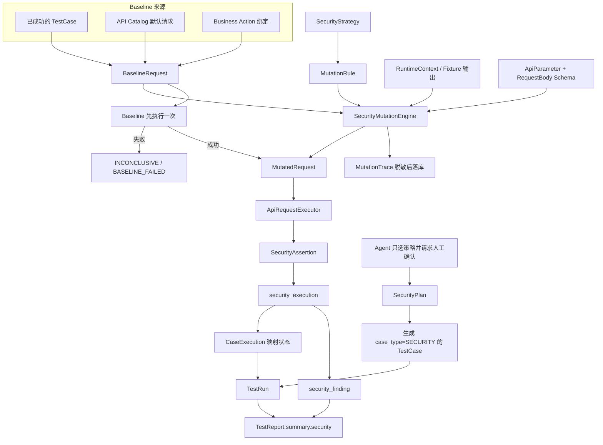

# Security Testing Phase 1 开发计划

状态：架构分析完成，本轮未改代码、未建迁移、未写页面、未提交 Git。  
分析基线：工作区当前源码（含未提交的 Mock Management，Alembic revision `0010`）。  
下一迁移号：`0011`，`down_revision = "0010"`。  
交付对象：按 Phase A → G 顺序交给 Claude Code 实现。禁止跳阶段、禁止并行改同一批文件。

---

## 0. 结论（先看这里）

Security Phase 1 是否能够完全基于当前平台架构扩展：**YES**

当前是否需要先重构其他模块：**NO**

没有阻塞性重构。HTTP 执行、TestRun、CaseExecution、Report、权限、Agent、变量解析、Fixture、Mock 生命周期都已经存在，本阶段只加安全域的策略、变异、判定和发现，并在 `TestCaseExecutor` 内插入一条分支。

实施建议：**READY**

第一步从 **Phase A** 开始。开工前只有一条顺序前提，不是重构：

工作区里 Mock Management（`0010_mock_management.py`，以及 `main.py`、`errors.py`、`run_service.py`、`variable_resolver.py`、`test_01_schema_and_seed.py`）仍未收口。Security Phase A 会改 `main.py`、`errors.py`、`test_01`。必须先让 `0010` 成为稳定 head（Mock 功能已在自己的分支提交），再从该 head 拉 `feature/security-testing`。不要把两套未提交改动叠在同一工作区。

另外，`backend/tests/test_10_business.py` 与 `backend/tests/test_18_test_data_crud.py` 仍断言 head `0009`，`test_01` 已断言 `0010`。Phase A 把三处一起改为 `0011`，不要把 `0010` 退回 `0009`。

---

## 1. Current Security Capability Inventory

盘点日期以当前工作区为准。技能文档里的 head `0009` 已过时。

### 1.1 已有、必须复用

| 能力 | 真实位置 | Phase 1 怎么用 |
|---|---|---|
| 项目权限 | `app/shared/roles.py`：`viewer < member < editor < owner < admin`。`editor` 的展示名是「项目管理员」。`owner` / 平台 `admin` 是推导角色，不落 `project_member.role` | 读 `viewer+`，生成和执行 `member+`，策略管理与 Finding 状态变更 `editor+`（含 owner、平台管理员）。跨项目统一 404，见 `test_management/services/_access.py` |
| 平台登录 | `app/shared/auth.py`，JWT 只代表**本平台用户** | 安全测试的「被测系统 Token」不是这个 JWT。不要用平台登录 Token 去打被测接口，也不要在安全模块里签发平台 JWT |
| 出站白名单 | `ProjectOutboundTarget`（`scheme/host/port/enabled/is_production`）+ `ApiRequestExecutor._check_outbound` | 变异后的 URL 仍交给 `ApiRequestExecutor`。私网地址只有白名单显式放行才通过 |
| 环境 | `Environment` 是**平台级**表，`name` 全局唯一，不是项目私有。字段：`base_url`、`gateway_prefix`、`default_headers`、`is_active` | URL 只用 `ApiRequestExecutor.build_url`。生产判断复用 `test_data/security/db_guard.classify`：`production/prod/live` → `PRODUCTION`；`dev/development` → `DEV`；`test/testing` → `TEST`；`staging/stage/uat/pre/preprod/pre-production` → `STAGING`；**未知名字一律 STAGING** |
| API Catalog | `api_interface`（`method/path/auth_type/content_type`，唯一键 `project_id+method+path`）、`api_parameter`（PATH/QUERY/HEADER/COOKIE/BODY，含 `type/required/schema_json`）、`api_request_body.schema_json` | Schema 驱动变异的唯一结构来源。目标必须是本项目已登记的 `api_id` |
| 业务知识 | `business_action`（`action_key` + `sort`）、`business_state`（`entity/pre_state/post_state`，无状态机引擎）、`business_rule`（`expression` 只存文本，不执行）、`business_precondition`（`VARIABLE/STATE/BUSINESS/TEXT`）、`business_binding` | 安全模块只读这些配置来决定「该不该测幂等 / 状态绕过 / 跳步」，不实现第二套业务模型 |
| HTTP 执行器 | `business/executors/api_executor.py` 的 `ApiRequestExecutor.execute(method, url, project_id, headers, query, cookies, json_body, form_body, raw_body, timeout)` | 安全模块禁止自己发 HTTP |
| 用例执行器 | `test_management/executors/test_case_executor.py`。`target_type`：`API` / `BUSINESS_FLOW` / `BUSINESS_ACTION`。快照经 `SensitiveDataMasker` | `case_type == SECURITY` 时走安全分支，其余用例路径保持原样 |
| 执行生命周期 | `RunService.create_and_execute_run`：环境校验 → 收集启用用例 → `TestRun` → RUN 级 Fixture → 逐用例 Mock 激活 → CASE Fixture → `test_case_executor.execute` → Cleanup → Mock 关闭 → RUN Cleanup | 安全用例走同一条循环。不要新写 Run 循环 |
| 断言引擎 | `assertion_engine.py`：`STATUS_CODE/JSON_PATH/HEADER/RESPONSE_TIME/CONTAINS/NOT_CONTAINS`，操作符含 `IN` | 安全断言是**另一套期望**（拒绝 / 校验错误 / 幂等）。可以调用 `evaluate_operator`，不要把「200 即漏洞」塞进现有断言 |
| 用例模型 | `test_case.case_type` 已含 `SECURITY`。`source_type` 只有 `MANUAL` / `AI`。名称唯一 `(project_id, name)`，最长 200。乐观锁 `revision` | 安全用例是一行 `test_case`，扩展信息放新表 `security_case`，不给 `test_case` 加列 |
| 执行记录 | `test_run`、`case_execution`。后者状态只有 `PENDING/RUNNING/PASSED/FAILED/SKIPPED/ERROR`。已有 `request_snapshot/response_snapshot/assertion_results/context_json/cleanup_*` | 不改这两张表的列。安全细结果放 `security_execution` |
| 报告 | `test_report.summary` 是 JSON。`ReportService._classify_failure` 已把 `PERMISSION/NEGATIVE/SECURITY` 的失败标成 `POTENTIAL_BUG`。风险由代码算，LLM 不算通过率 | 在 `summary` 里增加 `security` 对象。明细仍从 Finding / CaseExecution 读 |
| 变量 | `test_data/runtime/variable_resolver.py`：`fixture.*`、`faker.*`、`env.*`、`runtime.*`、`data.*`。不执行用户代码 | 变异值里的占位符继续走这个解析器 |
| 造数 | Fixture（`fixture_key`、`entity_type`、输出契约 `fixture_output`）、Data Factory、`LifecycleManager`、数据池与租约 | Cross User / IDOR 只引用 Fixture 输出。安全模块不创建用户 |
| Mock | `0010` 已接入 `RunService`。`MockLifecycle.activate_for_case` 按 `case_execution` 隔离。行为只有 `STATIC_RESPONSE/DELAY_RESPONSE/TIMEOUT/EMPTY_RESPONSE` | 安全用例可声明 `test_case_mock`。本阶段不实现序列响应 |
| Agent | langgraph，`interrupt_before` 停在测试点 / 用例 / 报告 review。意图现有 7 个，没有安全意图。`execution_node` 调 `execution_tool.create_test_run`，环境必须人工传入。ContextLoader 只拉单个目标 | 加安全意图和人工确认点，执行仍进现有 execution 节点 |
| 脱敏 | `SensitiveDataMasker`，键名精确匹配：`authorization/token/access_token/refresh_token/id_token/auth_token/cookie` 等 | Mutation Trace 落库前必经它。内存中的真实 Token 不入库 |
| 缺陷 | `bug` 表与 `/bugs` API 已存在 | Phase 1 不自动建 Bug |

### 1.2 看起来像安全能力、但不能当成安全测试引擎

- `test_strategy.category` 里的 `AUTH/PERMISSION/SECURITY/IDEMPOTENCY` 是测试资产分类标签，没有变异规则、没有期望、没有风险确认。不要把 Security Strategy 塞进这张表。
- `case_type=SECURITY` 今天只影响报告失败分类，执行器对它和功能用例一视同仁。
- `business_rule.expression` 不会被执行。幂等判断只能读 `rule_type`、`action_key`、人工标记，不能 `eval` 表达式。
- `business_flow_executor.execute_flow` 按 `sort` 跑完全部动作，没有跳步参数。Sequence Bypass 不要改这个函数去接受任意跳步脚本。
- 平台没有「被测系统过期 JWT」生成器。`EXPIRED_TOKEN` 第一阶段不伪造 JWT。
- 数据池读接口会脱敏。Token 不能放进 Data Pool。资源 ID 通过 Fixture 输出进 `ExecutionContext`。

### 1.3 平台项目与被测业务项目

这是两套 ID，计划里所有 Cross Project 都必须分开写：

- **平台项目**：`project.id`。管权限、用例、策略、Finding。跨平台项目访问返回 404。
- **被测业务项目**：被测 API 的 path / query / body 里的 `project_id` 或等价字段，值来自 Fixture 输出（例如 `PROJECT_A.project_id`）。它不是 `project.id`，除非被测系统碰巧使用同一个数字。安全模块禁止把平台 `project.id` 自动填进被测请求。

---

## 2. Gap Analysis

| 缺口 | 现状 | Phase 1 补什么 |
|---|---|---|
| 安全策略 | 只有测试资产分类 | `security_strategy` + 系统模板 + 项目自定义 |
| 结构化变异 | 无。禁止脚本也还没有载体 | `security_mutation_rule`，操作符白名单 |
| 变异引擎 | 无 | 纯函数 `SecurityMutationEngine`，不发请求 |
| 基线 | 用例直接执行自己的步骤 | 先跑 Baseline，失败则 `INCONCLUSIVE`，不再变异 |
| 认证 / 参数 / Header / Method | 无安全向变异 | 内置算子 |
| 越权 / IDOR | 无候选资源解析 | 只从 Fixture 输出取「另一个用户的资源」 |
| 重放 / 重复提交 | 无次数上限 | 2～3 次，硬上限 3 |
| 业务状态 / 跳步 | 状态只是配置 | 生成「用 post_state 数据去打该动作」的计划；跳步 = 直接执行后面的单个 Action，不改 Flow 执行器 |
| 安全结果 | CaseExecution 没有 `POTENTIAL_ISSUE` | 新表保存细结果，并映射到现有四态 |
| Finding | 无。报告里的 `POTENTIAL_BUG` 不是工单 | `security_finding`，独立于 Bug |
| 生产开关 | 数据库造数已禁生产，HTTP 执行没有同等禁令 | 安全变异在生产环境硬拒绝；出站目标 `is_production=true` 同样拒绝 |
| Agent | 不能识别「测越权」 | 新意图 + 代码生成计划 + 人工确认 |
| 前端 | 测试管理下无安全测试菜单 | 一个「安全测试」页，内部 Tab |
| 高风险确认 | 无 | 规则级 `confirmation_required`，未确认则跳过且不发请求 |

---

## 3. Recommended Architecture



约束：

1. `SecurityMutationEngine` 的输出字段与 `ApiRequestExecutor.execute` 对齐：`method`、`url`（仍由 `build_url` 生成）、`headers`、`query`、`cookies`、`json_body` / `form_body` / `raw_body`。
2. 引擎不接收用户输入的绝对 URL。path 只允许替换 Catalog 模板里的 `{param}`。
3. 一次安全用例的生命周期仍是：Fixture Prepare → Mock Activate → Baseline → Mutation → ApiRequestExecutor → SecurityAssertion → 写结果 → Mock Close → Fixture Cleanup → 按需写 Finding。
4. 预留类别 `INJECTION/RATE_LIMIT/UPLOAD/SSRF` 可以出现在枚举和模板开关里，执行时直接 `SECURITY_MUTATION_NOT_ALLOWED`。不实现 payload。

---

## 4. Data Model Design

全部 feature-local，放在 `app/features/security_testing/models/`。  
不要把模型 import 进 `app/models/__init__.py`。  
不要改 `0001`～`0010` 的历史迁移。  
不要给 `test_case`、`case_execution`、`test_run`、`test_report`、`environment` 加列。

迁移文件：`backend/alembic/versions/0011_security_testing.py`  
`revision = "0011"`，`down_revision = "0010"`。  
风格对齐 `0010`：显式 `op.create_table`，`inspect` 判断表是否已存在，索引使用 `CREATE [UNIQUE] INDEX IF NOT EXISTS`，以便 `stamp base + upgrade head` 可重放。  
`downgrade` 按依赖逆序 `DROP TABLE IF EXISTS`。

### 4.1 `security_project_setting`

项目级环境开关。一行一个平台项目。

| 列 | 类型 | 约束 |
|---|---|---|
| id | Integer PK | |
| project_id | FK `project.id` ON DELETE CASCADE | UNIQUE `uq_security_setting_project` |
| allow_dev | Boolean default true | |
| allow_test | Boolean default true | |
| allow_staging | Boolean default false | |
| allow_production | Boolean default false | 服务层忽略此列，生产永远拒绝 |
| updated_by | FK `user.id` ON DELETE SET NULL | |
| created_at / updated_at | DateTime | |
| revision | Integer default 1 | 乐观锁 |

生产环境即使用户把 `allow_production` 改成 true，执行器仍然返回 `SECURITY_PRODUCTION_FORBIDDEN`。第一阶段不提供「管理员打开生产」的生效路径。

### 4.2 `security_strategy`

| 列 | 类型 | 约束 |
|---|---|---|
| id | Integer PK | |
| project_id | FK `project.id` ON DELETE CASCADE，可空 | 空 = 系统模板 |
| scope | String(20) | `SYSTEM` / `PROJECT` |
| name | String(200) | |
| strategy_key | String(100) | 大写键，如 `AUTH_BASIC` |
| category | String(40) | 见下表 |
| description | String(1000) 可空 | |
| enabled | Boolean default true | |
| risk_level | String(20) | `INFO/LOW/MEDIUM/HIGH/CRITICAL` |
| builtin | Boolean default false | 系统模板 true，禁止项目成员改规则体 |
| created_by | FK `user.id` ON DELETE SET NULL | |
| created_at / updated_at | DateTime | |
| revision | Integer default 1 | |

`category` 第一阶段可执行：`AUTHENTICATION`、`AUTHORIZATION`、`IDOR`、`PARAMETER`、`HEADER`、`METHOD`、`REPLAY`、`DUPLICATE_SUBMIT`、`BUSINESS_STATE`、`SEQUENCE_BYPASS`。

只保存不执行：`INJECTION`、`RATE_LIMIT`、`UPLOAD`、`SSRF`。

索引与唯一：

- `UNIQUE (strategy_key) WHERE project_id IS NULL`，名 `uq_security_strategy_system_key`
- `UNIQUE (project_id, strategy_key)`，名 `uq_security_strategy_project_key`
- `INDEX (project_id, category)`，名 `ix_security_strategy_project_category`
- `INDEX (scope, enabled)`

系统模板 `project_id` 为空、`scope=SYSTEM`、`builtin=true`。项目自定义必须带 `project_id`。删除平台项目时级联删除项目策略，不删除系统模板。

### 4.3 `security_mutation_rule`

| 列 | 类型 | 约束 |
|---|---|---|
| id | Integer PK | |
| project_id | FK `project.id` ON DELETE CASCADE，可空 | 与所属策略一致；系统规则为空 |
| strategy_id | FK `security_strategy.id` ON DELETE CASCADE | NOT NULL，索引 |
| name | String(200) | |
| mutation_type | String(40) | 白名单，见第 6 节 |
| target_location | String(20) | `HEADER/QUERY/PATH/BODY/METHOD/REQUEST` |
| target_field | String(200) 可空 | 如 `Authorization`、`project_id`、`$.task_id` |
| operator | String(40) | 与 `mutation_type` 同集，禁止自由字符串脚本 |
| mutation_config | JSON | 结构化参数，schema 在服务层用 Pydantic `extra=forbid` |
| expected_security_behavior | String(40) | `EXPECTED_DENY/EXPECTED_ALLOW/EXPECTED_VALIDATION_ERROR/EXPECTED_IDEMPOTENT` |
| expected_status_codes | JSON | 整数数组，如 `[401,403]` |
| severity | String(20) | 规则上的默认级别，执行时由 `severity.py` 按结果重算，不信 LLM |
| enabled | Boolean default true | |
| confirmation_required | Boolean default false | HIGH 写操作默认 true |
| sort | Integer default 0 | |
| created_at / updated_at | DateTime | |

索引：`(strategy_id, enabled, sort)` 名 `ix_security_rule_strategy_sort`。  
`mutation_config` 禁止出现键：`script`、`python`、`sql`、`shell`、`payload_file`、`command`。出现即 `SECURITY_MUTATION_INVALID`。

### 4.4 `security_plan`

人工确认前的计划，不是第二套 TestRun。

| 列 | 类型 | 约束 |
|---|---|---|
| id | Integer PK | |
| project_id | FK `project.id` ON DELETE CASCADE | 索引 |
| name | String(200) | |
| target_type | String(20) | `API/TEST_CASE/BUSINESS_ACTION` |
| api_id | FK `api_interface.id` ON DELETE SET NULL | |
| baseline_case_id | FK `test_case.id` ON DELETE SET NULL | 优先 |
| business_action_id | FK `business_action.id` ON DELETE SET NULL | |
| strategy_ids | JSON | 策略 ID 数组 |
| status | String(20) | `DRAFT/CONFIRMED/DISCARDED` |
| preview_json | JSON | 预计用例清单，未落 TestCase 前的快照 |
| estimated_count | Integer | |
| environment_id | FK `environment.id` ON DELETE SET NULL | 可空，执行时再选 |
| created_by | FK `user.id` ON DELETE SET NULL | |
| confirmed_by | FK `user.id` ON DELETE SET NULL | |
| confirmed_at | DateTime 可空 | |
| created_at / updated_at | DateTime | |
| revision | Integer default 1 | |

索引：`(project_id, status, created_at)` 名 `ix_security_plan_project_status`。

### 4.5 `security_case`

与 `test_case` 一对一。安全用例的本体仍是 `test_case`。

| 列 | 类型 | 约束 |
|---|---|---|
| id | Integer PK | |
| project_id | FK `project.id` ON DELETE CASCADE | 必须等于 `test_case.project_id` |
| test_case_id | FK `test_case.id` ON DELETE CASCADE | UNIQUE `uq_security_case_test_case` |
| plan_id | FK `security_plan.id` ON DELETE SET NULL | |
| baseline_case_id | FK `test_case.id` ON DELETE SET NULL | 这就是追溯用的 parent。不要在 `test_case` 上再加 `parent_case_id` |
| strategy_id | FK `security_strategy.id` ON DELETE SET NULL | |
| rule_id | FK `security_mutation_rule.id` ON DELETE SET NULL | 实例化时的规则；规则后改不影响已生成用例的 config 快照 |
| api_id | FK `api_interface.id` ON DELETE SET NULL | |
| business_action_id | FK `business_action.id` ON DELETE SET NULL | |
| mutation_type | String(40) | 冗余，便于列表筛选 |
| mutation_config | JSON | 生成时快照 |
| security_expectation | JSON | behavior + status codes + 说明 |
| risk_level | String(20) | |
| confirmation_required | Boolean default false | |
| confirmed_by | FK `user.id` ON DELETE SET NULL | |
| confirmed_at | DateTime 可空 | 空且 `confirmation_required` 时禁止真正发变异请求 |
| created_at / updated_at | DateTime | |

索引：

- `(project_id, mutation_type)` 名 `ix_security_case_project_mutation`
- `(project_id, strategy_id)` 名 `ix_security_case_project_strategy`
- `(baseline_case_id)` 名 `ix_security_case_baseline`

生成出的 `test_case`：`case_type=SECURITY`，`target_type=API`（跳步场景用 `BUSINESS_ACTION`），`enabled` 在确认保存时为 true，`status=ACTIVE`，`source_type` 人工保存用 `MANUAL`、Agent 保存用 `AI` 并写 `agent_session_id`。名称 `{基线名}-{mutation_type}-{field}`，超过 200 字符截断并加短哈希。不要扩展 `TEST_SOURCE_TYPES`。

### 4.6 `security_execution`

一次 `CaseExecution` 至多一行。

| 列 | 类型 | 约束 |
|---|---|---|
| id | Integer PK | |
| project_id | FK `project.id` ON DELETE CASCADE | |
| test_run_id | FK `test_run.id` ON DELETE CASCADE | 索引 |
| case_execution_id | FK `case_execution.id` ON DELETE CASCADE | UNIQUE `uq_security_execution_case` |
| security_case_id | FK `security_case.id` ON DELETE SET NULL | |
| environment_id | FK `environment.id` ON DELETE SET NULL | |
| actor_id | FK `user.id` ON DELETE SET NULL | 谁执行的 |
| baseline_status | String(20) | `PASSED/FAILED` |
| baseline_http_status | Integer 可空 | |
| security_result | String(30) | `PASS/POTENTIAL_ISSUE/FAILED_EXECUTION/INCONCLUSIVE/SKIPPED` |
| classification | String(40) | `EXPECTED_DENY_MET/EXPECTED_VALIDATION_MET/EXPECTED_IDEMPOTENT_MET/POTENTIAL_ISSUE/UNEXPECTED_SERVER_ERROR/BASELINE_FAILED/FIXTURE_REQUIRED/CONFIRMATION_REQUIRED/TARGET_BLOCKED/TRANSPORT_ERROR` |
| mutation_trace | JSON | 脱敏后的 before/after |
| replay_count | Integer 可空 | 实际次数，最大 3 |
| actual_status_codes | JSON | 重放时为数组 |
| evidence | JSON | 脱敏后的对比摘要，不含原始 Token |
| error_code | String(50) 可空 | |
| started_at / finished_at | DateTime | |
| created_at | DateTime | |

索引：`(project_id, security_result)` 名 `ix_security_execution_project_result`。  
`(test_run_id)` 名 `ix_security_execution_run`。

### 4.7 `security_finding`

| 列 | 类型 | 约束 |
|---|---|---|
| id | Integer PK | |
| project_id | FK `project.id` ON DELETE CASCADE | |
| test_run_id | FK `test_run.id` ON DELETE SET NULL | |
| case_execution_id | FK `case_execution.id` ON DELETE SET NULL | |
| security_execution_id | FK `security_execution.id` ON DELETE SET NULL | |
| api_id | FK `api_interface.id` ON DELETE SET NULL | |
| business_action_id | FK `business_action.id` ON DELETE SET NULL | |
| strategy_id | FK `security_strategy.id` ON DELETE SET NULL | |
| security_case_id | FK `security_case.id` ON DELETE SET NULL | |
| mutation_type | String(40) | |
| severity | String(20) | `INFO/LOW/MEDIUM/HIGH/CRITICAL` |
| status | String(20) default `OPEN` | `OPEN/CONFIRMED/FALSE_POSITIVE/RESOLVED/IGNORED` |
| title | String(200) | |
| description | Text | |
| evidence | JSON | 脱敏 |
| recommendation | Text | 规则模板文案，不是 LLM 自由发挥 |
| fingerprint | String(64) | sha256，见下 |
| bug_id | Integer 可空 | **不加 FK**。Phase 1 不写 Bug。以后人工确认再关联，避免现在绑死缺陷模块 |
| created_by | FK `user.id` ON DELETE SET NULL | 执行人 |
| resolved_by | FK `user.id` ON DELETE SET NULL | |
| created_at / updated_at | DateTime | |

去重：部分唯一索引

`UNIQUE (project_id, fingerprint) WHERE status IN ('OPEN', 'CONFIRMED')`  
名 `uq_security_finding_open_fingerprint`。

`fingerprint` = sha256(`api_id|mutation_type|target_location|target_field|baseline_case_id`)。同一未关闭问题重复执行不插入第二行，只把 `security_execution_id` 更新到最新一次，并在 `evidence.repeat_count` 加一。`FALSE_POSITIVE/IGNORED/RESOLVED` 不占用该唯一索引，以后可以再次打开一条新的 OPEN。

状态机（仅 `editor+`）：

- `OPEN` → `CONFIRMED` / `FALSE_POSITIVE` / `IGNORED` / `RESOLVED`
- `CONFIRMED` → `RESOLVED` / `FALSE_POSITIVE`
- `FALSE_POSITIVE` / `IGNORED` / `RESOLVED` → `OPEN`（重新打开时重新计算 fingerprint 冲突；若已有 OPEN 则 409）

Phase 1 不提供 `POST /security-findings/{id}/bugs`。文档里预留：以后由人工从 `CONFIRMED` 调用缺陷服务创建 Bug，再把返回的 id 写入 `bug_id`。

---

## 5. Existing Model Reuse

| 模型 | 决定 | 原因 |
|---|---|---|
| `test_case` | 复用，不加列 | TestRun 只认 `test_case.id`。安全用例必须是普通用例，才能进套件、计划和报告。扩展字段放 `security_case` |
| `test_step` / `test_assertion` / `test_case_data` / `test_case_fixture` | 复用 | Baseline 的请求仍从基线用例的 step、data、fixture 解析。安全用例自己的 step 可以只保留一条 ACTION，指向同一 `api_id`；真正请求以基线解析结果为输入再变异。不要把基线的 body 复制成一份静态 JSON 后与基线脱节 |
| `test_strategy` / `test_point` | 不改表 | 生成安全用例时 `test_point_id` 可空。不要为了出现在测试资产树里去自动造一套策略，避免污染资产命名空间 |
| `test_suite` / `test_plan` / `test_run` | 复用 | 执行入口仍是 `POST /test-plans/{plan_id}/runs`。Agent 继续用 `execution_tool` 建临时计划和套件 |
| `case_execution` | 复用，不加列 | 状态枚举被报告、前端、计数器写死。细粒度安全结论放 `security_execution` |
| `test_report` | 复用 `summary` JSON | 不新报告表 |
| `bug` | 不自动写 | Finding 独立 |
| Fixture / Data Factory / Mock | 只引用 | 不复制造数，不扩展 Mock 序列 |

### 5.1 CaseExecution 映射

安全细结果不进入 `case_execution.status` 枚举。映射如下，这样现有计数器、通过率、`POTENTIAL_BUG` 分类不用改枚举：

| security_result | case_execution.status | 计数 | 说明 |
|---|---|---|---|
| `PASS` | `PASSED` | passed | 安全期望达成，例如无 Token 得到 401 |
| `POTENTIAL_ISSUE` | `FAILED` | failed | 含「该拒绝却 2xx」和「出现未处理 500」。报告里 SECURITY 失败已归为 `POTENTIAL_BUG`，文案保持「疑似，需人工确认」 |
| `FAILED_EXECUTION` | `ERROR` | error | 连不上、超时、白名单拒绝。不是漏洞 |
| `INCONCLUSIVE` | `SKIPPED` | skipped | 基线失败、缺 Fixture、结果无法判断。`error_code` 写具体原因。不拉低通过率（通过率分母排除 skipped） |
| `SKIPPED` | `SKIPPED` | skipped | 未确认的高风险、生产禁止、规则禁用。`error_code` 写原因。请求没有发出 |

`case_execution.error_code` 使用第 19 节的安全错误码。`error_message` 用中文说明。  
`context_json` 只额外放 `{"security_execution_id": <id>}`，方便前端跳转。变异明细以 `security_execution.mutation_trace` 为准。

---

## 6. Mutation Engine Design

### 6.1 模块

`app/features/security_testing/runtime/`

| 文件 | 职责 |
|---|---|
| `types.py` | `BaselineRequest`、`MutatedRequest`、`MutationTraceEntry` |
| `schema_reader.py` | 读 `ApiParameter` + `ApiRequestBody.schema_json`，产出 `FieldSpec` |
| `operators.py` | 纯函数注册表。一个 type 一个函数 |
| `mutation_engine.py` | `SecurityMutationEngine.apply` |
| `candidate_resolver.py` | 从 RuntimeContext 取其他用户 / 其他项目的资源 |
| `baseline.py` | 从基线用例组装请求，并判定基线是否成功 |
| `assertion.py` | 安全期望判定 |
| `severity.py` | 规则表算级别 |
| `trace.py` | 生成 trace 并调用 `SensitiveDataMasker` |
| `replay.py` | 有上限的重复执行 |
| `business_plan.py` | 读 BusinessState / Rule / Flow，产出计划项，不执行业务引擎 |
| `runner.py` | 串起基线、变异、执行器、断言、Finding。唯一允许调用 `ApiRequestExecutor` 的安全文件 |

### 6.2 数据结构

`BaselineRequest` 与执行器对齐：

```text
method: str
path: str                  # Catalog 路径模板，含 {param}
path_params: dict[str, str]
query: dict[str, str]
headers: dict[str, str]
cookies: dict[str, str]
json_body: dict | list | None
form_body: dict | None
raw_body: str | None
content_type: str | None
timeout: int
api_id: int
project_id: int            # 平台项目，只用于白名单和权限
```

`MutatedRequest` = `BaselineRequest` + `traces: list[MutationTraceEntry]`。  
`MutationTraceEntry` 落库形态：

```json
{
  "mutation_type": "REMOVE_TOKEN",
  "location": "HEADER",
  "field": "Authorization",
  "before": "******",
  "after": null
}
```

敏感键在写入 `before/after` 之前替换成 `******`。比较和发送使用内存中的原值。

### 6.3 `SecurityMutationEngine.apply`

输入：`BaselineRequest`、`MutationRule`、`ResolveScope`（已有 Fixture 输出）。  
输出：`MutatedRequest`。  
异常：配置不合法抛 `AppError(SECURITY_MUTATION_INVALID)`；类别未开放抛 `SECURITY_MUTATION_NOT_ALLOWED`。  
函数内禁止 `httpx`、禁止 `db.query` 出站、禁止 `eval`。

流程：

1. 校验 `mutation_type` 在白名单，且不属于预留攻击类别。
2. 按 location 取出目标值。
3. 调用对应算子。
4. 写 trace。
5. 返回新请求。不修改入参 Baseline（复制后再改）。

### 6.4 第一阶段算子

认证（目标默认 Header `Authorization`，也处理 `auth_type` 指向的头；没有该头则 trace 记录「基线无此头」，结果 `INCONCLUSIVE`，不假装测过）：

| type | 行为 |
|---|---|
| `REMOVE_TOKEN` | 删除 `Authorization` |
| `EMPTY_TOKEN` | 值改为空串；若原值以 `Bearer ` 开头则改为 `Bearer ` |
| `INVALID_TOKEN` | 值改为 `Bearer invalid-token`。这是固定哨兵，不是伪造 JWT |
| `MALFORMED_TOKEN` | 值改为 `Bearer a.b` |
| `WRONG_AUTH_SCHEME` | `Bearer` 换成 `Basic aW52YWxpZDpinv`（固定非法 Basic，不带真实口令） |
| `EXPIRED_TOKEN` | 仅当 `mutation_config.token_source` 指向 Fixture 输出，且该输出由测试人员事先准备。解析不到则规则跳过。禁止解码或拼接 JWT |

授权 / IDOR：

| type | 行为 |
|---|---|
| `CROSS_USER` | 用 Fixture 输出替换 Token，或替换资源 ID。两边都要在 `mutation_config.candidates` 里点名 |
| `CROSS_PROJECT` | 只替换被测请求里的业务项目字段。候选来自 `PROJECT_B.project_id` 这类输出 |
| `ROLE_DOWNGRADE` | 仅当 Fixture 提供了低权限 Token 输出。没有则跳过，不在平台用户表里改角色 |
| `RESOURCE_OWNER_CHANGE` | 替换 body/path 里的 owner 字段，候选来自另一个 Fixture |
| `IDOR` | `candidate_resolver` 按 location 替换一个资源 ID |

`mutation_config` 示例（Pydantic 固定形状）：

```json
{
  "token_source": {"fixture_key": "USER_B", "output": "token"},
  "resource_source": {"fixture_key": "TASK_B", "output": "task_id"},
  "location": "PATH",
  "field": "task_id"
}
```

参数：

| type | 何时生成 |
|---|---|
| `REMOVE_FIELD` | `required=true` |
| `NULL_VALUE` | schema 未声明 nullable，或 required |
| `EMPTY_STRING` | string |
| `TYPE_MUTATION` | integer/number 改成 `"abc"`；string 改成 `1`；boolean 改成 `"yes"` |
| `ZERO` | integer/number |
| `NEGATIVE` | integer/number，且 schema 没有允许负数 |
| `OVER_MAX` | 有 `maximum` 或 `maxLength`。字符串超长上限再封顶 256 字符，避免巨大 body |
| `UNDER_MIN` | 有 `minimum` 或 `minLength` |
| `INVALID_ENUM` | enum 存在时使用 `UNKNOWN`；若 `UNKNOWN` 已在枚举里，使用 `__INVALID__` |
| `INVALID_FORMAT` | `format=email/date/uuid/uri` 时用固定非法样例 `not-an-email`、`9999-99-99`、`not-uuid`、`not a uri` |

没有 schema 的字段不自动 fuzz。只执行规则上点名的 field。

Header：

| type | 行为 |
|---|---|
| `REMOVE_HEADER` | 删除指定头，默认 `Content-Type` |
| `EMPTY_HEADER` | 值改空串 |
| `INVALID_HEADER_VALUE` | 非鉴权头改为 `invalid` |
| `CONTENT_TYPE_MUTATION` | `application/json` 改为 `text/plain`。body 仍是原来的 JSON 文本，由执行器按 `raw_body` 发送，避免 httpx 再次按 JSON 改回 Content-Type |
| `AUTHORIZATION_MUTATION` | 转给认证算子，不另写一套 |

Method：

| type | 行为 |
|---|---|
| `METHOD_MUTATION` | `mutation_config.methods` 是白名单子集，默认只测一个：原方法为 POST 时测 GET；原方法为 GET 时测 POST。`DELETE` 只有规则 `confirmation_required=true` 且用例已确认才进入计划 |

同一 `project_id+method+path` 在 Catalog 已存在时，说明该方法是已登记接口，不把它当成「未声明方法」。未登记的方法才是本项要观察的对象。

重放：

| type | 行为 |
|---|---|
| `REPLAY_SAME_REQUEST` | `replay_count` 默认 2，允许 2 或 3。`replay_interval_ms` 默认 0，最大 5000。引擎返回同一请求，由 `replay.py` 循环调用执行器 |

重复提交与重放共用循环。区别是计划层：`DUPLICATE_SUBMIT` 只挂到 `action_key` 属于创建/提交/支付类，或 `business_rule.rule_type` 为 `IDEMPOTENCY` 的动作。`business_rule.expression` 不执行。

业务状态与跳步不是请求字段算子，由 `business_plan.py` 生成「用哪份 Fixture」的 `mutation_config`：

```json
{
  "state_entity": "task",
  "fixture_key": "SUCCESS_TASK",
  "output": "task_id",
  "location": "PATH",
  "field": "task_id",
  "skipped_action_id": 12
}
```

`SEQUENCE_BYPASS` 的执行方式：安全用例 `target_type=BUSINESS_ACTION`，目标是被跳过步骤之后的那个 Action，走现有 `TestCaseExecutor` 的 BUSINESS_ACTION 分支（绑定 + 映射 + `ApiRequestExecutor`）。不给 `execute_flow` 增加 `skip_ids`。前置步骤缺少 Fixture 时，计划项标记 `blocked_reason=SECURITY_FIXTURE_REQUIRED`，确认保存时仍可保存为禁用用例，执行时 `SKIPPED`。

### 6.5 Schema Reader

`FieldSpec`：`location`、`name`、`json_path`、`type`、`required`、`enum`、`minimum`、`maximum`、`min_length`、`max_length`、`format`、`example`。

读取顺序：

1. `api_parameter` 行：PATH/QUERY/HEADER/COOKIE，以及 body_type 为 form/multipart 时的 BODY 行。`schema_json` 里的 `enum/minimum/maximum/maxLength/minLength/format` 覆盖列上的 `type`。
2. `api_request_body.schema_json`：只展开 object 的第一层 properties，加上 schema 明确写出的 required。不递归进无限嵌套；第二层只在规则点名 `$.parent.child` 时读取。
3. 没有 schema 的 body：不生成参数变异。认证和重放仍可基于基线请求做，因为它们不依赖字段类型。

整数示例：正常值 10 时，计划里最多出现 `null`、`"abc"`、`-1`、`0`、`maximum+1`（没有 maximum 则不生成 OVER_MAX）。不要再生成随机长串。

---

## 7. Baseline Design

优先级：

1. 用户选中的、`enabled=true` 且最近一次 `CaseExecution.status=PASSED` 的 TestCase。这是默认推荐。
2. 若没有执行记录，仍允许选择 TestCase，但计划上标记「尚未验证」。执行时会先跑基线。
3. API Catalog：用 `api_parameter.example/default_value`、`api_request_body`、环境 `default_headers` 组装。没有 example 的 required 字段则该来源不可用，返回 `SECURITY_BASELINE_NOT_FOUND`。
4. Business Action：取该动作的主绑定和 INPUT 映射，复用 `mapping_resolver`，不新写映射。
5. 用户提交的请求：只接受与某个 `api_id` 匹配的 method + path 模板 + headers/query/body。服务端用环境重新 `build_url`。请求体里出现 `http://` 或 host 与 Catalog 不一致则 `SECURITY_TARGET_NOT_ALLOWED`。

基线成功的定义：

- 传输无 `error_message`。
- 若基线用例有 required 的 `STATUS_CODE` 断言，实际状态码满足该断言。
- 若没有状态码断言，2xx 视为成功。
- 基线用例自己的其余断言失败，也算基线失败。不能用一个本来就失败的请求判断「变异后更不安全」。

基线失败：写 `security_execution.security_result=INCONCLUSIVE`，`classification=BASELINE_FAILED`，`error_code=SECURITY_BASELINE_FAILED`，`case_execution=SKIPPED`。不调用变异，不创建 Finding。

基线请求和基线响应都经 `SensitiveDataMasker` 后写入 `security_execution.evidence.baseline`。

---

## 8. Security Assertion Design

`assertion.py` 纯函数。输入：期望、实际状态码列表、响应 body（已解析）、trace。输出：`security_result` + `classification`。

| 期望 | PASS | POTENTIAL_ISSUE | INCONCLUSIVE |
|---|---|---|---|
| `EXPECTED_DENY` | 状态码落在 `expected_status_codes`，默认 `{401,403,404}` | 2xx | 3xx（执行器 `follow_redirects=False`，重定向无法判断最终授权）；或基线本身没有 Token |
| `EXPECTED_VALIDATION_ERROR` | 400 或 422，或规则列出的码 | 500～599，classification=`UNEXPECTED_SERVER_ERROR`，严重级别 MEDIUM，仍然建 Finding，标题写「未处理错误」而不是「已确认漏洞」 | 2xx 且 body 无法判断是否采纳了非法值。若 2xx 且响应回显了非法值，算 POTENTIAL_ISSUE |
| `EXPECTED_ALLOW` | 2xx | 本阶段几乎不用于「攻击成功才算通过」。仅当规则明确写「低权限允许访问公开资源」时使用 | |
| `EXPECTED_IDEMPOTENT` | 第二次不是新的成功业务结果：409/400，或 2xx 但业务 ID 与第一次相同 | 两次都 2xx 且解析出的 ID 不同 | 两次都 2xx 但响应里没有可比较的 ID。不建 Finding |

500 不直接等于漏洞。classification 分开，结果仍用 `POTENTIAL_ISSUE`，这样会进入失败计数和 Finding 列表，严重级别停在 MEDIUM，除非规则另有更低默认值。

不要使用结果值 `VULNERABLE`。

严重级别由 `severity.py` 按表计算，LLM 不能覆盖：

| 场景 | 级别 |
|---|---|
| `auth_type != none`，去掉或换错 Token 仍 2xx | HIGH |
| `auth_type == none`，去掉 Token 仍 2xx | 不建 Finding（接口声明无需认证） |
| IDOR / Cross User：2xx 且响应包含候选资源 ID | CRITICAL |
| IDOR / Cross User：2xx 但响应对不上候选资源 | HIGH |
| Cross Project 业务项目字段被 2xx 接受 | HIGH |
| 删除 required 或类型错误返回 500 | MEDIUM |
| 未声明方法返回 2xx | MEDIUM；其中方法为 DELETE 且 2xx | HIGH |
| 幂等期望下第二次产生新 ID | HIGH |
| 终态资源仍被写操作 2xx 接受 | HIGH；读操作 2xx | LOW |

---

## 9. Finding Design

只在 `security_result=POTENTIAL_ISSUE` 时创建或合并 Finding。  
`PASS/INCONCLUSIVE/SKIPPED/FAILED_EXECUTION` 不建 Finding。

生命周期：

1. Runner 算 fingerprint。
2. 插入 OPEN。撞上部分唯一索引则更新已有 OPEN/CONFIRMED 的 `evidence.repeat_count` 和最新 `security_execution_id`。
3. 人工把状态改为确认、误报、忽略或解决。
4. 误报之后的再次执行可以新建 OPEN（旧行已离开部分唯一索引）。产品上这是预期：误报被重新打开需要人再看一次。若希望误报永久压制，把 fingerprint 的忽略也算进查询——Phase 1 采用「误报不永久屏蔽」，避免一次误点导致后续真问题消失。执行前如果存在同 fingerprint 的 `FALSE_POSITIVE` 或 `IGNORED`，新 Finding 仍创建，`evidence.prior_status` 记下上一次人工结论，供页面提示。

推荐文案来自规则表，例如「无 Token 访问返回 200，期望 401 或 403」。不要调用 LLM 写 Finding 标题。

---

## 10. Data Factory Integration

安全模块不调用 Provider，不写 SQL，不创建平台用户。

Cross User / IDOR 的数据约定（Fixture 输出契约，测试人员在测试数据中心维护）：

| fixture_key | entity_type | 至少要有的输出 |
|---|---|---|
| `USER_A` | USER | `token` |
| `USER_B` | USER | `token` |
| `RESOURCE_A` 或具体如 `TASK_A` | TASK / 业务实体 | 资源 ID 字段，如 `task_id` |
| `RESOURCE_B` / `TASK_B` | 同上 | 另一个用户的资源 ID |
| `PROJECT_A` | PROJECT | 被测系统的 `project_id` |
| `PROJECT_B` | PROJECT | 另一个被测项目的 `project_id` |

这些 key 是模板约定，不是新表。项目可以用别的 key，但必须写进 `mutation_config` 的 `fixture_key` + `output`。解析只走已经注入的 `ExecutionContext`：`${fixture.USER_B.token}` 由现有 `resolve_template` 完成。

执行时缺少候选：

- 不猜 ID，不用 `1`、不用「当前 ID ± 1」。
- `security_result=INCONCLUSIVE`，`error_code=SECURITY_FIXTURE_REQUIRED`。
- 不建 Finding。

数据池：只有 Fixture 步骤已经把池条目收成输出契约后，安全模块才能看见那个输出。安全模块不直接 `SELECT data_pool_item`。池 payload 在读 API 上会脱敏，不适合放 Token。

Token 切换：替换 Header 的值来自 Fixture 输出的字符串。平台 `User` 表不参与。替换发生在内存请求上，trace 里两边都是 `******`。

建议把 Cross User 用的 Fixture scope 设为 `CASE`，cleanup 设为 `AFTER_CASE`，避免两个并行 Run 共用同一对用户资源。Phase 1 执行器本身仍是 Run 内串行（`RunService` 的 for 循环），不同 Run 之间会并行，所以共享账号要由 Fixture 隔离，而不是由安全模块加锁。

---

## 11. Mock Integration

安全用例如果需要 Mock，走现有 `test_case_mock` + `MockLifecycle.activate_for_case`。  
Baseline 和变异请求落在同一次 `CaseExecution` 里，因此共用同一个 Mock Context。Phase 1 不支持「基线用场景 A、变异用场景 B」。

可用场景：静态 401、403、500、超时。  
不可用：第一次 500、第二次 200。`MOCK_BEHAVIOR_TYPES` 没有序列响应。本阶段不改 Mock。计划预览里如果用户勾了「重试安全性」，该项显示依赖未满足，不生成用例。

安全 Runner 不创建、不关闭 Mock Context。开关仍在 `RunService`。

---

## 12. Business Integration

`business_plan.py` 只读：

- `BusinessAction.sort` / `action_key`：决定重复提交和跳步的候选。
- `BusinessState.pre_state` / `post_state`：若 `post_state` 有值，生成一条「使用该终态 Fixture 再调用此动作」的计划。Fixture key 由规则配置，默认建议 `{POST_STATE}_{ENTITY}`，例如 `SUCCESS_TASK`。不存在则计划项带 `SECURITY_FIXTURE_REQUIRED`。
- `BusinessPrecondition.type=STATE`：作为同一条计划的说明文案，不另写求值器。
- `BusinessRule`：`rule_type` 含 `IDEMPOTENCY`（服务层把这个值加入允许列表，旧数据里没有也不报错）或名称由人工策略点名时，才生成 `DUPLICATE_SUBMIT`。不解析 `expression`。

跳步：在流程里选一个 sort 更靠后的 Action，生成 `target_type=BUSINESS_ACTION` 的安全用例，Fixture 只准备该动作真正需要、且测试意图允许准备的数据。不调用 `execute_flow` 的前缀步骤。

写操作（POST/PUT/PATCH/DELETE）的状态绕过、重放、重复提交，`confirmation_required=true`。

---

## 13. Agent Integration

### 13.1 意图

在 `AgentIntent` 增加四个值，并改 `prompts/intent.md` 与 `IntentResult`：

- `GENERATE_SECURITY_TEST`
- `EXECUTE_SECURITY_TEST`
- `ANALYZE_SECURITY_RESULT`
- `QUERY_SECURITY_FINDING`

LLM 只做三件事：选目标 ID、选已加载的 `strategy_key`、生成澄清问句。  
变异清单由 `SecurityPlanService.preview` 用代码生成。LLM 的 JSON 里如果出现 `script/sql/shell/payload` 字段，validator 直接拒绝。

### 13.2 图

在 `graph.py` 增加节点，不要复制一条执行链：

```text
intent
  → security_context_loader     # 新
  → security_plan_generator     # 新，调用 PlanService.preview，不落用例
  → security_plan_review        # 新的 interrupt_before 暂停点
  → （人工 confirm_security_plan）
  → security_case_materializer  # 调用 PlanService.confirm，写入 TestCase + security_case
  → test_case_review            # 复用现有暂停点
  → execution                   # 复用
  → result_analyzer             # 扩展读取 security_execution / finding
  → report_generator            # 复用，summary 里已有 security
```

`interrupt_before` 追加 `security_plan_review`。  
高风险用例在 materializer 里 `confirmation_required=true` 且 `confirmed_at` 为空。执行节点不自动补确认。用户必须再调一个人工 action `confirm_security_risk`，该 action 只在路由层接受，不进 LLM 工具参数。

`route_after_intent`：

- `GENERATE_SECURITY_TEST` → `security_context_loader`
- `EXECUTE_SECURITY_TEST` → 现有 `test_case_review`（只列出 `case_type=SECURITY`）
- `ANALYZE_SECURITY_RESULT` → `result_analyzer`
- `QUERY_SECURITY_FINDING` → `query` 节点扩展

### 13.3 Security Context Loader

只加载：

- 目标 API 的 method/path/auth_type/参数摘要/body schema 摘要（沿用 `api_catalog_tool.get_api`，经 sanitizer）
- 该 API 绑定的单个 Business Action、所属 Flow 的动作顺序、State、Rule 标题（不要整棵无关流程）
- 目标已有的 ACTIVE Fixture：只要 key、entity_type、输出名。不要 Provider config，不要 Token 值
- 本项目启用的 Security Strategy 和规则摘要（type、location、expectation）。系统模板一并给出
- 该 API 未关闭的 Finding 标题和严重级别，最多 20 条

沿用现有限制：一次一个目标。多目标返回澄清，不猜。

`AgentState` 增加可选键：`security_plan_id`、`security_strategy_keys`、`security_finding_brief`。缺省为空，旧会话不受影响。

### 13.4 工具

新文件 `agent/tools/security_tool.py`，薄封装：

- `list_strategies`
- `preview_plan`（不执行）
- `confirm_plan`（仅当 action 来自人工按钮）
- `list_findings`
- `get_execution`

禁止提供：执行任意 URL、改项目成员、改出站白名单、生成脚本、调用未登记 host。

### 13.5 验收路径

用户说「测试创建任务接口有没有越权问题」：

1. Intent 选中该 API，策略选 `AUTHORIZATION_BASIC` + `IDOR_BASIC`。
2. Loader 拉取该 API、绑定动作、Fixture 清单、已有 Finding。
3. 代码生成计划，例如「USER_A Token + TASK_B id」。
4. 停在计划 review。用户确认后才写入 Security Case。
5. 停在用例 review。用户选择环境并执行。
6. 若规则是高风险，未确认的用例被跳过并说明原因。
7. 执行进入现有 TestRun，分析节点返回 Potential Finding，报告 summary 带安全段。

---

## 14. Report Integration

改 `ReportService` 汇总函数，在现有 `summary` 上增加：

```json
{
  "security": {
    "cases": 32,
    "pass": 27,
    "potential_issues": 4,
    "inconclusive": 1,
    "failed_execution": 0,
    "skipped": 0,
    "findings": {"CRITICAL": 0, "HIGH": 1, "MEDIUM": 3, "LOW": 0, "INFO": 0},
    "top_findings": [
      {"id": 1, "severity": "HIGH", "title": "无 Token 访问返回 200", "api_id": 10, "mutation_type": "REMOVE_TOKEN"}
    ]
  }
}
```

数字来自 `security_execution` 与 `security_finding`，不用 LLM 相加。没有安全用例时 `security` 为 `null`，旧报告前端不报错。  
`top_findings` 最多 5 条，按严重级别排序，不放 evidence 正文。详情页从 Finding API 拉证据。

`_compute_risk` 保持原规则。额外一条：本 Run 存在 OPEN 且 severity 为 CRITICAL 的 Finding 时，风险至少 `CRITICAL`；HIGH Finding 时至少 `HIGH`。仍由代码计算。

前端 `ReportDetail.tsx` 增加一张「安全摘要」卡片，读 `summary.security`。失败聚类文案继续使用「疑似问题」，不写「已发现漏洞」。

飞书通知沿用现有报告摘要，不新增安全专用 webhook。通知内容只带计数和标题，不带 Token、不带响应体。

---

## 15. Backend File Plan

### 15.1 Phase A 新增

```text
backend/alembic/versions/0011_security_testing.py
backend/app/features/security_testing/__init__.py
backend/app/features/security_testing/schemas.py
backend/app/features/security_testing/router.py
backend/app/features/security_testing/builtins.py
backend/app/features/security_testing/models/__init__.py
backend/app/features/security_testing/models/project_setting.py
backend/app/features/security_testing/models/strategy.py
backend/app/features/security_testing/models/rule.py
backend/app/features/security_testing/models/plan.py
backend/app/features/security_testing/models/security_case.py
backend/app/features/security_testing/models/execution.py
backend/app/features/security_testing/models/finding.py
backend/app/features/security_testing/services/__init__.py
backend/app/features/security_testing/services/_access.py
backend/app/features/security_testing/services/strategy_service.py
backend/app/features/security_testing/services/rule_service.py
backend/app/features/security_testing/services/setting_service.py
backend/tests/test_22_security_strategy.py
```

`builtins.py` 在迁移末尾幂等插入 6 个系统策略和它们的规则。重复 upgrade 时按 `strategy_key` 跳过。

### 15.2 Phase B 新增

```text
backend/app/features/security_testing/runtime/types.py
backend/app/features/security_testing/runtime/schema_reader.py
backend/app/features/security_testing/runtime/operators.py
backend/app/features/security_testing/runtime/mutation_engine.py
backend/app/features/security_testing/runtime/trace.py
backend/app/features/security_testing/runtime/assertion.py
backend/app/features/security_testing/runtime/severity.py
backend/tests/test_23_security_mutation.py
```

### 15.3 Phase C 新增

```text
backend/app/features/security_testing/runtime/candidate_resolver.py
```

测试仍写在 `test_23`，增加 Cross User / IDOR 用例，使用内存中的 ResolveScope，不发 HTTP。

### 15.4 Phase D 新增

```text
backend/app/features/security_testing/runtime/replay.py
backend/app/features/security_testing/runtime/business_plan.py
backend/tests/test_24_security_business.py
```

### 15.5 Phase E 新增

```text
backend/app/features/security_testing/runtime/baseline.py
backend/app/features/security_testing/runtime/runner.py
backend/app/features/security_testing/services/plan_service.py
backend/app/features/security_testing/services/case_service.py
backend/app/features/security_testing/services/finding_service.py
backend/app/features/security_testing/services/execution_query_service.py
backend/tests/test_25_security_execution.py
```

### 15.6 Phase E 修改

| 文件 | 修改 |
|---|---|
| `test_management/executors/test_case_executor.py` | `execute()` 开头：若存在 `security_case` 行，改调 `runner.run_security_case`。非安全用例原分支不动 |
| `app/main.py` | `include_router(security_router, prefix=API_PREFIX)`。Phase A 就可以挂上策略路由；Phase E 补计划/用例/Finding 路由到同一 router |
| `app/shared/errors.py` | 第 19 节错误码 |

`run_service.py` 原则上不改控制流。安全分支发生在 executor 内部，Mock 和 Cleanup 仍由 RunService 包裹。只有当实现发现 executor 拿不到 `case_execution_id` 时，才给 `test_case_executor.execute` 增加可选参数 `case_execution_id: int | None = None`，由 RunService 传入。这是最小签名扩展，不新写循环。

### 15.7 Phase F 修改

| 文件 | 修改 |
|---|---|
| `agent/schemas.py` | 四个意图；`AgentState` 新键放 `state.py` |
| `agent/state.py` | 可选键 |
| `agent/nodes/intent.py` | 候选里增加策略名，不增加全量规则脚本 |
| `agent/nodes/router.py` | 新 action：`confirm_security_plan`、`confirm_security_risk` |
| `agent/graph.py` | 新节点与 `interrupt_before` |
| `agent/prompts/intent.md` | 安全意图说明与禁止项 |
| `agent/nodes/result_analyzer.py` | 读取 Finding 摘要 |
| `agent/nodes/query.py` | 只读 Finding |
| `agent/tools/__init__.py` | 导出 `security_tool` |
| `reports/services/report_service.py` | `summary.security` 与风险下限 |
| 新增 `agent/nodes/security_context.py` | |
| 新增 `agent/nodes/security_plan.py` | |
| 新增 `agent/tools/security_tool.py` | |
| 新增 `tests/test_26_security_agent_report.py` | |

### 15.8 Phase G 前端文件

见第 17 节。

每个新 Python 文件顶部用中文模块 docstring，服务层负责 commit，路由不 commit。这是现有 feature 约定。

---

## 16. API Plan

前缀 `/api/v1`。不可见项目 404。字段 snake_case。错误体 `{code, message, request_id}`。

### 16.1 设置与策略（Phase A）

| 方法 | 路径 | 权限 | 说明 |
|---|---|---|---|
| GET | `/projects/{project_id}/security-setting` | viewer | 没有行则返回默认值，不隐式插入 |
| PUT | `/projects/{project_id}/security-setting` | editor | 改 staging 开关。请求里的 `allow_production` 即使为 true 也存库后不生效，响应里带回 `production_enforced=false` |
| GET | `/projects/{project_id}/security-strategies` | viewer | 系统模板 + 本项目。query：`category`、`enabled` |
| POST | `/projects/{project_id}/security-strategies` | editor | 只创建 `scope=PROJECT`。`category` 为预留攻击类时允许保存但 `enabled` 强制 false |
| GET | `/security-strategies/{strategy_id}` | viewer | 含规则列表 |
| PATCH | `/security-strategies/{strategy_id}` | editor | 系统模板 403 `ERR_FORBIDDEN` |
| DELETE | `/security-strategies/{strategy_id}` | editor | 系统模板禁止删除 |
| POST | `/security-strategies/{strategy_id}/rules` | editor | |
| PATCH | `/security-rules/{rule_id}` | editor | |
| DELETE | `/security-rules/{rule_id}` | editor | |

系统模板的启用/停用：Phase 1 不允许项目覆盖系统行。项目若不想用，生成计划时不勾选即可。避免做一套「项目屏蔽系统模板」的隐藏配置。

### 16.2 计划、用例、发现（Phase E 起提供 API，前端 Phase G 才接）

| 方法 | 路径 | 权限 | 说明 |
|---|---|---|---|
| POST | `/projects/{project_id}/security-plans/preview` | member | 不写 TestCase。body：`baseline_case_id` 或 `api_id` 或 `business_action_id`，`strategy_ids`，可选 `environment_id`。返回预计条数、每条 mutation、风险、缺哪种 Fixture |
| POST | `/security-plans/{plan_id}/confirm` | member | body：`accepted_item_indexes`。写入 TestCase + security_case。高风险项 `confirmation_required=true` |
| POST | `/security-plans/{plan_id}/discard` | member | |
| GET | `/projects/{project_id}/security-cases` | viewer | 筛选 api、strategy、mutation、enabled |
| GET | `/security-cases/{security_case_id}` | viewer | 含基线引用、期望、最近一次 security_execution |
| PATCH | `/security-cases/{security_case_id}` | member | 只允许改 `enabled`，同步 `test_case.enabled` |
| POST | `/security-cases/{security_case_id}/confirm-risk` | member | 写 `confirmed_by/confirmed_at`。Agent 工具不能调 |
| POST | `/projects/{project_id}/security-runs` | member | body：`security_case_ids`、`environment_id`、`plan_name`。内部创建临时 TestPlan + Suite，调用 `RunService.create_and_execute_run`。这是唯一的「批量执行」入口，下面不再做第二套执行器 |
| GET | `/projects/{project_id}/security-findings` | viewer | 筛选 severity、status、api_id |
| GET | `/security-findings/{finding_id}` | viewer | |
| PATCH | `/security-findings/{finding_id}` | editor | body：`status`。非法迁移 400 |

执行响应就是现有 `TestRunResponse`，外加 `security_execution` 可从 `GET /test-runs/{run_id}/cases` 的 `context_json.security_execution_id` 再查：

`GET /security-executions/{security_execution_id}` viewer。

### 16.3 preview 请求与响应要点

请求：

```json
{
  "baseline_case_id": 15,
  "strategy_ids": [1, 2, 3],
  "environment_id": 2
}
```

响应：

```json
{
  "plan_id": 9,
  "status": "DRAFT",
  "estimated_count": 18,
  "items": [
    {
      "index": 0,
      "name": "创建任务-REMOVE_TOKEN-Authorization",
      "mutation_type": "REMOVE_TOKEN",
      "risk_level": "HIGH",
      "confirmation_required": false,
      "expectation": "EXPECTED_DENY",
      "expected_status_codes": [401, 403],
      "blocked_reason": null
    }
  ]
}
```

单次 preview 硬上限 50 条。超出则截断并在响应里给 `truncated=true`，不静默丢弃而不告诉用户。

---

## 17. Frontend Plan

菜单位置：`ConsoleLayout.tsx` 的「测试管理」分组下增加一项，key `/console/security-testing`，文案「安全测试」。不要再挂四个侧栏叶子。当前分组已经有 8 项。

`App.tsx` 增加：

```text
<Route path="security-testing" element={<ConsoleSecurityTestingPage />} />
```

`ROUTE_TITLES` 同步。

页面 `frontend/src/pages/console/SecurityTesting/index.tsx`，内部 Tabs：

| Tab | 内容 |
|---|---|
| Overview | 本项目接口数、已有安全用例覆盖的 api 数、安全用例数、最近一次含安全用例的 TestRun、OPEN Finding 数、HIGH+CRITICAL 数、六类覆盖（Authentication、Authorization、IDOR、Parameter、Replay、Business） |
| Strategy | 系统模板只读；项目策略可创建、启停。Drawer 编辑规则。预留类别显示「未开放」且开关禁用 |
| Cases | 表：名称、Target API、Baseline、Strategy、Mutation、Severity、启用、最近结果。操作：查看、启停、确认高风险、执行、批量执行。批量执行打开环境选择，调用 `POST .../security-runs` |
| Findings | 表：Severity、Title、API、Strategy、Mutation、Status、时间。操作：确认、误报、忽略、解决。不放「转 Bug」按钮 |

生成计划用 Modal，不单独占菜单：

1. 选择 Baseline TestCase，或选择 API。
2. 勾选策略。
3. 调 preview。
4. 展示预计 N 条，缺 Fixture 的行标黄。
5. 用户勾选后确认，才调 confirm。

`MutationDetailDrawer`：Baseline 头（Token 已脱敏）、变异类型、期望码、实际码、`security_result`、trace 列表。空态文案不要只写「安全测试失败」。

API client：`frontend/src/api/securityTesting.ts`。  
类型：`frontend/src/types/index.ts`。  
Query key：`['security-strategies', query]`、`['security-cases', query]`、`['security-findings', query]`、`['security-overview', projectId]`。失效用固定前缀。  
`message` 用 `App.useApp()`。弹窗 Form 用 `key` 重建。

报告详情 `frontend/src/pages/console/Reports/ReportDetail.tsx` 增加安全摘要卡片。无 `summary.security` 时不渲染该卡片。

Phase G 完成前用浏览器走通：预览 → 确认生成 → 执行（测试环境）→ 打开变异详情 → 把 Finding 标为误报 → 打开报告看到摘要。桌面宽度即可，本页不是响应式专项。

---

## 18. Permission & Security Boundary

### 18.1 角色

| 动作 | 最低角色 |
|---|---|
| 看策略、结果、Finding、报告安全摘要 | viewer |
| 预览计划、确认生成用例、执行、确认高风险 | member |
| 自定义策略与规则、改 staging 开关、改 Finding 状态 | editor，以及推导出的 owner、平台 admin |

跨平台项目：404，不返回 403。写操作在项目可见但角色不足时 403。

### 18.2 目标限制

- 执行和预览的 `api_id` 必须属于当前平台项目。
- URL 只由 `Environment.base_url + gateway_prefix + catalog path` 拼出。
- 拼完后仍走 `ApiRequestExecutor._check_outbound`。
- 用户不能提交任意 `http://IP`。

### 18.3 环境

执行前用 `db_guard.classify(environment.name)`：

| 归类 | Phase 1 |
|---|---|
| DEV | `allow_dev` 默认 true |
| TEST | `allow_test` 默认 true |
| STAGING（含未知环境名） | 默认拒绝。editor 把 `allow_staging` 打开后允许 |
| PRODUCTION | 永远拒绝 `SECURITY_PRODUCTION_FORBIDDEN`，不读 `allow_production` |

第二道：解析出的 scheme/host/port 命中本项目 `project_outbound_target.is_production=true` 时同样拒绝。防止环境名叫 `dev`、实际指向已标记生产的目标。

拒绝发生在变异请求发出之前。基线请求同样不发。`case_execution=SKIPPED`。

### 18.4 高风险

以下规则生成时 `confirmation_required=true`：

- `METHOD_MUTATION` 且目标方法是 DELETE
- `REPLAY_SAME_REQUEST`、`DUPLICATE_SUBMIT`
- `BUSINESS_STATE`、`SEQUENCE_BYPASS` 且目标方法不是 GET
- 策略 `risk_level` 为 HIGH 或 CRITICAL 且方法不是 GET

未确认：Runner 不调用执行器，结果 `SKIPPED`，`error_code=SECURITY_CONFIRMATION_REQUIRED`。  
确认接口要求当前登录用户，且调用栈不是 Agent 的 LLM 工具。`confirm_security_risk` 只能由路由在 `action` 显式等于该值时调用服务。

### 18.5 审计

`security_execution` 记录 actor、时间、environment、基线结论、trace、结果。  
`security_finding` 记录创建人与状态变更人。  
`security_plan` 记录确认人。  
这些表就是审计记录，不另做日志系统。

### 18.6 Agent 边界

允许：选已有策略、展示代码生成的计划、在人工确认后保存用例、读结果、读 Finding。  
禁止：生成 shell/python/sql、调用白名单外目标、修改平台权限、自动确认高风险、自动把 Finding 标成已解决。

---

## 19. Error Codes

加在 `app/shared/errors.py`，不加 `ERR_` 前缀，与数据域、Mock 域一致。

| code | HTTP | 场景 |
|---|---|---|
| `SECURITY_STRATEGY_NOT_FOUND` | 404 | |
| `SECURITY_RULE_NOT_FOUND` | 404 | |
| `SECURITY_BASELINE_NOT_FOUND` | 404 | 基线用例或 API 不在本项目 |
| `SECURITY_BASELINE_FAILED` | 200（执行结果，不是接口失败） | 写入 execution.error_code。接口本身成功返回 Run |
| `SECURITY_MUTATION_INVALID` | 400 | 配置含脚本键、次数超限、字段不存在 |
| `SECURITY_MUTATION_NOT_ALLOWED` | 400 | 预留攻击类别、未开放算子 |
| `SECURITY_PRODUCTION_FORBIDDEN` | 400 | 生产环境或生产出站目标 |
| `SECURITY_TARGET_NOT_ALLOWED` | 400 | 非本项目 API，或用户传入绝对地址 |
| `SECURITY_EXECUTION_FAILED` | 200 作为 execution.error_code；若编排本身崩了用 500 `ERR_INTERNAL` | 传输失败用前者 |
| `SECURITY_EXPECTATION_INVALID` | 400 | 期望与算子不匹配，例如 REMOVE_TOKEN 配 EXPECTED_IDEMPOTENT |
| `SECURITY_FINDING_NOT_FOUND` | 404 | |
| `SECURITY_FIXTURE_REQUIRED` | 200 作为 execution.error_code | 缺候选资源 |
| `SECURITY_CONFIRMATION_REQUIRED` | 400 当确认接口缺 body；执行中则写入 execution 并 SKIPPED | |
| `SECURITY_PLAN_NOT_FOUND` | 404 | |
| `SECURITY_PLAN_STATE_INVALID` | 409 | 重复确认或确认已丢弃的计划 |

执行期的「基线失败 / 缺 Fixture / 待确认」不要把 HTTP 接口打成 500。Run 接口返回 200，用例状态 SKIPPED 或 ERROR，错误码在执行记录上。

---

## 20. Tests

新文件从 `test_22` 起，`test_21` 已被 Mock 占用。测试库 `testplatform_test`。HTTP 出站沿用 `test_15` 的拦截方式，不访问真实公网。

### 20.1 单元（Phase B/C/D）

- Schema：integer 生成 null / 字符串 / -1 / 0 / max+1；enum 生成枚举外值；required 生成删字段；maxLength+1 且超长被封顶。
- 无 schema 时不生成参数变异。
- `REMOVE_TOKEN`、`EMPTY_TOKEN`、`INVALID_TOKEN`、`MALFORMED_TOKEN`、`WRONG_AUTH_SCHEME`。
- `EXPIRED_TOKEN` 无 Fixture 来源时拒绝，且输出里没有自造 JWT。
- Header、Content-Type、Method 白名单。DELETE 未确认不出现在默认可执行列表。
- Replay count 1 被拒绝，4 被拒绝，3 被接受。
- Trace 里 Authorization 的 before/after 都是 `******`。
- 断言：401 → PASS；200 → POTENTIAL_ISSUE；500 → POTENTIAL_ISSUE + `UNEXPECTED_SERVER_ERROR` + MEDIUM。
- IDOR 无候选 → 不替换、不使用随机数。
- 候选解析不会读取平台 `project.id` 去填 body。

### 20.2 集成（Phase A/E）

- 策略 CRUD、系统模板不可改、项目隔离 404。
- viewer 不能创建策略；member 不能改 Finding；editor 可以。
- 生产环境名 `prod` 执行安全用例得到 SKIPPED + `SECURITY_PRODUCTION_FORBIDDEN`，httpx 未被调用。
- 环境名 `dev` 但 outbound `is_production=true` 同样不发请求。
- 未知环境名按 STAGING 默认拒绝。
- 基线 2xx 后 `REMOVE_TOKEN` 得到 200 → CaseExecution FAILED，security_result POTENTIAL_ISSUE，Finding HIGH。
- 基线本身 500 → INCONCLUSIVE，无 Finding，无变异请求（断言 httpx 只被调用 0 次；基线失败时一次都不要发，包括不要发变异。基线请求若已失败，计数为 1 次基线 + 0 次变异）。
- Cross User：USER_A token + TASK_B id，响应含 task 200 的内容 → CRITICAL Finding。响应 404 → PASS，无 Finding。
- Cross Project 业务字段同理。
- 参数变异 422 → PASS；500 → MEDIUM Finding。
- Replay 两次 2xx 且 ID 不同 → HIGH Finding；第二次 409 → PASS。
- 终态 Fixture 再执行 → 按期望拒绝。缺 Fixture → SKIPPED。
- 同 fingerprint 执行两次只有一条 OPEN，`repeat_count=2`。
- 标 FALSE_POSITIVE 后再执行会新开一条，并带 `prior_status`。
- 生成的 TestCase `case_type=SECURITY`，`baseline_case_id` 指向原用例，不复制原用例的全部 step 文本作为第二份事实来源。
- 安全用例挂上 `test_case_mock` 后，Mock Context 仍按 case_execution 创建和关闭。
- 非安全用例回归：`test_15` 原路径通过，不查 `security_case` 以外的行为变化。

### 20.3 Agent 与报告（Phase F）

- 意图「检查创建任务越权」解析为 `GENERATE_SECURITY_TEST`，目标是该 API。
- 计划生成后图停在 review，未确认时数据库没有新的 SECURITY TestCase。
- LLM 输出带 `script` 被拒绝。
- 人工确认后执行，报告 `summary.security.potential_issues` 与 Finding 数一致。
- 报告 AI 总结失败不影响 `summary.security` 已写入。

### 20.4 并发

- 两个 Run 同时执行不同安全用例：两个 Mock Context，两个 security_execution。
- 并行插入同一 fingerprint：唯一索引保证一条 OPEN，另一条走更新。测试要覆盖 IntegrityError 分支。
- Replay 在单用例内串行，不会起线程。

### 20.5 回归命令

每个 Phase 结束至少跑：

```bash
cd backend && .venv/bin/python -m pytest tests/test_22_security_strategy.py tests/test_15_test_executor.py tests/test_17_report_notification.py -q
```

Phase E 之后把 `test_23`～`test_25` 加进去。Phase F 加 `test_26` 和 `test_16_agent.py`。全部 Phase 结束跑 `pytest tests/ -q`。  
Phase G 再跑 `cd frontend && npm run typecheck && npm run build`。

---

## 21. 开发阶段

依赖是严格串行的：

```text
Phase A 模型与策略
  → Phase B 变异引擎（认证、参数、Header、Method）
    → Phase C 授权 / IDOR / Cross User / Cross Project
      → Phase D 重放 / 业务状态 / 跳步
        → Phase E 接入 TestCase、TestRun、Fixture、Mock、Finding
          → Phase F Agent 与报告
            → Phase G 前端与验收场景
```

A 的迁移一次建完全部表。B～G 不再加迁移，除非实现时发现缺列，那时另开 `0012`，不要改 `0011`。

每个 Phase 使用分支 `feature/security-testing` 上的连续提交，或按阶段使用 `feature/security-testing-a` 这种分支后再合并。不要从旧的 `0009` 文档描述开工。不要在 `develop` 上直接改。

### Phase A — 数据模型、策略、项目开关

目标：表、错误码、系统模板、策略 CRUD、权限和项目隔离可用。没有变异执行。

新增：第 15.1 节。  
修改：`app/main.py`、`app/shared/errors.py`、`tests/test_01_schema_and_seed.py`、`tests/test_10_business.py`、`tests/test_18_test_data_crud.py`（head 断言改为 `0011`）。  
迁移：`0011`。  
API：第 16.1 节。  
Backend：strategy / rule / setting 服务。`builtins.py` 写入六套模板：`AUTH_BASIC`、`AUTHORIZATION_BASIC`、`IDOR_BASIC`、`PARAMETER_BASIC`、`REPLAY_BASIC`、`BUSINESS_STATE_BASIC`。Header 与 Method 规则放在 `PARAMETER_BASIC` 同级的系统策略里时，再增加 `HEADER_BASIC`、`METHOD_BASIC`，共 8 个模板。预留类别不插入可执行规则。  
Frontend：无。  
Tests：策略 CRUD、系统模板不可删除、跨项目 404、viewer/member/editor、预留类别 enabled 被强制 false、head 为 `0011`。  
验收：`alembic upgrade head` 后六张以上新表存在；`downgrade -1` 只丢掉安全表，Mock 表还在。  
风险：`0010` 未稳定时 down_revision 会错。开工前 `alembic heads` 只能有 `0010`。  
回滚：`alembic downgrade -1`。无旧表变更。

`PARAMETER_BASIC` 的规则是「模板」，field 为空表示执行前按 schema 展开，不在模板里写死 `project_id`。展开发生在 Phase E 的 preview，Phase A 只存模板行。

### Phase B — 引擎与认证、参数、Header、Method

目标：纯函数可测。不接 RunService，不发真实业务 HTTP。

新增：第 15.2 节。  
修改：无生产路径。  
迁移：无。  
API：无。  
Tests：第 20.1 节里除 IDOR 以外的算子、trace 脱敏、断言和严重级别。  
验收：给定一条 BaselineRequest 和 REMOVE_TOKEN 规则，输出请求没有 Authorization，trace 已脱敏；整数 schema 能展开规定的那几种值。  
风险：Content-Type 变异若仍走 `json_body`，httpx 会改回 `application/json`。实现时改为 `raw_body`。本 Phase 用单测锁住这个分支。  
回滚：删除 runtime 纯模块即可，表可留。

### Phase C — 授权与 IDOR

目标：候选解析和 Cross User / Cross Project / IDOR 算子。

新增：`candidate_resolver.py`。  
修改：`operators.py` 注册授权算子。  
迁移：无。  
Tests：内存 Fixture 作用域。覆盖「有候选则替换」「无候选则抛 SECURITY_FIXTURE_REQUIRED」「不会用平台 project.id」。  
验收：USER_A 的请求被换成 USER_B 的 token 与 TASK_B 的 id，trace 中 token 为 `******`，task_id 为明文数字（资源 ID 不是敏感键）。  
风险：把业务 project_id 和平台 project_id 写混。单测用两个故意不同的整数锁住。  
回滚：算子注册表去掉授权类。

### Phase D — 重放、重复提交、业务状态、跳步

目标：计划项生成与重放循环（循环的执行函数接收一个假的 execute 回调，测试里不连网）。

新增：第 15.4 节。  
修改：无执行器。  
迁移：无。  
Tests：次数上限、间隔上限、幂等判定、终态计划缺 Fixture 时 blocked、跳步计划的 target 是后置 Action 而不是一整条 Flow。  
验收：回调被调用 2 次而不是 N 次；`execute_flow` 源码无 skip 参数变更（本阶段不改那个文件）。  
风险：重放计划在 Phase E 才会碰到脏数据。本阶段在计划项上带 `confirmation_required=true`。  
回滚：不生成这两类计划项。

### Phase E — 执行集成

目标：安全用例跑在现有生命周期里，并写出 execution 与 finding。

新增：第 15.5 节。  
修改：第 15.6 节。  
迁移：无。  
API：第 16.2、16.3 节。  
Backend：Runner 顺序固定为：

1. 读 `security_case`。没有则原执行器。
2. 环境闸门。生产直接 SKIPPED。
3. 高风险未确认则 SKIPPED，不发请求。
4. 用基线用例的 step / data / fixture 输出组装 BaselineRequest。变量解析用现有 `resolve_template`。
5. 执行基线。失败则 INCONCLUSIVE。
6. `SecurityMutationEngine.apply`。
7. `ApiRequestExecutor.execute`。重放则 2～3 次。
8. 安全断言。
9. 写 `security_execution`，映射 `CaseExecution`。
10. 需要时 upsert Finding。

Fixture 与 Mock 仍由 RunService 在调用 executor 前后处理。Runner 不自己 cleanup。

Tests：第 20.2 节。  
验收场景 1～6 的后端部分在此 Phase 用测试客户端完成，不依赖页面。  
风险：见第 22 节。最大的是基线与变异两次请求留下的业务脏数据，Cleanup 只覆盖 Fixture 声明的步骤。  
回滚：executor 去掉安全分支后，安全用例会按普通 API 用例执行（可能误判）。回滚时应同时把已生成的 `case_type=SECURITY` 用例 `enabled=false`。downgrade 会丢掉安全表，那些 TestCase 行还在，所以回滚脚本在降级前先禁用 `case_type=SECURITY` 的用例。把这段写进 `0011.downgrade` 前面的注释，并在服务里提供一个仅测试使用的说明，不要在 downgrade 里写业务 UPDATE 以外的复杂逻辑。具体做法：downgrade 只 DROP 安全表；禁用用例用测试或手工 SQL 在降级前执行。计划要求 Claude Code 在 `0011` 文件头注释写明这条顺序。

### Phase F — Agent 与报告

目标：第 13、14 节。执行仍走 Phase E 的 Run。

新增与修改：第 15.7 节。  
迁移：无。  
Tests：第 20.3 节。  
验收场景 7 的后端：未确认不落用例；确认后 TestRun 存在；报告 JSON 含 security。  
风险：intent 提示词变长影响旧意图。测试 `test_16` 的七个旧意图仍能解析。安全上下文禁止塞 Token。  
回滚：图上的新节点可从 `route_after_intent` 摘除，旧意图边不变。报告多出来的 JSON 键对旧前端无影响。

### Phase G — 前端与验收

目标：第 17 节，并把七个验收场景在测试环境点通。

修改：`ConsoleLayout.tsx`、`App.tsx`、`types/index.ts`、`ReportDetail.tsx`。  
新增：`frontend/src/api/securityTesting.ts`、`frontend/src/pages/console/SecurityTesting/`。  
迁移：无。  
Tests：`npm run typecheck && npm run build`，加浏览器走查。  
验收：

1. 认证：基线 GET profile 成功；去掉 Token 若返回 200，页面显示 POTENTIAL_ISSUE，Finding 为 HIGH，期望列写 401/403。
2. IDOR：USER_A 访问 USER_B 的 task。404/403 为 PASS。返回对方内容为 CRITICAL。
3. Cross Project：业务项目字段换成 PROJECT_B。200 为 HIGH Finding。
4. 参数：required integer 展开删除、null、字符串、-1、0、超大值。422/400 为 PASS，500 为 MEDIUM。
5. Replay：同一支付或创建请求 2 次。新 ID 为 HIGH，需先确认高风险。未确认时按钮可点但结果为 SKIPPED，且网络面板没有第二次业务请求。
6. 业务状态：SUCCESS 任务再 run。被拒绝为 PASS，2xx 为 Finding。
7. Agent：自然语言到计划暂停，确认后才出现用例，执行后报告有安全摘要。

风险：菜单 key 与路由不一致导致高亮失败。key 必须是 `/console/security-testing`。  
回滚：去掉路由和菜单项，后端可保留。

---

## 22. 最终风险分析

1. **会不会污染 TestCase**  
   会新增 `case_type=SECURITY` 的行，这是复用而不是污染。不增加列、不改唯一约束、不改 `source_type` 枚举。名称冲突靠截断加哈希。回滚时这些行还在，需要先禁用。

2. **要不要扩展 CaseExecution**  
   不加列。细结果在 `security_execution`。只在 `context_json` 放一个 id。现有状态机保持六态。

3. **Data Factory 如何支持 Cross User**  
   不改 Factory。由项目事先提供 `USER_A` / `USER_B` Fixture。安全模块只消费输出契约。没有输出就 INCONCLUSIVE。

4. **IDOR 如何稳定拿到对方资源**  
   只读 RuntimeContext 里点名的输出。不扫描数据库，不枚举 ID。

5. **Token 如何切换**  
   替换 Header 字符串，来源是 Fixture 输出。不签发 JWT，不读平台用户密码。落库 trace 经 Masker。

6. **Replay 会不会弄脏数据**  
   会。创建类接口可能多出 1～2 条业务数据。上限 3 次。Cleanup 只负责 Fixture 声明的清理，清不掉「第二次意外创建」的资源。所以这类规则默认高风险确认，并且计划文案要写明。不要在 Phase 1 承诺自动补偿事务。

7. **Cleanup 如何保证**  
   沿用 `LifecycleManager`。Runner 异常也要回到 RunService 的 cleanup 分支。实现时安全分支的异常必须仍是返回 `CaseExecutionResult`，不要把异常抛出导致 RunService 跳过 cleanup。现有 `except Exception` 已兜底，安全分支应同样把错误收成 ERROR 结果。

8. **Finding 会不会重复**  
   部分唯一索引加 IntegrityError 更新。测试必须覆盖并发插入。

9. **生产误执行**  
   环境名归类与出站 `is_production` 两道闸，且在 httpx 之前返回。`allow_production` 列存在但不被执行器读取。单测锁住「改成 true 仍然不发请求」。

10. **Agent 自动执行**  
    两道暂停：计划确认、用例确认。高风险第三道。LLM 工具列表里没有 confirm 函数。

11. **并发**  
    Run 内串行。Run 之间靠 Fixture CASE 隔离和 Finding 唯一索引。变异引擎不持有全局可变缓存。

12. **Mock Context**  
    一次用例一个 Context，基线和变异共用。不在 Runner 里再 activate 一次，否则会覆盖 RunService 的 Context。

13. **报告兼容**  
    只往 `summary` 加键。旧前端忽略未知键。通过率口径不变：POTENTIAL_ISSUE 计为 failed，INCONCLUSIVE 计为 skipped。安全卡片单独展示细数，避免和通过率对不上时无法解释。页面上同时展示两套数字：执行状态计数，以及 security_result 计数。

14. **与未提交 Mock 的文件冲突**  
    `main.py`、`errors.py`、`run_service.py`、`test_01`。这是开工顺序问题，不是架构否决。

---

## 23. 本阶段明确不做

不实现 SQL 注入、XSS、命令注入、SSRF 探测、XXE、RCE、文件上传攻击、口令爆破、字典、端口扫描、ZAP、Burp、mitmproxy、UI/移动扫描、SAST、DAST、SCA、密钥扫描、Chaos、任意脚本。  
不新增 HTTP 客户端。  
不新增 TestRun 状态机。  
不自动创建 Bug。  
不改 Mock 为序列响应。  
不改 Data Factory 去「顺便造两个用户」。用户未配置 Fixture 时，用例结果是 INCONCLUSIVE，这是正确行为。

---

## 24. 交给 Claude Code 的执行说明

1. 确认 `alembic heads` 为 `0010`，工作区没有未提交的 Mock 改动。
2. 从该 head 创建 `feature/security-testing`。
3. 只做 Phase A。完成第 21 节 Phase A 的验收后再开始 B。
4. 每个 Phase 的测试绿了再进入下一 Phase。
5. 不要修改 `0001`～`0010` 迁移文件。
6. 不要把安全模型登记进 `app/models/__init__.py`。
7. 不要安装扫描器，不要加攻击 payload 库。

---

## 25. 最终判定

Security Phase 1 是否能够完全基于当前平台架构扩展：**YES**

当前是否需要先重构其他模块：**NO**

阻塞项：无架构阻塞。开工顺序前提是 Mock 的 `0010` 先成为稳定 head，避免和 `main.py`、`errors.py`、`run_service.py` 的未提交改动缠在一起。

第一步：**Phase A**（`0011` 表结构 + 策略 CRUD + 系统模板 + 环境开关）。

Security Testing Phase 1 实施建议：**READY**
