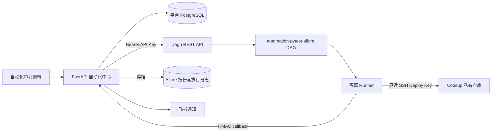
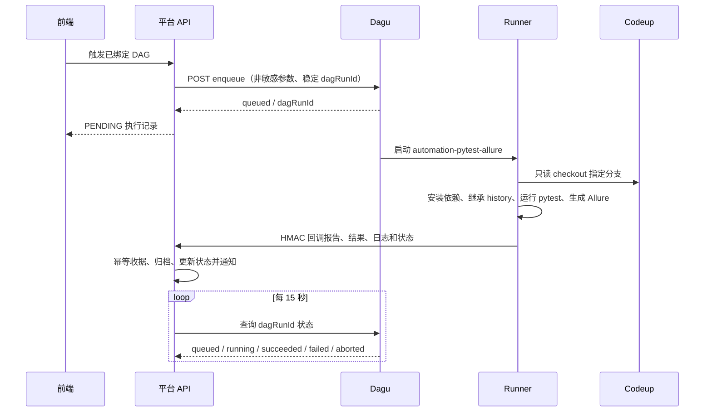
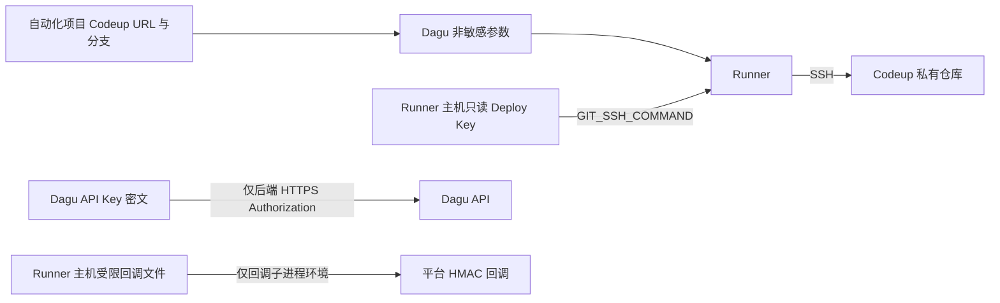
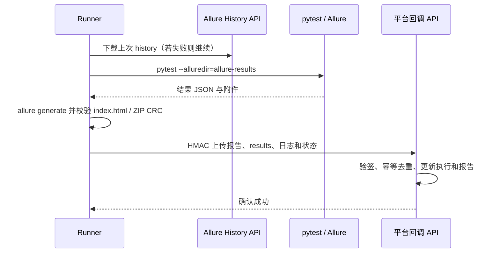
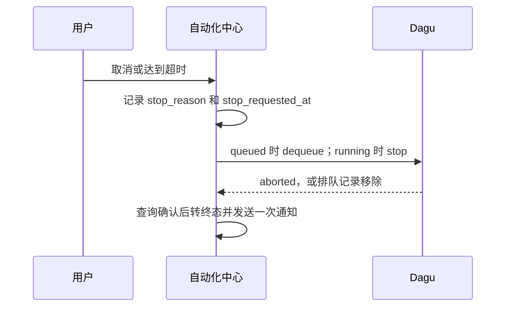
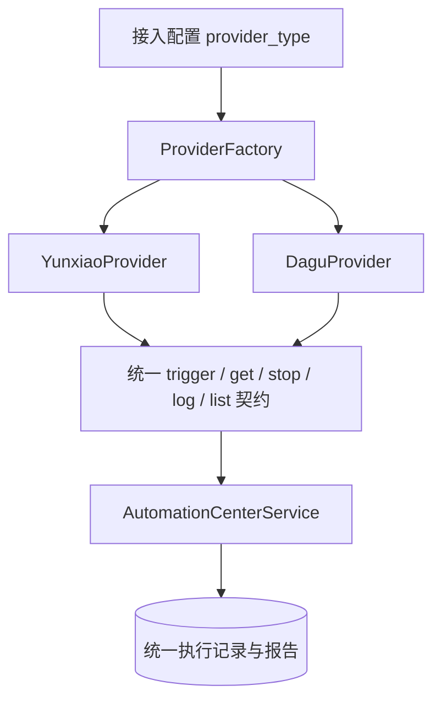

# 自动化中心：Dagu 执行器

自动化中心现在保留通用 Provider 接口，支持云效 Flow 和 Dagu。Dagu 承担临时 DAG 执行；Codeup 仍是测试脚本仓库；平台负责调度入口、执行历史、Allure 报告和飞书通知。

## 架构



### Dagu 执行时序



### Codeup 凭据路径



Codeup URL 仅接受 `codeup.aliyun.com`。用户界面可填 HTTPS 或 SSH 地址；Runner 会把 HTTPS 地址映射到 SSH URL，并只使用 Dagu 主机上的只读 Deploy Key。私钥和 HTTPS 用户密码不会进入平台数据库、Dagu params 或仓库 URL。

## 部署准备

### Dagu 主机

Runner 需要 Linux、Python 3.11+、Git、OpenSSH Client、Java 和 Allure CLI。Dagu 服务用户必须能执行 `/opt/automation-runner/runner.py`，并能写入 `/opt/automation-runs` 和 `/opt/automation-cache`。依赖虚拟环境按仓库地址、清单内容和 Python 版本缓存；pip 下载缓存也跨运行复用。

将下列文件安装到 `/opt/automation-runner/`，由 root 所有、Dagu 用户只读：

- `deploy/dagu/runner.py`
- `scripts/automation_run_tests.py`
- `scripts/automation_callback.py`

部署时可使用：

```bash
sudo install -d -o root -g dagu -m 0750 /opt/automation-runner
sudo install -o root -g dagu -m 0750 deploy/dagu/runner.py /opt/automation-runner/runner.py
sudo install -o root -g dagu -m 0640 scripts/automation_run_tests.py /opt/automation-runner/automation_run_tests.py
sudo install -o root -g dagu -m 0640 scripts/automation_callback.py /opt/automation-runner/automation_callback.py
sudo install -d -o dagu -g dagu -m 0700 /opt/automation-runs
sudo install -d -o dagu -g dagu -m 0700 /opt/automation-cache
```

将 `deploy/dagu/automation-pytest-allure.yaml` 安装到 Dagu DAG 目录。Dagu 服务环境需设置 `AUTOMATION_CALLBACK_ORIGIN=https://<平台 HTTPS 域名>`，并将其传入 DAG 环境。该 Origin 必须与平台 `PUBLIC_APP_BASE_URL` 一致。

Dagu API Key 在平台“CI 接入”中以 Fernet 密文保存，仅由后端在请求 `Authorization: Bearer ...` 头中解密使用。API Key 不会写进 DAG、params、运行日志或前端响应。Dagu 侧应使用 Builtin Auth 签发专用 API Key，将角色限制为 `operator`，只开放 REST API surface，并设置 `attributionClass: service_account`；不要使用管理员密钥。部署版本的 OpenAPI 与 Auth 配置字段仍需在实例上核对。

默认只接受 HTTPS。平台默认拒绝 HTTP；如已确认流量在受控隔离网内，可由部署管理员显式设置 `DAGU_ALLOW_INSECURE_HTTP=true`，并且 URL 必须使用回环、私有 IP 或 `.internal` / `.local` / `.localhost` 名称。公网主机名的 HTTP 地址仍会被拒绝。用户提供的 `http://gold1.mczbc.cn:45394` 目前不能用于传输 API Key；请在 Dagu 前配置 HTTPS 反向代理，并将平台接入地址改为 HTTPS。

### 并发队列

将 [`deploy/dagu/config.example.yaml`](../deploy/dagu/config.example.yaml) 合并到当前 Dagu Server 配置，使自动化 DAG 共用一个并发数为 1 的队列。这个并发限制在 Dagu 侧生效，平台不会自行模拟队列。

### Codeup Deploy Key

在 Codeup 为私有仓库配置只读 Deploy Key。把私钥安装为 `/etc/dagu/keys/codeup_automation`（`root:dagu`、`0640`），并安装经过校验的 Codeup SSH host key 到 `/etc/dagu/keys/known_hosts`（`root:dagu`、`0640`）。不要使用 `ssh-keyscan` 的未校验输出直接信任主机；host key 应从组织可信配置渠道核验后下发。

### 回调凭证

创建 Dagu 接入时设置回调密钥，并将创建时输入的密钥安全地交给 Dagu 主机维护人员。平台只返回回调标识，不回显回调密钥。每个接入配置需要一个 JSON 文件：

```json
{
  "callback_key": "<配置响应中 callback_path 最后一段>",
  "callback_secret": "<创建 Dagu 接入时设置的回调密钥>"
}
```

保存到 `/etc/dagu/automation-callback-secrets/<integration_config_id>.json`，属主 `dagu:dagu`，权限 `0400`。Runner 按 Dagu params 中的接入配置 ID 读取。回调 URL 由可信 `AUTOMATION_CALLBACK_ORIGIN` 和此文件中的回调标识构造，**回调密钥、回调标识和回调 URL 均不会传入 Dagu params**。

API Key 与回调密钥是不同用途的凭证。修改回调密钥时要同时更新此文件；轮换回调标识后也需更新 `callback_key`。

## 运行流程与边界

1. 后端保存平台执行记录，再以 `automation-<execution_id>` 作为稳定 Dagu `dagRunId` 调用 enqueue。重复请求遇到同一个 ID 时会读取现有运行，不重复创建另一条 Dagu Run。
2. enqueue 的 params 只含执行 ID、仓库地址、分支、测试范围、超时和接入 ID等非敏感字段。回调凭证和 Codeup 私钥留在 Runner 主机。
3. Runner 为每次 Dagu Run 创建独立目录，浅克隆对应分支并记录 commit SHA；参数通过 `scripts/automation_run_tests.py` 的 pytest 白名单解析，不经 shell 拼接。
4. Runner 尝试下载前一次 Allure history。读取失败会记录日志并继续本次测试；报告生成仅在结果目录存在且 Allure CLI 成功时进行，不会创建伪报告。
5. 即使 pytest 返回失败，Runner 仍会尝试生成报告、打包结果并发送 HMAC 回调。报告 ZIP 必须包含根目录 `index.html` 且 CRC 校验通过。
6. 回调使用稳定幂等键 `dagu:<dag_run_id>:report-v1`，最多重试 4 次。回调未被平台确认时，Runner 保留目录以供恢复；确认成功的工作区保留 7 天后由后续 Runner 调用清理。Dagu 自身日志按 Dagu 的保留策略保存。

### Allure 回调时序



`deploy/dagu/automation-cleanup.service` 和 `.timer` 每日清理成功回调且超过 7 天的运行目录，以及超过 30 天且没有 Runner 持有锁的依赖虚拟环境。没有 `.callback-ok` 标记的失败现场不会被定时删除；Dagu 日志独立按 Dagu 的配置轮转。

### 状态、取消和超时

| Dagu 状态 | 平台状态 |
|---|---|
| `queued` | `PENDING` |
| `running` | `RUNNING` |
| `succeeded` | `SUCCESS`，仍以 Allure 测试结果为准 |
| `failed`、`partially_succeeded`、`rejected` | `FAILED` |
| `aborted` | 平台主动取消时 `CANCELLED`；平台超时时 `TIMEOUT`；其他原因按 `FAILED` |



取消接口是幂等的。平台会先记录停止原因，再在轮询中重复请求停止并查询 Dagu；不会把“已提交停止请求”提前当作已终止。queued Run 被 dequeue 后若 Dagu 返回 404，平台把它当作队列已移除的终态确认。超过项目超时时，平台立即记为 `TIMEOUT`，通知等待 Dagu 确认后发送。

## 验证与运维

部署后在 Dagu 主机以服务用户验证：

```bash
sudo -u dagu python3 -m py_compile /opt/automation-runner/runner.py
sudo -u dagu dagu validate /etc/dagu/dags/automation-pytest-allure.yaml
sudo -u dagu dagu dry /etc/dagu/dags/automation-pytest-allure.yaml
```

随后在平台新建 Dagu 接入，测试连接并从 DAG 列表选择 `automation-pytest-allure`。首次应绑定一个不含生产凭证的测试仓库并跑通回调、Allure 报告、取消和超时路径。

本仓库 Dagu HTTP 客户端覆盖 API Key、重定向拒绝、DAG 列表、enqueue 幂等、运行状态、日志、停止和 404 等 Mock 行为。**部署实例联调仍需以该实例的 `/api/v1/openapi.json` 为准**。本次对用户提供的 OpenAPI 地址做了无凭证 GET，主机可达但返回 HTTP 401；没有可用 API Key，且当前地址使用公网 HTTP，因此未向它发送凭证，也未验证部署版本、路径和响应字段。请先提供 HTTPS 地址，并在平台的 Dagu 接入中安全录入专用 API Key，再运行“测试连接”。

### Provider 切换



Provider 类型从接入配置派生，不由自动化项目额外指定。历史 Jenkins 接入在迁移后禁用并标记为 `LEGACY`；已完成记录仍可查询，旧 Queue/Build 标识写入历史 JSON 字段以便审计。新建或更新 Dagu/Yunxiao 接入不改变既有执行记录。迁移 `0087` 在没有 Dagu 配置和已归档 Jenkins 数据时会恢复旧表结构；一旦存在这些无法重建的凭据或历史，降级会拒绝并要求恢复数据库备份。`0088` 增加 Dagu 投递状态和执行幂等约束。
