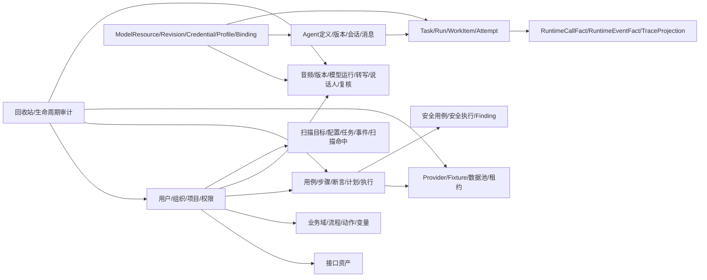

# 数据库目标架构（P2）

> 本架构结论仍有效。生命周期模型注册已补齐，0086重复索引去重已应用到本机开发库；生产环境仍需独立迁移审批。

## 设计基线

目标先统一模型装配和迁移事实来源，再维持业务实体边界。当前 187 个 ORM 表不设定压缩目标；没有证据时以强外键、历史不可变性、审计/恢复能力和独立生命周期优先。建议的目标状态是：

1. Alembic `target_metadata` 完整包含所有 ORM 声明；物理库与代码迁移版本可复核。
2. User/Organization/Project、权限、回收站及审计等平台级数据保持关系型约束。
3. 每个业务模块保留其 own lifecycle：测试用例/执行、ASR音频版本/运行/审核、安全扫描、Agent会话/任务运行等不跨域合并。
4. `ModelResource` 作为模型资源中心的规范目录，Revision、Credential、ParameterProfile、Grant/DefaultBinding保持独立；旧模型通过兼容映射逐步退场，Credential密文独立保存。
5. JSON用于版本化快照、灵活模型参数和结构化外部结果；高频过滤字段、身份权限、外键关系、审计历史继续使用关系型列。
6. 只去重经数据库定义确认的物理冗余索引，保持 API 合同与查询语义。

## 域边界图

## 关系保持原则

- **测试管理**：用例文本与步骤、断言、前置条件、输入数据、Suite/Plan/Run/CaseExecution关系分离。Case↔Scope 和 Case↔Asset 关系承担不同含义；scope 的多态资产链接不替代测试对象 FK。
- **业务管理**：Domain→Flow→Action及 Binding/Variable/VariableRef/Precondition/Rule/State/API mapping分工独立。FlowExecution拥有ActionExecution子记录；不能把二者放进统一JSON或平表。
- **测试数据**：Fixture依赖图、步骤、输出、执行/清理、Provider运行、Data执行、PoolItem/Lease与CaseFixture关联保持关系型字段和状态。
- **ASR**：Audio/AudioVersion、GroundTruthVersion、ModelRun、转写分段、说话人结果/时间段/分配、内容审核任务/块、Review Audit保持独立生命周期；主模型连接/参数与Model Center的遗留映射采用兼容层。
- **安全测试**：自研 SecurityExecution/Finding 与 ZAP ScanJob/Event/ScanFinding/Target/Profile/AuthProfile继续隔离，凭据字段保持密文/隔离存储。
- **Agent与编排**：Agent Definition/Revision、Session/Message、Task/TaskRun、WorkItem/Attempt、Runtime Facts/Projection分层，支持恢复、幂等、Trace和成本投影。
- **通用模型**：ModelResource不吞并历史Task、ASR Run或独立凭据。LegacyBinding只作为迁移映射，不把凭据塞到普通JSON配置。

## 表数目标

当前代码的目标表数仍按 187 张 ORM 声明保留。迁移链明确后，0083 Excel导入批次和0085 Jenkins凭据预计使当前物理库从187张应用表增至189张（另含`alembic_version`为190）；两张无ORM历史/测试表暂留。此预测与表合并无关，尚未实库应用。未来若完成历史/测试表保留审查，可能另有评估，但当前没有删除批准或减少估算。
