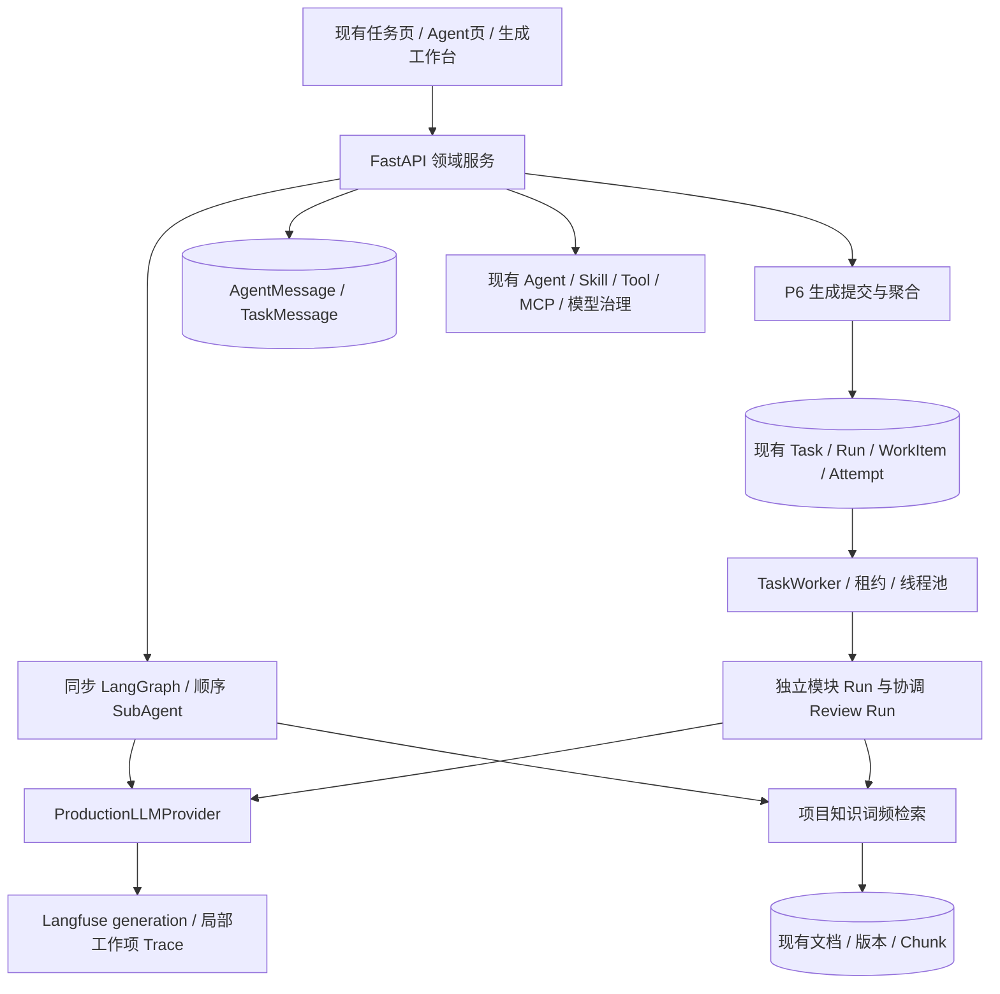
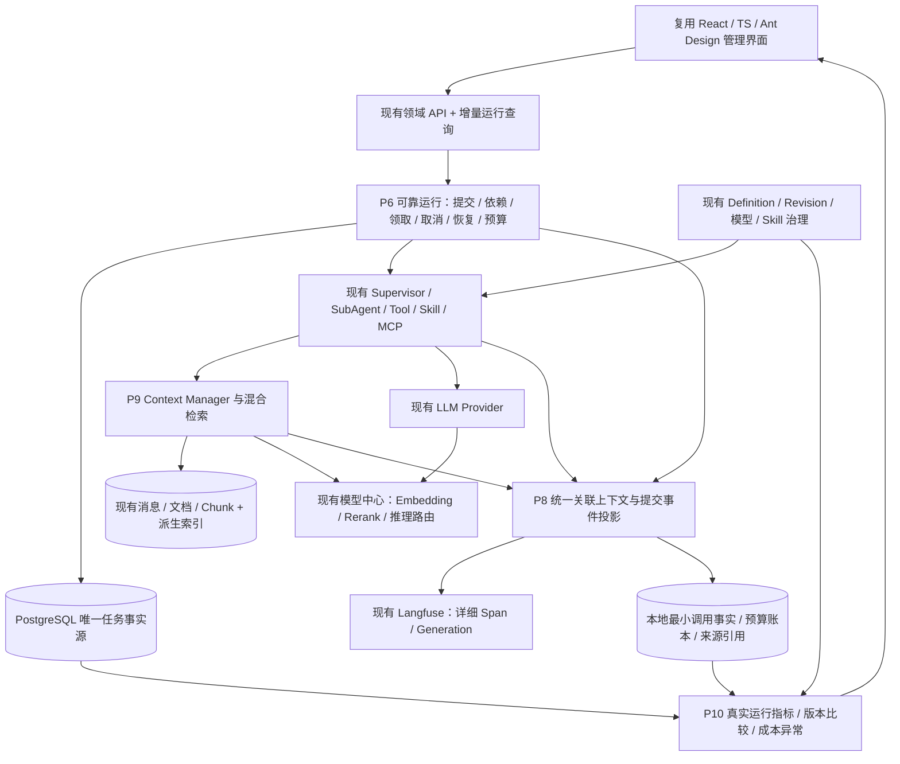
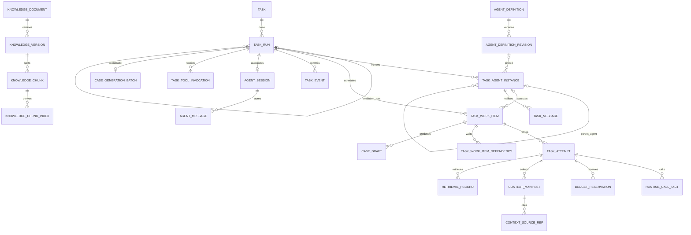
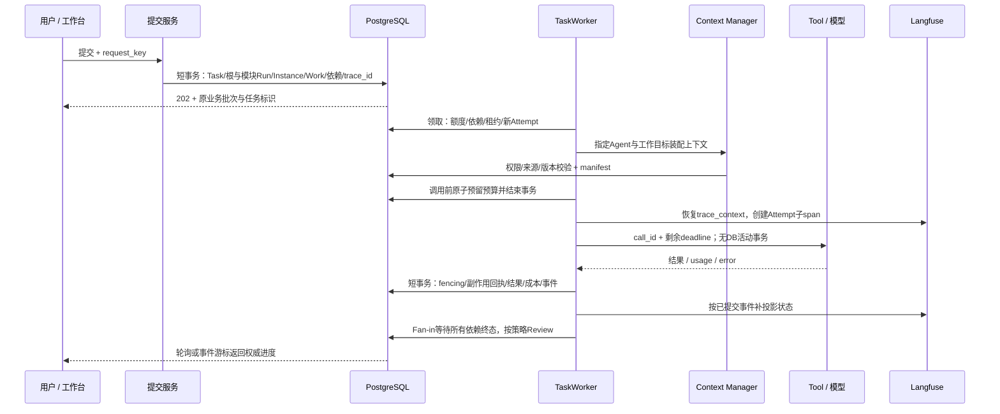
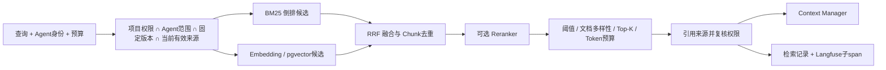

<!-- 本文给出当前工作区的运行底座审计、统一架构、接口与分期验收方案；与现有 P6 设计协作，仅为待确认方案，不代表功能已交付。 -->
# Super Agent 统一运行底座：审计与分阶段研发方案

审计日期：2026-11-11（Asia/Shanghai）。状态：**待方案确认；本轮仅核对并更新架构设计文档，不实施业务代码或数据库变更。**

范围：P6 异步调度、P8 全链路可观测、P9 RAG 与上下文、P10 运行质量与版本治理。不建设 P7 标准数据集、离线评测平台或 LLM-as-a-Judge；现有业务审核、结构校验及 ASR 功能保持原边界。

## 1. 当前架构审计报告

### 1.1 基线、证据等级与工作区

- 分支 `feature/case-generation-closed-loop`，HEAD `aa46bf1`（用例生成审核闭环）。本次读取到 31 个已跟踪修改文件、17 个未跟踪顶层路径；以**当前工作区源码（含未提交 P6）**为依据，不把历史文档或未提交草稿当作已合并能力。
- 未提交范围包括生成服务/API/Schema/模型、任务 Worker/租约/命令与收尾、Langfuse tracing、两条 Alembic 草稿、P6 专项测试、前端工作台及合同、Playwright 配置/E2E、验收脚本，以及 `.idea/`。这些既有改动均予保留；本次没有修改业务代码。
- 已跟踪迁移脚本截至 `0049`；当前工作区另有 `0050_case_generation_tasks.py` 与 `0051_runtime_execution_identity.py` 草稿，因此**工作区 Alembic head 为 0051，尚未提交**。0051 草稿补充执行根、Trace、Run/Attempt deadline、Agent Revision/父实例，并仅对可证明的单一生成批次回填根关系。
- `docs/p6/verification-snapshot.json` 与 `docs/p6/acceptance-report.md` 记录了 2026-11-10 冻结版本在隔离库上的 P6 验收：后端 1149 passed、前端 41 passed、TypeScript/构建通过、Playwright 15 passed。当前复核未重跑测试；选取的 0051、生成服务、租约、tracing 文件哈希与该快照记录一致。该记录不证明生产数据库或外部服务状态。
- 本次为源码、迁移草稿和文档证据的静态复核；未连接运行数据库，无法确认部署 schema、pgvector 扩展、Langfuse 服务或生产 Worker 配置。

### 1.2 现有能力及复用结论

下列路径相对于仓库根目录；函数名可作为稳定定位依据。

| 能力 | 当前源码事实与证据 | 结论 |
|---|---|---|
| 任务唯一事实源 | `backend/app/orchestration/tasks/models/task.py`：Task、TaskRun、TaskWorkItem、Dependency、Attempt、Command、Event、ResourceRef、ToolInvocation、SchedulerControl；工作区草稿增加 `execution_root_run_id`、`trace_id`、deadline | 原表与状态机继续使用，不新增任务队列；提交 0051 前仍属工作区草稿 |
| 领取与租约 | `runtime/lease_service.py::claim_work/heartbeat_loop/recover_expired`：全局控制行锁、SKIP LOCKED、Run 级租约、Attempt 代次、独立心跳 | 保留 Run 单执行者语义，不能直接让同一 Run 的工作项并行覆盖租约 |
| P6 异步生成 | `features/test_management/services/generation_tasks.py::submit`：202 提交，一个模块一个 Run/WorkItem，Review Run 作协调根并以依赖等待；每个 Run 建 TaskAgentInstance/AgentSession，记录 Agent Revision 和父子实例 | 已是专项持久化 Fan-out/Fan-in；仍未把通用 SubAgent 图编排迁入 TaskWorkItem |
| 并发与资源 | `runtime/worker.py::_loop`：有界线程池，槽位受连接池限制；领取时全局与模块并发检查；提交时项目/用户活跃任务额度；生成 Provider 按 `call_id` 在 Attempt 检查点预留/结算 usage，未知用量保留预算 | 复用现有闸门与 P6 专项调用账本；尚无跨 Provider/RAG 的标准化调用/成本事实表，公平老化策略仍需设计 |
| 恢复和幂等 | 生成 `finish` 与通用 `has_live_claim` 检查 owner、代次、状态、未过期租约及 deadline；0050 草稿 `(work_item_id,result_ordinal)` 唯一；请求摘要+幂等键 | 保留并扩展调用外的副作用回执；不复制 TaskRun/队列 |
| 控制和重试 | `generation_tasks.py::control/recover_generation`；通用 Command/Completion 服务；未知 API 回执进入 RECONCILIATION_REQUIRED | 复用安全边界；不同模式的恢复及终态语义需契约化 |
| LangGraph | `agents/runtime/subagents.py::run_subagent_graph` 将子节点依次串联，`compile().invoke()` 无持久化 checkpointer；`case_generation_service.py` 保留同步图 | 复用节点/业务逻辑；图负责推理与局部编排，DB 负责跨进程调度和恢复 |
| Trace | P6 为批次创建共享 `trace_id`，写入各 Run/事件；`generation_trace` 显式传递 Langfuse `trace_context` 并创建工作项 span；任务 Trace 模式下 LLM 输入/输出均脱敏 | 已具备批次级关联雏形；仍缺统一根/父子 span、通用 Agent/Tool/Skill/RAG spans、提交事件投影和可收敛 Trace 状态 |
| Agent 版本 | `agents/models/definition.py`：Definition/Revision；`definition_service.py::restore_agent_version` 已有恢复入口 | 不再建设 Agent 版本表或第二套回滚服务 |
| Skill/MCP/Tool | `skills/models/definition.py`：Skill Revision、UsageEvent；`skill_service.py::restore_skill_version`；`agents/assembly` 和 `tools/`、`mcp/` 管理受控能力 | 复用授权/快照；区分 Skill 装载和真实可执行工具调用 |
| 模型治理 | `platform/model_configuration/models.py` 已有 Resource/Revision/Profile/Grant/TaskSlot/LegacyBinding；运行 Provider 仍加载旧 ModelConfiguration | 复用模型中心，补运行路由桥接；旧配置 digest 不等于 ModelRevision 主键或供应商模型版本 |
| 知识库 | `knowledge/models.py/service.py/worker.py`：库、文档、版本、原文件、解析、切片、来源、持久化 QUEUED 解析任务 | 复用文档与解析生命周期，不再建文档管理 |
| 知识检索 | `service.py::search` 全量加载选定版本 chunk，按词频排序取 8；未实现 BM25/向量/重排/阈值；零命中仍可能返回片段 | 需要检索升级，当前分数不能称为相关性概率 |
| 向量基础设施 | 仓库后端依赖、运行代码和部署文件中未检出 pgvector 或独立向量检索服务引用；未检查部署数据库扩展清单 | 按“当前没有可复用向量后端”规划；先测 PostgreSQL pgvector 与 BM25，不新增数据库服务，部署能力需上线前确认 |
| 知识权限 | `freeze` 明确忽略 KnowledgeBinding，冻结项目全部启用版本；已有测试 `test_binding_does_not_limit_project_knowledge`、`test_agents_share_project_knowledge` | 项目隔离已有；Agent 范围治理尚未生效，必须显式迁移，不能悄然恢复旧绑定语义 |
| 会话与上下文 | AgentSession/AgentMessage、TaskMessage 已持久化；`message_store.py::list_messages` 读取全部会话消息；`session_state.py` 重建状态 | 复用原存储，增加选择/预算/摘要/来源引用层 |
| 当前上下文隔离 | Planner 已按子 Agent 检索知识并传入任务数据；未看到统一 Context Manager、Token 预算或长期记忆治理 | 保留现有隔离路径，不把所有历史统一广播 |
| 前端 | React18/TS/Ant Design/React Query；Tasks 详情已有 metrics 入口；AgentGovernance、Knowledge、ModelCenter、生成工作台均存在 | 扩展现有页面和领域 API，不建设第二个管理台 |

### 1.3 本轮需要优先处理的缺口

| 级别 | 发现 | 影响和处理方向 |
|---|---|---|
| 必须先定契约 | P6 已用 Review Run 作为显式协调根，0051 草稿加 `execution_root_run_id`；但通用 `sync_task_status` 仍以最新 run_number 聚合 | P6 当前排序约定可用；通用多 Run 消费者需显式按根关系聚合，并保留旧 run_number API 兼容 |
| 已有但仅限 P6 | 新提交已创建 TaskAgentInstance/AgentSession，绑定可找到的 Agent Revision 与父实例 | 质量统计可以使用新 P6 记录；历史任务及未接入该装配路径的运行仍需标 unknown，禁止推测回填 |
| 必须扩展 | P6 `_post` 已按 `call_id` 保存 STARTED/RETURNED/UNKNOWN、预留/实际 usage、耗时；失败或无 usage 保留预留，且捕获已返回 usage | 这是 Attempt JSON 中的专项账本；P8/P9 需要跨模型候选、工具循环、Embedding/Rerank 的稳定去重、原子结算和计价版本，不能据此宣称全平台已覆盖 |
| 仍需验收 | P6 有 Run/Attempt deadline，领取/心跳/调用前限制剩余 timeout，收尾 fencing 拒绝过期写入 | 网络库取消不保证远端立即停止；deadline 到期后的尝试应由恢复器收敛，需对慢请求和迟到回执做故障注入 |
| 部分已收口 | 通用 `complete_work`、`fail_work` 与生成 `finish` 共用有效 Claim 校验，覆盖 owner/代次/状态/租约/deadline；通用恢复有尝试上限 | 保持该 fencing 契约，检查所有直接状态写入路径及取消/过期边界；不得为旧测试放宽生产校验 |
| 已在工作区修复 | `claim_work` 在 SQL 中排除未就绪依赖后再取首个可运行项，不再只扫描前 20 项 | 为修复增加回归；静态 FIFO 仍无显式 aging/fairness 策略 |
| 必须补齐 | P6 传入显式 trace_context，异常 span 写 ERROR；`llm_generation` 在任务 Trace 范围内对输入和输出正文脱敏 | 还没有 DB 提交事实驱动的 Trace 投影、根状态收敛及 Agent/Tool/Skill/RAG 统一时间线 |
| 可见接口风险 | `generation_tasks.task_status` 在 dict 中重复定义 `trace_id`/`execution_root_run_id`，后项会覆盖前项回退值；`observability_status` 在 Langfuse 开启时固定返回 `PENDING` | 清理重复字段并让 Trace 投影回执驱动状态；历史任务/禁用/失败/延迟状态均需明确返回 |
| 脱敏边界仍需全链路核验 | P6 任务 Trace 下 LLM 输入/输出已置为 redacted，生成错误写受控摘要；其他 Provider、Tool/MCP 参数、应用日志仍须分别审计 | 在 Provider/Tool/MCP/Trace 出站统一策略，覆盖异常/headers/凭据，保留白名单身份与数值指标 |
| 分期补齐 | Provider 有 before_request 回调，但为可选；配置查询会开启事务 | P6 路径已显式结束事务，不能据此宣称所有调用都满足要求；逐入口验证网络前无活动 DB 事务 |
| 分期补齐 | SkillUsageEvent 记录冻结使用，未记录调用成功/失败；模型 fallback 与重试存在多层尝试 | 真实调用指标需稳定 call_id 去重，不能拿配置使用次数当 Skill 成功率 |
| 分期补齐 | 数据库有不可变配置版本，但当前生成策略在 Definition.version 变化时停止旧任务 | 本期先保留此安全策略；“旧 Revision 可继续运行”的能力需独立版本准入策略，不能自动放开 |

这些为源码可见差距及风险判断。`docs/p6/acceptance-report.md` 已记录隔离环境测试结果，本次没有重跑；性能目标仍是待测标准。文档规范中“知识库尚未实现”的描述已落后于代码；实施时同步修正，当前以实际 `app/knowledge` 为准。docs 索引还存在已失效的 `agent-governance-runtime.md` 引用，本方案不依赖它。

## 2. 新旧架构对比与四模块统一架构图

### 2.1 当前工作区架构

### 2.2 目标统一架构（图中新增能力均为规划）

运行层是权威：业务状态由 PostgreSQL 决定，Trace 是观测投影；模型输出不能直接写调度状态。P8 的身份契约在 Phase 1 同步落地，详细链路页面在 Phase 2 完成。P9 复用 P6 预算与 P8 身份；P10 消费前三阶段可验证的运行事实。

## 3. 统一数据模型与关联关系

### 3.1 身份语义

建议链 `task_id → trace_id → agent_run_id → span_id → tool_call_id` 是导航关系，不是逐级一对一的数据库外键链。

| 标识 | 定义与基数 |
|---|---|
| task_id | 现有 Task.id，业务任务稳定身份 |
| execution_root_run_id | 新增 TaskRun 自引用；一轮执行分组的协调 Run。普通历史 Run 无值时视自身为根；P6 模块指向已有 Review Run |
| parent_run_id | 可选 TaskRun 自引用，表达调度层父子关系，与 Agent 父子身份分开；禁止环路和跨 Task 引用 |
| task_run_id / work_item_id | 保留原 Run/WorkItem 主键，Run 仍是租约单位 |
| attempt_id | 现有 TaskAttempt.id；恢复和重试产生新 Attempt，历史不覆盖 |
| agent_run_id | **直接复用 TaskAgentInstance.id**，表示一轮配置冻结后的逻辑 Agent 实例；重试沿用，单次执行用 attempt_id 区分，不新增 agent_run 表 |
| agent_session_id | 现有 AgentSession.id，可空；不能以会话 ID 代替执行实例。现有 uq(task_run_id) 保留，P6 每模块一 Run 可一一装配；将来同 Run 多 Instance 需另行迁移唯一约束 |
| trace_id | 每 execution_root_run_id 一个稳定的 Langfuse Trace ID（合规格式）；重试用新 span，同任务新执行轮次用新 Trace |
| span_id | 单次 Agent Attempt、检索、模型、Tool 或 Skill 装载的 Langfuse observation ID；不可复用来覆盖多次尝试 |
| tool_call_id | 每次真实工具调用稳定 ID；副作用幂等键 invocation_key 与物理调用次数分开，不能用幂等键掩盖重复请求 |
| llm_call_id | 每次实际供应商请求的唯一 ID；fallback、工具循环中每次网络请求均单列 |

所有子 Run 必须与根属于同 Task；所有关联实例、会话、引用经 Task.project_id 校验。客户端不得指定业务归属、父 span 或越权 Trace；跨项目、跨任务引用使用现有 404 语义。

### 3.2 数据模型关系图

`RUNTIME_CALL_FACT` 等为拟新增的最小数据，不是完整 Langfuse Trace 副本；图中“pinned”用于已补齐 Revision 的运行，历史未知允许为空。

### 3.3 复用与增量模型清单

| 模型 | 拟增量字段/职责 | 约束 |
|---|---|---|
| TaskRun（扩展） | execution_root_run_id、parent_run_id、trace_id、deadline_at、policy_version、预算配置快照 | 同 Task 根关系；根 trace_id 唯一，子 Run 可不存并经根取值；不改变旧 run_number 排序 API |
| TaskAgentInstance（扩展） | agent_definition_revision_id、parent_agent_instance_id；模型/Skill 版本引用放现有快照并标准化 | id 即 agent_run_id；子实例权限不继承扩大；历史快照不强行猜 Revision |
| TaskAttempt（扩展） | agent_span_id；checkpoint_json 继续存恢复检查点 | 与 work/代次一致；跨崩溃可重建 span 关联 |
| TaskToolInvocation（扩展） | tool_call_id、attempt_id、span_id，复用副作用回执 | 旧调用可空；只读调用事实进入下表，不能把所有 Span 都变成回执 |
| runtime_call_fact（新增） | call_id、kind、项目/根/Run/Instance/Attempt、trace/span、模型 Revision 或 Skill/Tool/MCP 标识、起止时间、状态、error_code、tokens、usage_status、成本与计价版本 | call_id 唯一；只存数值/引用/脱敏摘要；LLM 状态拆 provider_status 和 contract_status |
| runtime_budget / budget_reservation（新增） | 根预算、已结算/已预留/未知消耗、call_id、额度、状态、货币、定价版本 | 原子预留；call_id 唯一结算；不是第二套任务队列 |
| knowledge_chunk_index（新增派生索引） | chunk_id、index_generation、tokenizer_version、Embedding Revision、dimension、text_hash、索引状态；向量列与倒排数据按选型落表 | 按 chunk+索引版本唯一；原 Chunk 是来源，不复制文档生命周期 |
| retrieval_record（新增） | 调用关联、query_hash/可选脱敏摘要、检索策略版本、候选量、过滤范围摘要、chunk/version 引用、分数类型、排名/耗时/降级原因 | 不存正文；查询全文默认不持久化；权限变化后页面隐藏不可读来源 |
| context_manifest/source_ref（新增） | attempt、Agent、预算、输入 Token 估算、来源 kind/id/version/hash、scope、选择/裁剪/冲突原因、摘要版本 | 原消息与原文只引用，不重复保存完整历史 |
| context_summary / memory_fact（按需新增） | 摘要或已确认长期事实、源引用、范围、版本、有效期、确认人和失效状态 | 是派生摘要/业务事实治理，不是第二份消息存储；关键事实必须有来源 |
| 质量聚合（后期按需） | 按日/项目/Agent Revision/模型 Revision 的指标读模型、样本量、口径版本、水位 | 可由事实重建；先 SQL 聚合，达到查询性能瓶颈再物化 |

模型价格复用模型中心配置扩展为不可变计价版本（币种、输入/输出/缓存/推理 Token 单价与生效时间）；未知计价成本为 null。供应商不暴露真实模型版本时记录 `provider_version=unknown`，保留 model_name、配置 Revision 和 endpoint 指纹，不能称精确复现。

## 4. 统一 Agent 运行链路、任务与 Trace 关联

### 4.1 运行链路图

图中多个模块可同时执行，分别持有自己的 Run 租约和 Session；不得共享 SQLAlchemy Session。Supervisor 仅获取已授权的结构化结果、必要引用及失败摘要。

### 4.2 Trace 生命周期与一致性

1. 提交时生成并持久化根 trace_id，不依赖 Langfuse 在线。Trace 关闭时仍返回关联 ID，但 `observability_status=DISABLED`，不得伪造已上报。
2. Worker 从可信 DB 身份构建不可变 `RuntimeCorrelation`，进入线程后设置并在 finally reset；不能依赖 ContextVar 自动跨线程传播。重启、重试从 DB 恢复同一 trace_id，新 Attempt 新 span。
3. Agent span 记录 parent_agent_run_id；Generation、Tool、Skill 装载、检索、上下文装配作为子观察。持久化 root span/parent span 所需的最小引用；长任务不维持一个跨数天的内存上下文。
4. 本地状态与 TaskEvent 同事务提交。复用 TaskEvent 作为待投影事实，增加**投递游标/回执**（可独立小表，按根事件定位），不是业务队列。Langfuse 投影提交后发送，失败重试，按稳定 observation_id 和 event_seq 幂等更新。
5. 投影必须按根序号/版本有序，旧 RUNNING 更新不得覆盖新终态。人工重试会开启新 Attempt 并使根重新运行，需提升根状态版本后更新，不把历史失败 span 改成功。
6. 业务最终状态唯一来自现有聚合：成功、部分问题、失败、取消、待核对等。Langfuse level 不能完整表示所有业务状态，在 metadata 保存精确 business_status。取消但已生成部分草稿时允许模块成功、根取消，含义不同不算矛盾。
7. 无跨 PostgreSQL/Langfuse 的分布式事务，不能承诺瞬时强一致。任务页始终显示 DB 权威状态、Trace 投影水位/延迟；不一致标记 SYNC_PENDING 并自动修复，禁止呈现两个“最终状态”。
8. trace 与生成批次通过现有 batch.task_run_id → 根关联；TaskResourceRef 继续承载业务产物引用。历史多 Trace 返回关联列表，不改写成虚假的完整单 Trace。

字段至少包括 project/task/root/run/work/attempt、agent_run/session、Agent Revision、父子关系、模型与配置版本、工具/Skill 版本、脱敏摘要、Token/耗时/重试/error_code/业务状态。完整已脱敏模型调用内容只在 Langfuse 按策略保存；本地只存关联、结算和查询指标必要事实。

脱敏统一在 Provider、Tool/MCP 适配器和 Trace 出站边界执行；默认 metadata-only 时**输入和输出均禁止正文**。仅白名单标识/数值可出站，错误只输出分类与受控摘要；不发送异常原文、headers、endpoint 凭据、隐藏推理。治理页查询和 Langfuse 跳转先校验项目权限；Langfuse 自身项目隔离另行配置，不能把平台凭据交给浏览器。

## 5. P6 调度、恢复与资源契约

### 5.1 通用化而不换任务体系

- 现有 P6 专项处理器继续运行；抽取 Run 分组/依赖/预算/身份的公共窄接口，业务生成、审核、正式资产写入留在 test_management。
- 继续“一模块 Run 一租约”，用 execution_root_run_id 归组。将来需要同 Run 多工作项并行才考虑迁移租约粒度，本轮不做。
- 依赖边明确 `ALL_SUCCEEDED` 与 `ALL_TERMINAL` join_policy，P6 Review 使用后者；失败传播、SKIPPED 及取消策略由服务端定义。旧边默认 ALL_SUCCEEDED，保留原语义。
- DAG 提交前校验无环、节点上限、父子授权、同 Task；分支持久化后才可派发，Fan-in 不依赖内存计数。
- 依赖就绪查询、全局领取额度、每项目/用户/根/模型限额采用短事务；禁止等待依赖的协调 Run 占执行租约和并发槽位。加入排队老化避免大任务长期压住小任务。
- 公共查询兼容旧最新 Run 视图，同时新增 execution_root_run_id/modules 视图；公共 Task 状态改由模式对应的根聚合器决定，不能泛化“最大 run_number 就是业务最新一轮”。

### 5.2 幂等、取消与恢复

- 请求幂等仍使用 `(created_by,request_key)` + canonical digest；同键不同内容 409，重试请求不重复扣预算或生成任务。
- 每次结果写回统一验证 owner、代次、Attempt/Work 状态、未过期租约和根取消/截止状态；检查与业务回执/结果/终态同事务。
- 副作用采用现有 ToolInvocation 回执。STARTED 后崩溃不能证明是否执行时，进入 NEEDS_RECONCILIATION；必须查外部幂等回执或人工核对，不能承诺“外部恰好一次”。
- 崩溃后重领仅未完成工作；checkpoint 指向已提交结果/消息游标和必要业务引用，不保存无法跨进程恢复的对象。成功模块、人工审核草稿不重生成。
- 用户取消优先于后续自动重试；取消持久化后不发起新调用，运行中调用在安全边界停止后续副作用。中断中的远端调用记潜在消耗，不假定免费。
- 恢复、可重试失败均计入总尝试上限；指数退避带抖动，429 尊重可信 Retry-After 上限，鉴权/权限撤销不重试；租约丢失线程不能续新租约或写迟到结果。
- Worker 关闭先停止领取，再有限等待；超时依赖租约恢复，不等待线程池无限阻塞应用退出。心跳须检查 Attempt 状态与 generation，终态之后不得续租。

### 5.3 严格预算与超时

调用前按 call_id 在根预算行锁内预留：已结算 + 未结算预留 + 本次预留 ≤ 总预算；同时限制输入、输出、调用数、单次/任务时长及成本。输入由对应 tokenizer 估算并留安全余量；输出预留 max_tokens，Embedding/Rerank 也纳入资源范围。不同模型 Token 与货币分维度核算。

模型请求期间不持 DB 事务。返回后按实际 usage 幂等结算、释放剩余额度；失败但已计费也结算。供应商 usage 缺失或请求失联记 UNKNOWN，保留保守额度直至核对，不用零掩盖；展示“已知成本下界 + 未知调用数”。多次 retry/fallback/tool-loop 都是独立预留。

deadline_at 在根、模块和调用层取最早值；调用 timeout=min(模型设置、剩余 deadline、策略上限)。超时看门狗终结当前代次并拒绝迟到结果；仅可合作取消的 HTTP 使用关闭连接，不能声称远端一定停止。外部服务无费用硬上限时，只能保证平台不再放行超额调用，不保证未知供应商账单绝不超出估算。

## 6. RAG 混合检索架构设计

### 6.1 存储选型与 BM25 路线

| 方案 | 复用与成本 | 决策 |
|---|---|---|
| PostgreSQL + pgvector | 现有事务/备份/权限体系；需验证部署支持扩展、维度、索引内存及带过滤召回 | **首选候选**，先实验再启用；本轮未确认已安装 |
| 现有普通 PostgreSQL | 可支持文档、词项倒排、BM25 统计；原生全文检索有 ts_rank/ts_rank_cd | 作为关键词实现基础；不能把原生 ts_rank 宣称 BM25 |
| 新独立向量数据库 | 新服务、凭据、备份、同步、权限过滤和故障面 | 暂不引入；只有 PG 压测不达标且有明确收益时另行评审 |

官方依据：PostgreSQL 文档介绍的是内置词频/位置等排名函数，并非一个可直接更名为 BM25 的接口（[全文排名](https://www.postgresql.org/docs/17/textsearch-controls.html)）。pgvector 支持与全文检索融合，近似索引的过滤可能使结果不足，需要验证迭代扫描或精确检索兜底（[pgvector 官方说明](https://github.com/pgvector/pgvector)）。

BM25 明确实施路径：首阶段用 PostgreSQL 维护 tokenizer 版本化的词项 posting、doc_len、df、N、avgdl，以经授权语料范围统计 BM25，默认 k1=1.2、b=0.75 并进入策略版本。中文分词、英文标识符/接口路径拆词需要专项实验；词表统计不得跨项目泄漏。候选量由倒排限制，不能每次全量加载原文。

先以固定工程语料验证公式、分词、权限和吞吐；不建设独立评测引擎。若 SQL BM25 在 10 万 chunk 基线达不到验收目标，再比较可部署的 PostgreSQL BM25 扩展；扩展的维护、许可、中文支持、备份和升级兼容通过后才替换实现。接口保持 LexicalRetriever，降级原生全文检索时返回 `lexical_mode=postgres_fts`，不伪装 BM25。

### 6.2 检索流水线

- 初始策略建议：每路候选 40、融合保留 40、rerank 20、最终 Top-K=8（服务端允许 1–20），RRF k=60；都是待压测的策略默认值，不是当前实现或质量保证。
- BM25/vector/rerank 分数分别记录 score_type、值与模型版本；RRF 分数不当作概率。不设跨模型通用 0.7 阈值。向量最低相似度与 rerank 最低分经对应策略验证后配置；不足阈值可返回空，不填充无关片段。
- Embedding 由模型中心按能力授权，冻结模型 Revision/dimension/normalization；禁止混合不同维度向量。新索引 generation 后台构建，READY 后原子切活动指针，旧代留作回滚。
- 原有解析和版本发布保留。索引构建使用现有 TaskWorkItem 新 kind（如 KNOWLEDGE_INDEX），版本+索引策略作为幂等键，不增第二队列；原解析 Worker 本期继续处理本地解析，未来迁移必须交接未完成状态后停止旧领取者。
- 不在文档解析锁事务里发 Embedding/Rerank 网络请求。索引失败不抹掉旧 READY 版本；required 检索失败阻止模型继续，可选检索失败时明确降级/告警。
- 返回 chunk_id、document_id、version_id、digest、page、position、字符范围/章节、索引版本、分数、可访问来源入口。现有 page/position 继续保留；offset、parser_version、chunker_version 新增，无法回填的历史字段为 unknown。
- ANN 过滤不足 Top-K 时在同一授权集合内扩召回或精确检索；严禁扩大项目/Agent 范围补数量。任何 Reranker 和模型只接收经过权限筛选的候选文本。

### 6.3 Agent 权限迁移

当前产品允许同项目 Agent 共享知识，且有测试保护。新增显式 `knowledge_access_mode=PROJECT_SHARED | AGENT_SCOPED`：旧项目迁移为 PROJECT_SHARED，保留原行为；新配置可选择 AGENT_SCOPED 并引用现有 KnowledgeBinding.scopes/revision。AGENT_SCOPED 无绑定时拒绝/空结果，不能回退项目全量。

有效范围取“调用人当前项目权限 ∩ 项目启用文档 ∩ 显式 Agent 策略 ∩ 任务冻结版本”。固定旧文档版本可继续读，前提是来源文档仍启用且当前授权允许；撤权/停用立即阻止新的检索、Context 装配和来源查看。切严格模式前输出影响预览（运行任务/Agent/文档），排空或取消不兼容任务后切换，禁止静默扩权或自动复活历史停用绑定。

缓存键包含 project/Agent/actor授权代次、binding revision、version_ids、索引与策略版本、query hash；权限变化失效并再次校验。已派发远端模型的文本无法撤回，后续调用/写回必须再次校验。

## 7. Context Manager 设计

放在 `agents/assembly` 下按需增加服务与契约；复用 AgentMessage、TaskMessage、运行快照、ResourceRef 与知识检索，不替换消息 API，不创建全量 conversation 副本。

### 7.1 输入、装配与输出

输入：可信 actor/project/task/root/run/work/attempt/agent_run、当前子目标、允许来源、Agent Revision、模型上下文窗口和资源预算、所需事实类型。调用方不能直接传“允许全部历史”。

流程：校验权限 → 读取当前任务必要事实 → 读取本 Agent 邮箱及短期窗口 → 召回授权长期事实/历史摘要 → 检索知识 → 检测来源版本和事实冲突 → 按优先级与 Token 预算选择/压缩 → 保存引用 manifest → 发往 Provider 前再校验授权。

输出 `ContextBundle`：system/任务材料/选定消息/引用片段、source_refs、context_version、token_estimate、预算余额、裁剪与冲突列表、降级标志。不改变 Task 状态，不授予 Tool 权限。

### 7.2 各类上下文的边界

| 类型 | 来源与治理 |
|---|---|
| 当前任务 | 原始用户目标、TaskPlan、约束、允许资源和已提交检查点；原始业务事实优先保留可追溯引用 |
| 短期记忆 | 原 AgentMessage/TaskMessage；按 Agent/会话/接收方过滤，分页读取而非把全历史塞给模型 |
| 历史摘要 | 有覆盖消息区间、源 hash、summary_version、生成模型 Revision、生成时间；原消息不删，变化或撤权使摘要失效 |
| 长期记忆 | 显式确认的业务事实或可回溯来源，带项目/Agent/用户范围、版本、有效期、确认人；模型提取只能成为待确认候选 |
| RAG | 本 Agent 当次授权检索结果，版本及具体 chunk 引用；来源指令作为不可信数据，不提升为 system 指令 |
| Agent 专属 | 现有 instruction、Skill Revision、职责和授权的结构化任务数据；不同 Agent 单独分配预算 |
| 子 Agent 结果 | 仅提交的结果摘要、来源、置信说明/失败分类；Supervisor 按需取，兄弟 Agent 不直接读彼此邮箱 |

输入预算 = 模型上下文窗口 − 预留输出 − 工具 schema − 安全余量，并与根预算可分配额度取小值。优先级：平台必要规则/当前用户硬约束 → 关键业务事实及冲突 → 当前工作输入 → 近期相关消息 → RAG/历史摘要。指令和必保留事实放不下时返回 CONTEXT_BUDGET_EXCEEDED 或要求拆分任务，不能悄悄裁掉。

压缩先去重、裁剪低相关历史，再生成带来源的派生摘要；摘要消耗也记一次模型调用和预算。不允许“模型说总结完成”就删除原始业务事实。Tokenizer 未支持模型时使用保守估计并标记 estimated，实际 usage 与估计误差可观测。

冲突检测第一期只做可解释规则：同一业务实体/属性不同值、版本不一致、来源时间冲突、用户硬约束与任务方案冲突；保留冲突双方引用。可信优先序为已确认业务资产/明确用户指令优先于未确认模型摘要，但原有平台安全规则不被覆盖。关键冲突阻止执行并走现有人工确认，不能自动以“较新摘要”覆盖事实；不宣称可发现所有语义矛盾。

## 8. Agent 运行质量、成本与版本治理

### 8.1 统计公共口径

每个指标响应必须带 metric_definition_version、source、时间区间、时区、样本量、分子/分母、排除量、缺失量、数据水位。后台 UTC 存储，页面按 Asia/Shanghai 默认展示；时间范围用左闭右开。

任务趋势默认按**执行根完成时间**分桶，每个根仅一次；创建队列量另按 created_at。普通任务历史 Run 各视为一轮，P6 模块不能当多次任务。任务 ID 维度的最新结果另列，防止多次重跑混入“任务成功率”。人工重试使同根重开时，旧聚合失效并按最新状态重算；Attempt 历史始终保留。

令 S=SUCCEEDED、I=SUCCEEDED_WITH_ISSUES、F=FAILED、C=CANCELLED，N=S+I+F+C；RECONCILIATION_REQUIRED、PAUSED、WAITING_CONFIRMATION 作为待办不进入终态分母，单列存量和等待时间。SUPERSEDED 单列排除。默认总成功率=S/N，问题完成率=I/N，失败率=F/N，取消率=C/N。若另给执行成功率 S/(S+I+F)，必须单独命名并展示分母。

### 8.2 指标体系

| 指标 | 公式与数据来源 | 注意事项 |
|---|---|---|
| 任务成功/失败/取消率 | 上述 S/F/C 除 N，TaskRun 根及状态事件 | 部分问题单列；不是答案正确率 |
| 平均/P95 耗时 | 根 finished_at−started_at；AVG、percentile_cont(0.95) | 默认所有终态；排队 created→started、暂停耗时和活跃耗时分别列；缺时间排除并披露 |
| 模型调用成功率 | provider_status=SUCCEEDED 的真实请求数 / 已知终态请求数；runtime_call_fact | HTTP/协议成功与结构校验通过分别统计；UNKNOWN 单列；fallback 不合并隐藏失败 |
| 工具调用成功率 | SUCCEEDED 调用数 / 已知终态 Tool/MCP 实际调用数 | 取消前未发起不计；副作用未知归 UNKNOWN；缓存复用不算新外部调用 |
| 子 Agent 失败率 | 最终失败的非Supervisor Instance数 / 已终态子Instance数 | Agent逻辑最终结果与Attempt失败率分别展示；首次失败后重试成功仍计入Attempt失败 |
| 重试率 | 曾有 attempt_number>1 的 WorkItem数 / 已启动WorkItem数 | 另列额外Attempt次数；模型fallback与调度重试分开 |
| Token 消耗 | 每 llm_call_id 的输入/输出/缓存/推理 usage 分类求和 | total_tokens 不再与分项相加；unknown/estimated单列；工具循环每次请求计量 |
| 模型调用量/延迟 | llm_call_id去重计数；请求结束−开始的平均/P95 | 按实际接手的模型 Revision 分组，不只按配置主模型 |
| 任务/Agent/项目成本 | 各真实调用按不可变计价版本结算求和 | 共享检索/摘要计实际发起者一次；项目汇总不重复加任务和Agent汇总；币种不混加 |
| Skill 使用/异常 | 已冻结装载次数、render/load失败次数；真正可执行Skill关联的Tool事实 | Markdown Skill没有独立执行结果，不提供虚构“Skill正确率” |
| 人工拒绝/修改率 | 已决策草稿中拒绝/人工编辑的 distinct draft数 / 已决策 distinct draft数；生成审核审计 | 编辑及拒绝可重叠；以明确决策/最终处理口径固定，未审不计；只代表人工反馈 |
| 检索/上下文 | 检索耗时、空结果率、降级率、引用完整率、预算裁剪率、冲突数 | 引用存在与可访问是工程完整性，不是检索语义准确率 |

旧运行缺失调用事实不补零、不推算真实成本。生成批次 module_metrics_json 可做历史兼容读取，但不是新账本的第二统计来源。LLM latency 用单调时钟测量，跨进程时间线用 UTC，并监控机器时钟偏差。

### 8.3 版本治理

继续用 AgentDefinitionRevision、SkillDefinitionRevision、ModelRevision/Profile。运行冻结明确 Revision 引用、非敏感参数摘要、Skill 内容 hash、知识版本和上下文策略版本。通过现有 restore 服务恢复为**新 Revision**，不改写历史快照；版本比较需显示样本量、任务类型/项目/模型组合和时间，不能把任务难度变化当版本因果效果。

现有全局 is_enabled 保留为紧急停用开关；新增版本准入（允许新任务/仅允许已运行任务/禁用）作为轻量策略，作用在已有 Revision，不另建 Definition。新任务绑定当前准入版本，运行前检查当前权限和停用状态。首期保留 P6“定义版本变化则停止”的兼容策略；后续仅在版本级授权核验完善后允许冻结旧版续跑。回滚只影响新任务，存量任务需明确重提或排空。

### 8.4 异常分析（规则，不是评测引擎）

可配置初值：当前15分钟对比过去7天同类时段；至少30次Agent/工具调用，失败率上升≥10个百分点且≥基线2倍触发；模型P95延迟≥基线2倍且超绝对SLO；版本单任务已知成本中位数≥基线1.5倍；至少30个已审草稿后，拒绝/修改率连续3个窗口抬升。低流量用更长窗口，不够样本显示“数据不足”。

阈值、样本门槛和基线算法都版本化；分项目/版本/模型/Skill归因，记录触发样本与排除项。缺失usage、投影延迟、未知账单比例高时降低结论可信度并提示数据异常。冷却去重、恢复事件和现有通知集成后再启用告警，不因单次错误轰炸用户。

## 9. 模块依赖、组件与接口契约

### 9.1 目录与依赖

| 所属模块 | 复用 | 新增组件（仅规划） |
|---|---|---|
| orchestration/tasks | Worker、状态/命令/查询、租约、回执、事件 | execution grouping、通用依赖策略、fencing、BudgetService、TelemetryProjection |
| agents/assembly | Builder、snapshot、context guidance | RuntimeCorrelation/ContextRequest/Bundle，ContextManager、Summary/Memory服务 |
| llm | ProductionProvider、tracing | 每网络调用的事实与预算hook、统一脱敏、模型中心Revision路由适配 |
| knowledge | models/service/解析worker/权限 | 授权策略、Lexical/Vector/Rerank契约、索引generation、RetrievalRecord |
| platform现有治理 | Agent/Skill/模型修订、授权与恢复 | 运行质量只读聚合服务、版本准入、计价版本、异常规则 |
| test_management | 生成提交、草稿审核与审计 | 接入公共身份/预算/状态投影；保留业务聚合及产物事务 |

工具/Skill/MCP 不反向依赖 Worker 或任务图。由运行层注入窄观测/预算回调，领域服务拥有自己的权限和写事务。跨域不调用对方 `_` 私有实现；当前生成处理器调用 `_refresh_quality/_audit` 等私有方法列入小步公开服务契约整理，不能借机搬迁全部模块。

### 9.2 内部服务契约

| 接口 | 输入→输出 | 失败/事务语义 |
|---|---|---|
| submit_execution | actor/project、幂等请求、已授权Agent→现有batch/task/root IDs | 不调用模型，原子创建；冲突409；跨资源越权404 |
| claim_ready_work | owner、可用槽位→ClaimedWork +可信correlation | 短事务领取；不可执行依赖不阻塞后续候选 |
| assemble_context | ContextRequest→ContextBundle+manifest_id | 来源逐项校验；权限/必需事实/预算失败阻止调用 |
| retrieve | actor/project/Agent、固定版本、query、策略/预算→hits+retrieval_id | 不越权扩召回；可选降级带原因，required失败显式错误 |
| reserve_call / settle_call | root、call_id、资源估算→reservation；实际usage→账本 | 原子预留、幂等结算；外部I/O不在事务内 |
| provider_call hooks | correlation、冻结路由、call_id、deadline→已分类调用事实 | 每候选/工具轮次独立，开始后无usage不能当零 |
| finalize_attempt | ClaimToken、输出引用/错误/usage→已提交事件 | fencing失败丢弃业务结果；未知账单另记事实，不污染新Attempt |
| project_trace | 已提交事件+游标→Langfuse更新/投递回执 | no-throw，不改变任务结果；重试按状态版本收敛 |

统一运行错误分类包括：权限撤销、版本变化、上下文预算、Token/成本预算、deadline、模型限流/传输/协议/结构错误、工具错误、副作用待核对、Worker中断。对外仍用现有 `{code,message,request_id}` 信封，内部 error_code 不替代 HTTP 契约。

### 9.3 增量 HTTP 合同（建议名，实施前以 OpenAPI 冲突核验）

全部在 `/api/v1` 下。保留当前生成同步/异步、取消/重试、任务/消息/Agent治理 API；不要求老客户端发送 trace_id。

| 接口 | 用途 |
|---|---|
| 现有任务详情增量字段 | execution_root_run_id、trace_id、observability_status、水位、预算摘要；旧字段不删除 |
| GET /tasks/{task_id}/runs/{run_id}/execution-chain | 返回同根层级、Agent/Attempt时间线、调用摘要、trace引用；分页/游标，不返回完整prompt |
| GET /tasks/{task_id}/runs/{run_id}/retrievals | 检索来源与分数、策略和降级；每次读取复核来源权限 |
| GET /tasks/{task_id}/runs/{run_id}/contexts | manifest、预算、裁剪/冲突、可读source refs；正文通过原授权接口取 |
| GET /projects/{project_id}/agent-runtime-metrics | 窗口/AgentRevision/模型/工具过滤，返回指标口径/样本/水位/缺失 |
| 现有Agent/Skill/Model详情增量 | 版本使用情况、准入状态和指标比较；restore继续原入口 |

已有分页约定 `{items,total,page,page_size}` 保留。事件若继续复用每Run的 event_seq，跨Run合并返回 `(run_id,event_seq)` 复合游标，不能把不同Run的序号视全局单调。

## 10. 统一前端页面规划

| 入口（复用） | 新增内容 | 边界 |
|---|---|---|
| Tasks/TaskListPage | 运行概览、队列/恢复/取消、预算和异常筛选 | 不新增第二任务列表 |
| Tasks/TaskDetailPage与RunPanels | 根/模块DAG、独立状态、Attempt时间线、Trace页签、Tool/Skill、检索和Context页签、成本 | 默认DB状态；显示Trace同步延迟和不可用状态 |
| GenerationWorkbench | 继续显示异步批次和审核草稿，链接任务链路及引用 | 不复制任务调度/Trace详情组件 |
| AgentGovernance/AgentPane | Revision使用、启停/准入、恢复、跨版本性能对比 | 管理配置仍由原治理接口负责 |
| ModelCenterPage | 模型调用量/延迟/失败/成本、Embedding与Rerank能力状态 | 未接入能力明确标记，不展示假统计 |
| AgentGovernance/ToolsPane/SkillPane/McpPane | 真实调用失败、装载使用量、MCP异常、来源任务 | 文本Skill不展示虚构调用正确率 |
| admin/Knowledge | 文档版本保留；增索引状态、检索策略、权限影响预览、来源片段 | 不新增文档管理系统 |
| 现有治理页扩展运行质量视图 | 项目/Agent/模型/版本成本与异常趋势 | Console仅可见授权项目，跨项目聚合由服务端鉴权 |

使用现有 Ant Design Table、Tabs、Timeline、Descriptions、Statistic、Alert/Empty；初期可用表格和轻量SVG展示趋势，不引新UI库。API走 shared/api/client，领域合同在 features，跨域组合在 pages/widgets。queryKey含身份/项目/筛选/口径版本；身份切换清缓存，终态停止轮询，大时间线分页。权限隐藏只改善体验，后端始终复核。

## 11. Alembic 迁移、兼容与发布规划

迁移编号以仓库脚本为准，不得改写已部署历史迁移。当前已跟踪 head 是 `0049`，工作区含未提交 `0050` 与 `0051` 草稿；下面先审核并冻结这两条，再为后续能力从真实 head 顺序分配新编号。

| 批次 | 结构与回填 | 发布/回滚 |
|---|---|---|
| M0 P6基线 | 验证0049→0050→0051与空库base→0051；审核0050草稿唯一约束及0051可空FK/同 Task 根约束/单批次回填 | 使用现有任务体系；不新建队列或 TaskRun |
| M1 关联与调度 | 复核已加的 Run 根/trace/deadline、Attempt deadline、Instance Revision/父引用；只补目标确认后仍缺的 parent_run_id、Attempt/span 关联或依赖 join 策略 | P6 新任务已有 Instance/Session；历史与歧义记录保留 unknown，不伪造 Session、Revision 或实际 span |
| M2 调用/预算/投影 | 最小call_fact、预算与reservation、TaskEvent投递游标及索引 | 先写后读；开关按项目，旧usage只显示legacy，不与新call_id累计重复 |
| M3 检索 | Agent模式、chunk来源元数据、索引generation、posting/BM25统计、可选pgvector、retrieval_record | 扩展预检查；异步建索引、灰度切读；回退旧检索必须维持当前授权过滤 |
| M4 上下文 | manifest/source refs、summary、按需memory_fact | 原消息不变；关闭新装配可回退旧受控窗口，不能绕过撤权/预算 |
| M5 质量治理 | Revision准入/价格版本/异常规则，必要时可重建聚合 | 原Revision/restore保留；禁用新看板不影响执行 |

迁移原则：expand → 可空双读/受控双写 → 幂等分批回填 → 核验 → 切读 → 后续收紧约束。关联字段用FK/索引与服务事务共同保证同项目同Task；大表建立索引需评估锁等待，CONCURRENTLY在Alembic独立事务段执行并处理失败索引。pgvector扩展创建权限/版本由部署预检查确定，不在应用启动时自动建。

回填记录处理批次与水位，限速不长锁；新事件/指标用明确schema_version。历史trace_id若只存在work.output_json，保留原引用列表；历史model digest只能标配置指纹，不能猜ModelRevision。历史Agent/Skill版本能匹配不可变Revision才关联；Session只在有原会话证据时回填。

上线前验证：当前生产版本副本升级、旧API读新schema、旧/新Worker混跑、升级中断再跑、回填重跑。只允许兼容Worker领取新增kind；不兼容旧Worker先停止领取再滚动更新，避免未知kind被误判失败。关闭提交开关后排空或安全取消运行，保留事实账本与审核结果；数据产生后优先前向修复，不能盲目downgrade删除新增账本。

## 12. 分阶段研发任务、自动化测试及性能验收

### 12.1 实施任务与阶段依赖

| 阶段 | 任务 | 前置/交付门槛 |
|---|---|---|
| 0 方案确认 | 固定工作区快照；确认根Run语义、agent_run复用、Trace投影、知识权限迁移、预算范围与SLO | 本文确认后才实施；pgvector/BM25选型实验结论单独记录 |
| 1A P6收口 | 审核现有隔离验收记录；修复任务状态响应重复字段和静态 Trace 状态，复核迁移/取消/恢复/幂等/并发/deadline/fencing；验证领取公平性 | M0通过；保留生成审核与旧同步 API 兼容 |
| 1B 公共运行契约 | M1/M2；统一身份、根聚合、原子预算、跨 Provider 逐调用计量；将持久化 SubAgent 调度扩展到通用 Supervisor/SubAgent | 同 Run 仍单租约；无第二队列；事务/预算故障测试通过 |
| 2 全链路可观测 | trace_context恢复、Agent/Tool/Skill/RAG span、事件投影、统一脱敏、现有任务详情时间线 | 依赖1B；Langfuse故障不影响任务，状态投影可收敛 |
| 3A RAG | M3；先权限与BM25，再Embedding/Hybrid、Rerank、索引切换与追溯 | 依赖预算/身份；pgvector部署及过滤压测通过后启用向量 |
| 3B 上下文 | M4；按Agent选择、预算、manifest、摘要、长期事实、规则冲突检测 | 最小ContextRequest可与3A并行开发，完整集成依赖3A；原消息保留 |
| 4 运行质量治理 | M5；口径化指标、版本比较/准入、成本异常、人工反馈分析；统一页面收尾 | 依赖调用事实与来源覆盖；缺数不造数；不扩展到P7 |

每阶段完成后提供变更清单、迁移结果、自动测试、性能实测、缺失项与回退开关；先按单项目/单任务模式灰度，再推广全部Agent。工期需在基线固定和选型实验后估算，不以未验证速度承诺日期。

### 12.2 自动化测试矩阵

| 范围 | 已有资产与必须增加的验证 |
|---|---|
| P6闭环 | 复用test_51_generation_tasks、test_52_generation_task_migration、test_35_tasks、task模块/消息/Session测试、现有生成Playwright；增加同键并发、跨项目幂等、失败模块独立重试、Review-only重试、已审核草稿不变 |
| 调度故障 | 双Worker竞争、杀进程、过期心跳、旧代次迟到成功/失败、写回提交前/后崩溃、取消与提交竞争；前20个候选阻塞但后面可执行、DAG环、join_policy、尝试上限、关闭超时 |
| 副作用 | STARTED后断线必须待核对；供应商同幂等键只执行一次；回执未知不盲重放；数据库提交失败后重启不重复业务写入 |
| 预算 | 并发同时读剩余额度、重复结算、失败计费、usage缺失、fallback/工具循环/摘要/Embedding/Rerank、deadline；平台不放行超过预留额度调用 |
| 事务 | 在真实网络stub边界断言所有相关Session无活动事务；延迟模型时DB连接池仍可服务心跳/取消/查询；不跨线程共享Session |
| Trace | 复用test_27_langfuse_tracing，增加跨线程/重启同trace、重试新span、投影重复/乱序、Langfuse断网/恢复、终态修复、任务/批次导航；metadata-only输入输出双向脱敏 |
| 权限 | 项目/组织/用户撤权、AgentScoped无绑定、绑定变更、旧版本停用、缓存撤权、ANN过滤；跨Agent消息不可读；非法trace/parent/source ID拒绝 |
| RAG | 复用knowledge/tests；BM25公式与中英分词固定fixture、相同分数稳定排序、零命中/阈值、融合去重、rerank降级、索引维度不匹配、新版构建失败旧版可用、来源定位 |
| Context | 各Agent收到不同必要材料；原始硬约束不被摘要删掉、旧摘要hash失效、上下文超限、来源撤权、长期事实待确认、冲突双方可追溯 |
| 质量与版本 | 复用test_36_agent_governance_details；构造S/I/F/C、重试/fallback/UNKNOWN等可计算fixture，核验分母、P95、去重、币种和定价版本；restore不篡改历史 |
| API/前端 | 原OpenAPI合同兼容；权限404/错误信封/分页；断网、空态、无Trace、指标缺失、时区、项目切换及迟到响应、终态停止轮询、长时间线分页 |
| Alembic | base→head、0049→0050→新head、生产结构副本升级、回填幂等、约束脏数据探测、可行空数据downgrade、滚动Worker兼容 |

测试模型只使用可控本地stub，注入429/5xx/慢响应/断线/无usage/畸形JSON/真实计量字段；禁止默认访问真实模型。BM25/召回工程fixture用于实现与索引一致性验证，不建设标准答案业务评测服务。

### 12.3 性能及可靠性验收标准（拟定，实施前确认基准机）

基准环境：独立8 vCPU/16GB RAM PostgreSQL测试机，应用4 vCPU/8GB，网络同区域；2个Worker进程、总执行并发8、1万历史执行根/10万chunk（中文与英文混合），每项目范围包含大/小过滤集合。记录PG/扩展版本、索引、连接池、硬件、数据分布、冷热缓存；预热5分钟、测量30分钟，报告样本数、P50/P95/P99、错误率和缺失。以下均为**目标，非本轮实测结果**。

| 项目 | 通过标准 |
|---|---|
| 异步提交 | 20并发提交下P95≤500ms、P99≤1s；提交阶段零模型调用；幂等重复不新增执行 |
| 调度 | 1000个排队工作项、依赖混合时空闲槽位就绪→领取P95≤2s；全局/项目/根并发不超配置；阻塞候选不饿死就绪项 |
| 恢复 | 至少100轮杀Worker/旧代次注入，业务产物重复数=0、迟到写入数=0；恢复启动≤租约时长+2轮轮询，最终状态全部可解释 |
| 取消 | 未调用工作在请求提交后不再派发；运行中最迟在配置调用timeout后一个控制边界收敛；待核对副作用不得伪报已撤销 |
| 预算 | 100并发预留/结算竞争无超额放行、无重复扣记；已知usage对stub账单逐call一致，UNKNOWN数量可核对 |
| Trace | 观测开启/关闭各≥1000次stub调用，关联标识覆盖100%；健康服务提交事实→投影P95≤5s；故障恢复后积压收敛且不倒写终态 |
| 观测开销 | 本地埋点与事实采集使stub任务P95增加≤5%或20ms（二者取较大）；Langfuse不可用时任务完成率不下降 |
| 检索 | 10万chunk、20 QPS，关键词+向量本地检索P95≤300ms；rerank单独P95≤1.5s；超时按策略降级；页/片段引用有效率100%、越权返回0 |
| 向量验证 | 授权集合内近似检索对精确Top-20的overlap recall≥0.95；按不同过滤比例分别报告；这是索引工程召回率，不是业务答案准确率 |
| 上下文 | 无需模型压缩的装配P95≤200ms；估算输入不超配置预算；所有入选事实/片段来源引用完整率100%；摘要调用单列耗时与费用 |
| 指标查询 | 30天1万执行根聚合P95≤1s，任务链首屏100条P95≤500ms；未达标才引入增量聚合，数据水位≤60s |
| 稳定性 | 24小时混合压力含重启/撤权/429/超时；无僵尸租约、跨项目材料泄漏、任务与Trace未解释终态冲突；连接池无持续耗尽 |

安全与成本验收：合成密钥/个人敏感字段覆盖日志、Trace、错误、Tool/MCP、前端响应，泄漏数必须为0；不记录隐藏推理。长模型调用期间监控pg_stat_activity，不得出现由该调用持有的长事务/业务行锁。所有数值结论必须随测试原始摘要交付，未达标项不能写“已完成”。

### 12.4 本轮交付与确认项

本文包含全部12类交付：当前审计、新旧架构图、运行链路、模型关系、任务Trace设计、RAG、Context Manager、质量口径、前端页面、迁移、分期任务与自动化/性能标准。

建议确认的架构决策：①保持Run租约且用协调根归组；②agent_run_id复用TaskAgentInstance；③DB权威状态+Langfuse最终一致投影；④PostgreSQL优先的BM25/pgvector实验路线；⑤项目共享兼容、显式AgentScoped迁移；⑥原子预算及UNKNOWN计量；⑦按上述阶段推进且排除P7。

外部技术依据补充：[Langfuse Trace ID与分布式追踪](https://langfuse.com/docs/observability/features/trace-ids-and-distributed-tracing)。其支持显式关联的能力用于目标设计；实际实现需针对本项目安装的SDK版本验证，不直接复制不匹配版本的API。
