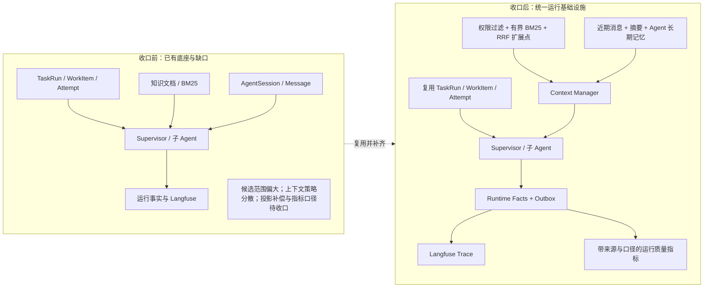
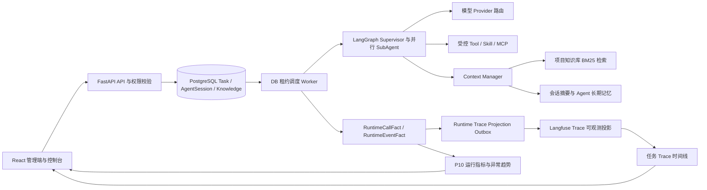
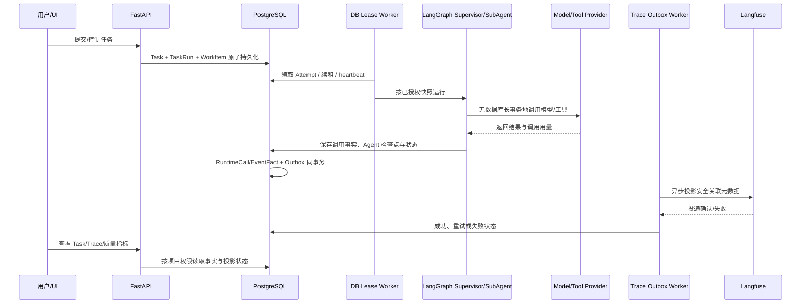
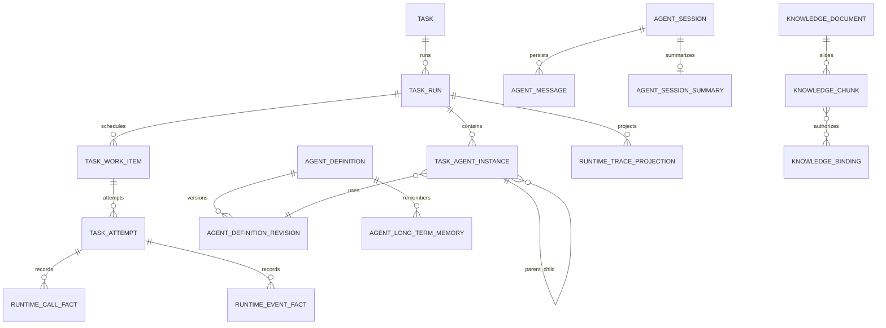

# Super Agent 统一运行底座收口报告

## 执行范围

按仓库当前实现审查 P6/P8/P9/P10，复用既有 FastAPI、PostgreSQL、LangGraph、React/TypeScript/Ant Design 与 Langfuse。保留 Task/TaskRun/TaskWorkItem/TaskAttempt、AgentDefinition/Revision、AgentSession/Message、知识库文档与授权边界；没有新建第二套任务队列、Trace 正文库、Agent 定义库或文档管理系统。

P7 独立评测引擎明确排除：本轮没有固定标准答案集、独立 Evaluation Engine、LLM-as-a-Judge、准确率或自动晋级门禁。已有显式只读评审工具不扩展为评测流水线。

## 新旧架构对比

## 统一架构

| 旧链路缺口 | 收口后的责任边界 |
|---|---|
| 长任务依赖单次请求或进程内状态 | 已有 TaskRun/WorkItem/Attempt 及租约、心跳、恢复继续负责持久化调度；不另建队列 |
| Agent 运行事实与外部 Trace 投递耦合 | PostgreSQL 运行事实为业务侧权威记录，Outbox 负责可重试投影；Langfuse 保留正文 |
| BM25 候选集可能过大 | 先在 PostgreSQL 做权限过滤、候选排序/上限，再在受限候选上评分；向量/Reranker 缺依赖时明确降级 |
| 长会话加载全历史 | Context Manager 使用近期与相关历史、可追溯摘要、Agent 范围记忆和 Token 清单 |
| 成功率、成本和质量容易混淆 | 指标附数据源与口径；未知调用/未知用量/未计价成本单列，不推算准确率 |

## 统一 Agent 运行链路

业务关联按 `Task → TaskRun → WorkItem → Attempt → AgentInstance/AgentSession → RuntimeCallFact/RuntimeEventFact → TraceProjection` 组织；调用事实带 `trace_id/span_id`，工具事件保留 `tool_call_id`，知识事件保留 Chunk 与文档版本来源。Trace ID 对齐 Langfuse，数据库不存储重复的 prompt、模型响应或工具正文。

## P6 异步调度与恢复

- 复用现有 TaskRun、TaskWorkItem、TaskAttempt、TaskSchedulerControl；数据库为队列与租约事实源。
- 复用 `FOR UPDATE SKIP LOCKED`、全局并发闸门、Run/Attempt deadline、heartbeat 和 lease generation fencing。
- 子 Agent 输出在独立短事务按输入指纹写入 TaskAgentInstance.result_json；恢复时匹配指纹则复用成功结果，不匹配则重新运行。
- API 等外部副作用回执未知时进入 `RECONCILIATION_REQUIRED`，不自动重放；失败子任务独立重试，已成功兄弟结果保留。
- **已知边界**：模型已返回但进程在成功检查点提交前崩溃，供应商调用与 PostgreSQL 不可组成分布式原子事务。恢复可能再次发起同一模型调用并产生重复 Token 费用；系统提供 at-least-once 执行、任务侧幂等和指纹检查点，不宣称 LLM exactly-once。

## P9 RAG 与 Context Manager

检索保留既有知识解析、切片、文档版本、知识绑定与项目/Agent 权限。PostgreSQL 先应用授权与关键词过滤、候选上限；现有 BM25 排序只处理受限候选。结果包含来源文档、版本和 Chunk，检索事件记录策略、耗时、候选/命中数、阈值和引用 ID。

服务层支持融合授权候选的 RRF 扩展点、Top-K 和最低相关度阈值。当前部署没有可用的 pgvector 扩展或 Embedding Provider，因此 HTTP 路径明确报告向量与 Reranker 不可用并降级 BM25；本轮没有引入新数据库服务或伪称语义召回已上线。0057 提供可选 `pg_trgm` 索引；若托管 PostgreSQL 不允许扩展，SQL 候选上限与 BM25 降级仍工作。

Context Manager 沿用 AgentSession/Message 原始消息：近期窗口优先，受限召回相关历史，当前问题优先保留；长会话摘要使用抽取式索引，携带源消息 ID、摘要哈希、版本和过期时间，源事实变化时不再使用。长期记忆按 Project + Agent + key + version 隔离，支持来源引用、expected-version 更新和过期。Context manifest 记录来源、权限范围、消息/摘要/记忆版本、估算 Token、预算、截断和遗漏量；子 Agent 只获得本 Agent 任务所需的上下文，不接收完整会话历史。

## P8 Trace 投影

`RuntimeCallFact`、`RuntimeEventFact` 和 `TaskAttempt` 保留业务状态及数值事实；新增 `runtime_trace_projection` 只记录来源键、任务/Trace/span 关联、投递尝试、租约及状态。来源事实与 Outbox 在同一事务写入。Worker 领取使用短事务，网络请求期间不持有数据库长事务；退避、租约恢复、状态查询和具权限的历史重放均复用同一 Outbox。

状态为 `PENDING / RETRYING / SUCCEEDED / FAILED`。Langfuse 不可用只影响投影。远端重复检查使用稳定投影键及已有 span 查询；远端读可延迟，因此不是数学意义的 exactly-once。Trace 时间线展示模型/Tool/Skill/RAG/Context/子 Agent 的时间、状态、错误码、用量与投影状态，敏感输入正文仍留在既有安全数据边界。

部署要求 Langfuse 服务端支持 observations 查询 API。当前环境没有真实 Langfuse 凭据/实例，E2E 使用 `LANGFUSE_ENABLED=false`；真实服务兼容性与投递可见性仍需目标环境验收。SDK 的 observation ID 由 SDK/OpenTelemetry 管理，不能由应用任意指定；`flush()` 返回不能保证读端立即可见。[Langfuse Python SDK v3→v4 迁移指南](https://langfuse.com/docs/observability/sdk/upgrade-path/python-v3-to-v4)、[Python SDK API 参考](https://python.reference.langfuse.com/langfuse)。

## P10 指标、异常与版本治理

沿用 `/api/v1/agent-governance/runtime/overview` 和 Agent Governance 页面，支持项目、最多 90 天时间窗、统计水位和定义版本。包含任务成功/部分完成/失败/取消、平均/P95 执行耗时、子 Agent 失败、重试、模型成功率/延迟/Token/已知成本、Tool/Skill、RAG/Context 调用量，以及用例草稿人工拒绝/修改率。

- 模型成功率分母仅为 SUCCEEDED + FAILED；UNKNOWN 单独展示。
- 模型平均/P50/P95 延迟仅使用 `duration_ms > 0` 的样本，并显示样本数；无有效样本返回 null。
- 成本基于已知价格快照与币种；未知成本不按 Token 推测，多币种不合计。
- Agent Revision 使用量与成本从 RuntimeCallFact 的 revision 引用聚合；恢复旧快照会创建新 Revision，不改写历史。
- 异常趋势比较等长时间窗，要求最低样本数，覆盖任务/Agent/模型/Tool/Skill 失败率、模型延迟、Revision 成本和现有用例人工反馈变化。
- 人工拒绝/编辑率不是准确率；模型调用成功率不是 Agent 输出质量。没有标准答案时不显示准确率或 Judge 分数。

## API 与界面复用

| 能力 | 现有或扩展接口/页面 |
|---|---|
| 异步生成任务 | `POST /api/v1/projects/{id}/case-generation-tasks`、`GET /api/v1/case-generation-batches/{id}/task`、取消/重试接口；沿用 TaskRun |
| 任务 Trace | `GET /api/v1/task-runs/{id}/trace`，`POST /api/v1/task-runs/{id}/trace/replay` |
| RAG | 现有知识管理、Agent 绑定与项目权限接口；知识检索增加受控候选数与运行统计 |
| 长期记忆 | `/api/v1/projects/{project_id}/agents/{agent_id}/memories` 及版本更新/过期接口 |
| 运行指标 | `GET /api/v1/agent-governance/runtime/overview` |
| 界面 | 现有任务详情/Trace、项目知识库、Agent 治理、Agent 运行质量页面；增加投影状态、上下文来源/统计及模型 P50/P95 |

所有新增写入沿用项目访问检查；Trace 读取按 TaskRun 项目权限；Trace replay 需要写权限；Agent Revision 管理沿用平台管理员授权。

## 迁移规划

| Revision | 目的 | 处理 |
|---|---|---|
| 0052 | 知识绑定兼容默认与 Agent 范围访问 | 继续保留历史默认共享行为 |
| 0053–0055 | 模型调用事实、运行事件事实、AgentSession 关联 | 不复制 Trace 正文 |
| 0056 | TaskAgentInstance 子 Agent 成功输出检查点 | 新增可空 JSON，不改变历史任务 |
| 0057 | `pg_trgm` 可选索引 | 扩展不可用时继续走数据库过滤 |
| 0058 | 工作区既有数据生命周期/回收站迁移 | 本次 Super Agent 不改变其业务范围 |
| 0059–0060 | 会话摘要与 Agent 长期记忆 | 现有 Message 保留为源事实 |
| 0061 | Trace 投影 Outbox 与历史事实回填 | 只建关联与投递状态 |
| 0062–0068 | 工作区既有业务配置、测试套件/计划、报告/缺陷、Web UI 页面对象、测试策略、Mock 与测试数据资产/Provider 生命周期迁移 | 本次 Super Agent 不改变其业务范围 |

当前 Alembic head 为 0068，链路为单一线性 head。新环境从 base 升级会应用完整链；0058 与 0062–0068 属于同一工作区的相邻数据生命周期迁移，回退测试应使用隔离数据库并验证数据保留语义。生产升级前需确认这些前置迁移与本发布同批部署。

## 分阶段实施记录

1. Phase 0：核验 `develop` 分支、HEAD、工作区及 P6–P10 代码；区分本轮文件与已有工作区功能。
2. Phase 1：后端基线为 1163 passed；前端旧基线的路由数断言已按新增路由调整。
3. Phase 2：P9 BM25 候选上限、检索统计、来源追溯、摘要索引、长期记忆与隔离；RRF 留扩展入口，向量/Reranker 因无运行时依赖保持降级。
4. Phase 3：P8 Outbox、故障隔离、重试、远端去重检查、历史重放及 UI 状态。
5. Phase 4：P10 修正 UNKNOWN 成功率分母，新增实测模型延迟 P50/P95、样本数和运行页面展示；不扩展 P7。
6. Phase 5：P6 检查点与 fencing 审计；新增模型响应成功但检查点持久化失败的恢复回归，明确重复模型调用边界。
7. Phase 6：全量回归与隔离 Playwright/迁移/性能结果在下方更新。

## 验收结果

Phase 6 实际结果将在最终稳定工作区验收后填写。

### 验收标准

- 后端从隔离库执行完整 pytest；所有用例通过。Alembic 从 base 升级到唯一 head `0068`，并由迁移回归覆盖指定降级/再升级及原始业务数据保留。
- Playwright 使用单独隔离库和本地 LLM stub；覆盖生成任务、并行/取消、Agent 多轮消息刷新恢复、Trace 状态、运行质量、回收站恢复等全量现有用例。
- 前端 Node 单测、ESLint（零 warning）、TypeScript 检查和 Vite production build 全通过。
- RAG 性能回归以 10,000 个 Chunk、候选上限 200 为固定合成基准，必须验证候选数量受限、索引路径可用，查询低于测试上限 2 秒；记录实测延迟，但不将本地数值解释为生产 SLA。
- 在关闭 Langfuse 或注入远端失败时，任务状态不受影响；Trace API 返回 Outbox 整体和单事实状态，敏感正文仍不进入运行事实和 Outbox。

## 剩余边界

- 未配置 Embedding Provider/pgvector/Reranker 的环境当前仅有 BM25；需要产品部署配置后再验 Hybrid Search。
- 未对真实 Langfuse 实例做外部 API/最终可见性验收；目标服务端必须支持 observations 查询。
- 非事务型模型供应商调用存在响应已返回、检查点尚未提交时的重复执行窗口。
- 本地合成数据性能结果不构成生产 SLA；需按实际数据量和硬件做容量验收。
- 本轮不建设固定评测数据集、LLM-as-a-Judge、准确率分数或质量门禁。
