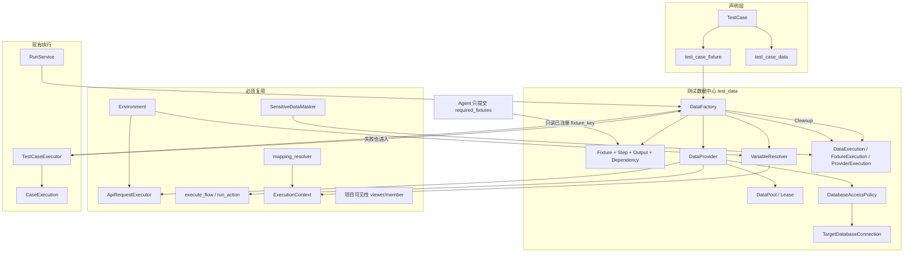

# 测试数据中心 + Data Factory 开发计划

本文基于当前仓库真实源码（截至工作区扫描时），给下一阶段实现用。只描述要做什么、改哪些文件、验收什么。不在本文范围内改代码、建迁移或做页面。

开工前先在功能分支开发，主线是 `develop`。新表走 feature-local 模型 + 显式 Alembic `op.create_table`，**不要**把新模型 import 进 `app/models/__init__.py`。路由运行时装配点是 `backend/app/main.py` 的 `include_router(..., prefix=API_PREFIX)`。`backend/app/bootstrap/routes.py` 目前落后于 `main.py`（缺 api_catalog、test_management、reports），新路由两处都登记。

中文注释、service 层 commit、跨项目不可见统一 404、路径参数用 `{fixture_id}` 这类后缀，沿用现有约定。

---

## 1. 当前能力分析

### 1.1 API Catalog

位置：`backend/app/features/api_catalog/`，前端 `frontend/src/pages/console/ApiCatalog/`，客户端 `frontend/src/api/apiCatalog.ts`。

可直接复用：

- `ApiInterface`（`id` / `project_id` / `method` / `path` / 状态）。`API_CREATE` 只保存 `api_id`，不复制 URL。
- 出站白名单 `project_outbound_target`。HTTP 必须继续走 `ApiRequestExecutor._check_outbound`，不能自己发 httpx。
- JSONPath 提取已经在 `backend/app/features/business/executors/mapping_resolver.py` 的 `_jsonpath_extract`（支持 `$.data.id`、`$.data[0].name`）。输出映射复用它，不要再写一套 JSONPath。

不能复用成造数执行器：Catalog 的 `POST /apis/{api_id}/debug` 仅平台管理员，且和用例运行时上下文无关。Data Factory 不调用 debug 接口。

### 1.2 Business Management

位置：`backend/app/features/business/`。

可直接复用：

- `BusinessFlow`、`BusinessAction.action_key`（流程内唯一）、默认 `BusinessBinding`、`BusinessApiMapping`（INPUT/OUTPUT）。
- `execute_flow(db, flow_id, *, environment_id, variables, actor)`：顺序执行动作、写 `FlowExecution` / `ActionExecution`、把输出放进 `ExecutionContext`。
- 单动作执行逻辑在 `business_flow_executor._execute_action`（私有）：前置条件 → 默认 API 绑定 → `resolve_input_mappings` → `ApiRequestExecutor` → `resolve_output_mappings` → 写回上下文。
- `precondition_evaluator.evaluate_preconditions`。

约束：`execute_flow` 内部会 `db.commit()`。测试用例跑业务流程时今天就是这个行为，Data Factory 调用它时同样会落下 `flow_execution` 行。不要为了造数重写执行循环。

`_execute_action` 不能从 feature 外直接调用。本阶段在 `business_flow_executor.py` 增加一个公开薄封装（见第 9 节），内部仍走现有步骤。

### 1.3 Test Management

位置：`backend/app/features/test_management/`。前端在 `frontend/src/pages/console/TestManagement/`，菜单在 `ConsoleLayout.tsx` 的「测试管理」分组。

已经存在、必须接着用的模型：

| 现有表 | 现状 | 本阶段怎么用 |
|---|---|---|
| `test_case` | 目标类型 API / BUSINESS_FLOW / BUSINESS_ACTION | 不改目标路由。只增加「声明需要哪些 Fixture」 |
| `test_case_data` | `source_type` 已含 STATIC / ENVIRONMENT / VARIABLE / RUNTIME / FAKER / FIXTURE | 字段保留。FAKER 与 FIXTURE 今天被当成字面量，本阶段改为真正解析 |
| `test_case_precondition` | 类型含 FIXTURE，注释写明本阶段不自动执行 | 不把 Fixture 生成塞进前置条件。前置条件仍表示「校验」，不表示「造数」 |
| `test_step` | 有 SETUP / ACTION / ASSERT / CLEANUP | 执行器只读首个 ACTION 的 `config_json`。不要把 Fixture 步骤塞进 `test_step` |
| `test_run` / `case_execution` | Run 逐用例调用执行器并逐条 commit；ERROR 已单独计数 | 在调用执行器前后插入 Setup / Cleanup。准备失败写入 ERROR，不写 FAILED |
| `test_suite` / `test_plan` | 计划收集用例顺序 | Run 级 Fixture 按这个顺序共享，不改收集算法 |

执行器：`backend/app/features/test_management/executors/test_case_executor.py`。

- API 路径复用模块级 `_EXECUTOR = ApiRequestExecutor()`。
- BUSINESS_FLOW 调 `execute_flow`。
- BUSINESS_ACTION 自己加载默认绑定 + `resolve_input_mappings` + `ApiRequestExecutor`（与 `_execute_action` 同思路，但是复制的一段）。
- 快照全部经过 `SensitiveDataMasker`。
- 断言走 `assertion_engine`。
- 变量替换是私有函数 `_resolve_tokens` / `_resolve_token_str`，正则只认 `${data.NAME}` 和 `${env.KEY}`。
- `_load_data_values`：只有 ENVIRONMENT 会读环境；STATIC / VARIABLE / RUNTIME / FAKER / FIXTURE 一律 `_parse_value` 当字面量。这是本阶段要补上的缺口，不是新造一张用例数据表。

编排：`RunService.create_and_execute_run`（`services/run_service.py`）创建 `TestRun(RUNNING)` 后逐用例执行。没有 PREPARE / SETUP / CLEANUP 阶段，没有跨用例共享数据。

前端用例详情 `TestAsset.tsx` 已有「测试数据」Tab 和来源下拉（含 FAKER、FIXTURE），值是自由文本。本阶段改这个表单，不新开一套用例编辑器。

### 1.4 Agent

位置：`backend/app/features/agent/`。

已有：

- `TestCaseDraft.test_data: list[TestCaseDataCreate]`，`source_type` 字面量与测试管理一致。
- `prompts/test_case.md` 要求模型输出 STATIC 一类的字面 `test_data`。
- `nodes/validator.py` 只校验数据项名称非空且用例内唯一。
- `tools/test_asset_tool.py` 经 `CaseService` 落库，`source_type="AI"`。
- 没有 Fixture 注册表，也没有「缺少 Fixture 则只建议、不执行」的分支。
- Agent 不持有 SQL 工具。保持这样。

本阶段只加只读查询和草稿校验，不增加「AI 创建 Fixture」节点，不增加数据库工具。

### 1.5 Executor / Runtime Context / Variable Mapping

| 能力 | 文件 | 复用方式 |
|---|---|---|
| HTTP | `business/executors/api_executor.py` `ApiRequestExecutor` | API_CREATE、Cleanup 的 HTTP、用例执行继续用这一个实例语义。无状态，Data Factory 可再实例化，禁止新写 HTTP 客户端 |
| 业务流程 | `execute_flow` | BUSINESS_FLOW Provider 直接调用 |
| 运行时上下文 | `ExecutionContext` | Fixture 输出写入 `variables`，键名使用稳定前缀，避免和业务变量撞车。同时 `set_action_output` 可存调试副本 |
| INPUT/OUTPUT 映射 | `resolve_input_mappings` / `resolve_output_mappings` | 继续负责「变量名 → Header/Query/Path/Body」和「响应 → 变量」。它不做 `${...}` 模板。模板统一先交给 VariableResolver，再把具体值放进 context |
| 脱敏 | `SensitiveDataMasker` | 一切快照、池数据 API 响应、执行记录 |
| 环境 | `app/models/configuration.py` `Environment` | `base_url`、`gateway_prefix`、`default_headers`、`is_active`。平台级，按 `name` 唯一，不是项目级 |
| 断言 | `assertion_engine` | 用例断言不改口径 |

优先级注释已写在 `ExecutionContext` 模块文档：Runtime variables > 请求变量 > Environment > 接口默认值。VariableResolver 要接上这条顺序，而不是推翻它。

### 1.6 Environment

`Environment` 没有 `environment_type` 列。风险等级只能从 `name` 归类，并用独立策略表覆盖非生产环境。

写环境仍只允许平台管理员（模型文件 docstring 已说明 `base_url` 是危险字段）。Data Factory 不新增改 `base_url` 的入口。

名称归类（大小写不敏感，实现放在策略服务里，集中一处）：

| name | 归类 | 数据库直写 |
|---|---|---|
| `dev` / `development` | DEV | 允许（仍受表白名单、操作白名单约束） |
| `test` / `testing` / `qa` | TEST | 允许 |
| `staging` / `stage` / `pre` / `uat` | STAGING | 默认关闭，仅当该项目+环境的策略 `enabled=true` |
| `prod` / `production` / `prd` | PRODUCTION | 始终禁止。策略行不能打开 |
| 其他 | 按 STAGING | 默认关闭 |

### 1.7 报告与通知

工作区已有（相对已提交历史是新增）：

- `backend/app/features/reports/`：`TestReport` 对一次 `TestRun` 做汇总，不复制用例明细。
- `backend/app/features/notifications/`：渠道、飞书、`Sensitive` 相关加密走 `app/shared/crypto.py`。

复用方式：造数失败变成 `CaseExecution.status=ERROR` 后，现有报告统计里的 `error_cases` 自然计入。不新建报告表，不新建通知渠道。若 `report_service` 在实现时已存在，只在它的 summary JSON 里追加 `data_preparation_errors` 计数（读 `data_execution`）。报告模块不存在时跳过这段，不阻塞造数。

### 1.8 加密与权限

- 目标库密码、连接串用 `app/shared/crypto.py` 的 `encrypt_secret` / `decrypt_secret`（Fernet，与模型 Key、飞书 Webhook 同源）。响应永不返回明文。
- 项目可见性复制 `test_management/services/_access.py`：读 viewer+，不可见 404；写 member+，不足 403。测试数据 feature 自己写 `_access.py`，不 import 其他 feature 的 service。
- 平台库就是本系统的 PostgreSQL。被测系统的库是另一条连接。禁止用 `SessionLocal` / 当前 `db` 去 INSERT/UPDATE 业务表。

### 1.9 迁移基线

已有修订：`0001` → `0007`（`0007_agent_tables.py`）。工作区另有未提交的 `0008_report_notification.py`（`down_revision = "0007"`）。

`backend/tests/test_01_schema_and_seed.py` 与 `test_10_business.py` 仍断言 `head == "0007"`。实现时以 `alembic heads` 为准：有 `0008` 则新修订为 `0009`，`down_revision = "0008"`；没有则 `0008`。下文暂称 **下一修订**。同步所有 `assert head ==`。

`tests/conftest.py` 的 `EXPECTED_TABLES` 只列了基线 9 张表，用 `issubset` 断言。新表不必塞进这个集合，除非有人把它改成相等比较。

---

## 2. 当前缺口

1. 没有 Fixture、Data Provider、Data Factory、执行记录、数据池、目标库连接、数据库策略这些表和 API。
2. `test_case_data.source_type` 的 FAKER / FIXTURE / RUNTIME 只是枚举，执行器当字面量。
3. 用例不能声明「我需要 SUCCESS_TASK」，只能把 `task_id` 写死在 `value` 里。
4. 变量语法分裂：用例步骤认 `${data.*}` / `${env.*}`；业务映射只认 context 里的精确键；没有 `${fixture.*}` / `${faker.*}` / `${runtime.*}`。
5. 没有 Setup/Cleanup 生命周期。`test_step.step_type=CLEANUP` 不会被执行。失败后也不清理。
6. 没有 CASE / RUN / PROJECT / GLOBAL 作用域缓存和引用计数。
7. 没有被测库的结构化写入。全仓库没有安全的 SQL 执行器，只有平台自己的 psycopg 迁移和测试夹具。这是缺口，不是「已有能力可直接放开」。
8. `Environment` 不能表达「生产禁止写库」。
9. Agent 会把示例 ID 写进 `test_data`。没有「只能引用本项目已注册 Fixture」的校验。
10. 用例前置条件类型 FIXTURE 没有运行时语义，执行器甚至不读 `test_case_precondition`。
11. 敏感脱敏覆盖了 HTTP 快照和业务 context，但还没有数据中心的输入/输出快照入口。必须接上同一个 Masker。
12. 前端没有「测试数据」菜单。用例数据表单要求手写值，没有 Fixture 输出选择器。

明确不做成缺口的东西：

- 不重写 HTTP、业务流程执行、环境拼接、脱敏、项目权限、报告表、通知渠道。
- 不把 `test_case_data` 换成新表。它继续表示「用例上的一个变量槽」。
- 不在第一阶段做 WAIT 的真正等待、DAG 画布、AI 自动创建 Fixture、自由 SQL、Agent 直接写库。

---

## 3. 总体架构

新 feature：`backend/app/features/test_data/`。测试管理执行器和 Agent 调用它，它只向下调用执行器与模型，不调用 `CaseService` / `RunService`（避免循环依赖）。



运行时数据流：

```text
TestCase 声明 Fixture（fixture_key，不保存真实 ID）
        │
        ▼
FixtureResolver  展开依赖、检测环、按 scope 查缓存
        │
        ▼
DataFactory      按 FixtureStep.sort 执行
        │
        ├─ FIXTURE          递归生成依赖
        ├─ API              ApiRequestExecutor
        ├─ BUSINESS_ACTION  run_action（现有动作路径）
        ├─ BUSINESS_FLOW    execute_flow
        ├─ FAKER            白名单生成器
        ├─ STATIC           配置字面量
        ├─ DATABASE_INSERT  结构化写入 + 策略
        └─ DATABASE_PATCH   结构化更新 + 策略
        │
        ▼
只把 FixtureOutput 声明的键写入 ExecutionContext
        │
        ▼
TestCaseExecutor 用 VariableResolver 取 ${fixture.SUCCESS_TASK.task_id}
        │
        ▼
断言（现有 assertion_engine）
        │
        ▼
Cleanup（成功、失败、部分失败都走；失败单独记账）
```

Agent 边界：

```text
Agent：我需要 SUCCESS_TASK / FAILED_TASK
Data Factory：SUCCESS_TASK 怎么生成
Agent 不得：选择连接、拼 SQL、调用 DATABASE_*、创建未注册 Fixture 并执行
```

默认取数优先级（Data Factory 在「未指定 provider、仅有实体需求」时使用；FixtureStep 已经写明类型时按步骤执行，不重新排序）：

1. API_CREATE
2. BUSINESS_ACTION / BUSINESS_FLOW
3. EXISTING_POOL
4. DATABASE_INSERT / DATABASE_PATCH
5. STATIC
6. FAKER

产品规则：真实业务数据优先 API 或业务流程；特殊状态优先 API 造出基础数据再 DATABASE_PATCH；批量才允许 DATABASE_INSERT；随机字段用 FAKER；固定账号用 STATIC 或 EXISTING_POOL。数据库直写不是默认第一步。Provider 编辑页用这段文案，不靠执行器偷偷改用户写好的步骤顺序。

---

## 4. 数据库设计

全部 feature-local，继承 `app.shared.database.Base`（经 `app.models.base` 再导出也可，与现有 feature 一致，现有代码直接 `from app.shared.database import Base`）。状态列用 `String`，不建数据库 ENUM，合法值在 schema 校验。时间列 `DateTime` + `server_default=func.now()`，与现有表一致。

下一份迁移文件：`backend/alembic/versions/0009_test_data_center.py`（若开工时 head 仍是 0007 且没有 0008，则文件名用 `0008_test_data_center.py`）。`upgrade` 只 `op.create_table` / `op.add_column`，`downgrade` 对称删除。

### 4.1 `fixture`

测试需要的业务状态配方，不是静态 JSON 结果。

| 列 | 类型 | 约束 |
|---|---|---|
| id | Integer PK | |
| project_id | Integer FK `project.id` ON DELETE CASCADE | NOT NULL，index |
| name | String(200) | NOT NULL |
| fixture_key | String(100) | NOT NULL，`^[A-Z][A-Z0-9_]{0,99}$` |
| entity_type | String(50) | NOT NULL，如 USER / PROJECT / TASK |
| description | String(1000) | NULL |
| scope | String(20) | NOT NULL，CASE / RUN / PROJECT / GLOBAL，默认 CASE |
| status | String(20) | NOT NULL，DRAFT / ACTIVE / DISABLED，默认 DRAFT |
| cache_enabled | Boolean | NOT NULL，默认 true |
| cleanup_policy | String(20) | NOT NULL，AFTER_CASE / AFTER_RUN / MANUAL / NEVER，默认 AFTER_CASE |
| created_by | Integer FK `user.id` ON DELETE SET NULL | NULL |
| created_at / updated_at | DateTime | NOT NULL |

- Unique：`uq_fixture_project_key (project_id, fixture_key)`
- Index：`ix_fixture_project_status (project_id, status)`，`ix_fixture_project_entity (project_id, entity_type)`
- 部分唯一索引：`uq_fixture_global_key` ON `(fixture_key)` WHERE `scope = 'GLOBAL'`，避免两个项目发布同一个全局键

GLOBAL 仍然有所属 `project_id`（拥有者）。其他项目只能按 key 读取已 ACTIVE 的定义来执行，不能改。执行记录的 `project_id` 永远是**消费方**项目。

### 4.2 `fixture_dependency`

显式依赖。步骤类型为 FIXTURE 时，保存步骤要同步写入一行，删除步骤时删掉对应行。环检测把这张表和步骤里的 FIXTURE 引用合成一张图。

| 列 | 类型 | 约束 |
|---|---|---|
| id | Integer PK | |
| fixture_id | Integer FK `fixture.id` ON DELETE CASCADE | NOT NULL，index |
| depends_on_fixture_id | Integer FK `fixture.id` ON DELETE CASCADE | NOT NULL，index |
| sort | Integer | NOT NULL，默认 0 |

- Unique：`uq_fixture_dependency (fixture_id, depends_on_fixture_id)`
- Check（应用层）：`fixture_id != depends_on_fixture_id`
- 两条 FK 都必须属于同一 `project_id`，或被依赖方 `scope=GLOBAL` 且 ACTIVE。跨项目私有 Fixture 拒绝，返回 404（隐藏存在性）

### 4.3 `fixture_step`

| 列 | 类型 | 约束 |
|---|---|---|
| id | Integer PK | |
| fixture_id | Integer FK `fixture.id` ON DELETE CASCADE | NOT NULL，index |
| phase | String(20) | NOT NULL，GENERATE / CLEANUP，默认 GENERATE |
| step_type | String(30) | NOT NULL |
| name | String(200) | NOT NULL |
| sort | Integer | NOT NULL，默认 0 |
| provider_id | Integer FK `data_provider.id` ON DELETE SET NULL | NULL |
| config_json | JSON | NULL |
| on_failure | String(20) | NOT NULL，ABORT / CONTINUE，默认 ABORT。CLEANUP 阶段默认 CONTINUE |

`step_type`：`FIXTURE` / `API` / `BUSINESS_ACTION` / `BUSINESS_FLOW` / `FAKER` / `STATIC` / `DATABASE_INSERT` / `DATABASE_PATCH`。预留保存但不执行：`WAIT` / `DATABASE_QUERY` / `EXTERNAL_PROVIDER`。执行到预留类型时本步失败，错误码 `FIXTURE_STEP_UNSUPPORTED`，不静默跳过。

- Index：`ix_fixture_step_fixture_phase_sort (fixture_id, phase, sort)`

`config_json` 按类型约定（服务层 Pydantic 校验，不信任任意 JSON）：

- FIXTURE：`{"fixture_key": "NORMAL_USER"}`
- API：`{"provider_id": 1}` 或内联映射，见第 9 节。优先引用 Provider，避免两套配置
- BUSINESS_ACTION：`{"business_action_id": 1}` 或 `{"flow_id": 1, "action_key": "RUN_TASK"}`
- BUSINESS_FLOW：`{"business_flow_id": 1, "input_mappings": {...}}`
- FAKER：`{"generator": "phone", "locale": "zh_CN", "output_key": "phone"}`
- STATIC：`{"values": {"username": "demo"}}`
- DATABASE_INSERT / DATABASE_PATCH：结构化操作，见第 10 节，必须带 `connection_id`
- WAIT：`{"seconds": 1}` 只保存

### 4.4 `fixture_output`

Fixture 的稳定契约。用例只能引用这里声明的名字。

| 列 | 类型 | 约束 |
|---|---|---|
| id | Integer PK | |
| fixture_id | Integer FK `fixture.id` ON DELETE CASCADE | NOT NULL，index |
| name | String(100) | NOT NULL |
| value_type | String(20) | NOT NULL，STRING / INTEGER / NUMBER / BOOLEAN / OBJECT / ARRAY，默认 STRING |
| source_path | String(200) | NOT NULL。从本 Fixture 私有上下文取，如 `task_id` 或 `$.data.id` |
| description | String(500) | NULL |
| sort | Integer | NOT NULL，默认 0 |

- Unique：`uq_fixture_output_name (fixture_id, name)`

生成结束后，只有这些键进入 `ExecutionContext`，命名空间 `fixture.<fixture_key>.<name>`。步骤中间变量留在 Fixture 私有 dict，不暴露给用例。

### 4.5 `data_provider`

| 列 | 类型 | 约束 |
|---|---|---|
| id | Integer PK | |
| project_id | Integer FK `project.id` ON DELETE CASCADE | NOT NULL，index |
| name | String(200) | NOT NULL |
| provider_type | String(30) | NOT NULL |
| config_json | JSON | NOT NULL，默认 `{}` |
| enabled | Boolean | NOT NULL，默认 true |
| risk_level | String(20) | NOT NULL，LOW / MEDIUM / HIGH / CRITICAL |
| description | String(1000) | NULL |
| created_by | Integer FK `user.id` ON DELETE SET NULL | NULL |
| created_at / updated_at | DateTime | NOT NULL |

- Unique：`uq_data_provider_project_name (project_id, name)`
- Index：`ix_data_provider_project_type (project_id, provider_type, enabled)`

`provider_type`：`STATIC` / `ENVIRONMENT` / `FAKER` / `API_CREATE` / `BUSINESS_ACTION` / `BUSINESS_FLOW` / `EXISTING_POOL` / `DATABASE_INSERT` / `DATABASE_PATCH`。

建议默认风险（创建时若未传则服务端写入，允许调高不允许把 DATABASE_* 调成 LOW）：

| 类型 | risk_level |
|---|---|
| STATIC / ENVIRONMENT / FAKER / EXISTING_POOL | LOW |
| API_CREATE / BUSINESS_ACTION / BUSINESS_FLOW | MEDIUM |
| DATABASE_INSERT / DATABASE_PATCH | HIGH |
| 配置里显式包含 DELETE | CRITICAL，且默认 `enabled=false` |

`config_json` 里的密码字段禁止出现。连接只存 `connection_id`。

### 4.6 `test_data_asset`

「测试数据」页的目录项：静态样本、池的逻辑分组、或由 Fixture 登记的可检索数据。它不是 Fixture 配方。

| 列 | 类型 | 约束 |
|---|---|---|
| id | Integer PK | |
| project_id | Integer FK `project.id` ON DELETE CASCADE | NOT NULL，index |
| name | String(200) | NOT NULL |
| entity_type | String(50) | NOT NULL |
| source | String(30) | NOT NULL，STATIC / POOL / FIXTURE |
| scope | String(20) | NOT NULL，同 Fixture scope |
| status | String(20) | NOT NULL，ACTIVE / DISABLED / EXPIRED |
| fixture_id | Integer FK `fixture.id` ON DELETE SET NULL | NULL |
| value_json | JSON | NULL。STATIC 的值；敏感键入库前可以是明文（项目内配置），**读 API 必须脱敏** |
| description | String(500) | NULL |
| created_by / created_at / updated_at | 同其他表 | |

- Unique：`uq_test_data_asset_project_name (project_id, name)`
- Index：`ix_test_data_asset_project_entity (project_id, entity_type, status)`

被引用次数不落库。列表接口用 COUNT：`test_case_data.config_json.asset_id`、`data_pool.asset_id`、`fixture_step` 引用。第一阶段可以只统计 pool + fixture_id 关联，避免扫全部 JSON。

### 4.7 `data_pool` / `data_pool_item` / `data_pool_lease`

`data_pool`：

| 列 | 类型 | 约束 |
|---|---|---|
| id | Integer PK | |
| project_id | FK project CASCADE | NOT NULL，index |
| asset_id | FK test_data_asset SET NULL | NULL |
| pool_key | String(100) | NOT NULL |
| name | String(200) | NOT NULL |
| scope | String(20) | NOT NULL，默认 PROJECT |
| max_concurrency | Integer | NOT NULL，默认 1。共享只读数据可大于 1 |
| lease_ttl_seconds | Integer | NOT NULL，默认 1800 |
| status | String(20) | ACTIVE / DISABLED |
| created_at / updated_at | DateTime | |

- Unique：`uq_data_pool_project_key (project_id, pool_key)`

`data_pool_item`：

| 列 | 类型 | 约束 |
|---|---|---|
| id | Integer PK | |
| pool_id | FK data_pool CASCADE | NOT NULL，index |
| status | String(20) | AVAILABLE / OCCUPIED / EXPIRED / DISABLED |
| payload_json | JSON | NOT NULL |
| occupied_count | Integer | NOT NULL，默认 0 |
| expires_at | DateTime | NULL |
| created_at / updated_at | DateTime | |

- Index：`ix_data_pool_item_available (pool_id, status)`

`data_pool_lease`：

| 列 | 类型 | 约束 |
|---|---|---|
| id | Integer PK | |
| item_id | FK data_pool_item CASCADE | NOT NULL，index |
| project_id | FK project CASCADE | NOT NULL |
| test_run_id | FK test_run SET NULL | NULL |
| case_execution_id | FK case_execution SET NULL | NULL |
| status | String(20) | ACTIVE / RELEASED / EXPIRED |
| leased_at / released_at / expires_at | DateTime | |

占用算法：`SELECT ... FROM data_pool_item WHERE pool_id=? AND status='AVAILABLE' AND occupied_count < max FOR UPDATE SKIP LOCKED`。租约到期由领取时懒更新为 EXPIRED，第一阶段不加定时任务。释放在 Cleanup 里做。并发用例不能拿到 `max_concurrency=1` 的同一条。

### 4.8 `target_database_connection`

被测库连接。不是平台库。

| 列 | 类型 | 约束 |
|---|---|---|
| id | Integer PK | |
| project_id | FK project CASCADE | NOT NULL，index |
| environment_id | FK environment RESTRICT | NOT NULL，index |
| name | String(200) | NOT NULL |
| host | String(255) | NOT NULL |
| port | Integer | NOT NULL，默认 5432 |
| database_name | String(128) | NOT NULL |
| username | String(128) | NOT NULL |
| password_encrypted | Text | NOT NULL |
| schema_name | String(128) | NULL |
| enabled | Boolean | NOT NULL，默认 true |
| created_by / created_at / updated_at | | |

- Unique：`uq_target_db_conn (project_id, environment_id, name)`
- `password_encrypted` 只存 `encrypt_secret` 结果。Schema 响应用 `password_set: true`，没有 password 字段

第一阶段方言只支持 PostgreSQL（psycopg，参数化）。其他数据库类型直接 400，不做通用 SQL 抽象。

### 4.9 `database_access_policy`

| 列 | 类型 | 约束 |
|---|---|---|
| id | Integer PK | |
| project_id | FK project CASCADE | NOT NULL |
| environment_id | FK environment RESTRICT | NOT NULL |
| enabled | Boolean | NOT NULL，默认 false |
| allowed_tables | JSON | NOT NULL，字符串数组 |
| allowed_operations | JSON | NOT NULL，默认 `["INSERT","UPDATE","SELECT"]` |
| created_by / created_at / updated_at | | |

- Unique：`uq_db_policy_project_env (project_id, environment_id)`

PRODUCTION 归类的环境：`enabled` 强制 false，服务层拒绝写成 true。DELETE 不在默认数组里。

策略的写权限：平台管理员。项目成员可读本项目策略，不能改环境开关。这是因为 `Environment` 本身是平台级危险配置。

### 4.10 执行记录

`data_execution`：一次用例（或一次 Run 级准备、或一次手工试跑）的造数总记录。

| 列 | 类型 | 约束 |
|---|---|---|
| id | Integer PK | |
| project_id | FK project CASCADE | NOT NULL，index |
| test_run_id | FK test_run SET NULL | NULL，index |
| case_execution_id | FK case_execution SET NULL | NULL，index |
| environment_id | FK environment SET NULL | NULL |
| status | String(20) | NOT NULL，见第 16 节 |
| scope | String(20) | NULL |
| started_at / finished_at | DateTime | |
| duration_ms | Integer | NULL |
| error_code | String(50) | NULL |
| error_message | Text | NULL |
| cleanup_status | String(20) | NULL，PENDING / SUCCESS / FAILED / SKIPPED |
| cleanup_error_code | String(50) | NULL |
| cleanup_error_message | Text | NULL |
| created_at | DateTime | NOT NULL |

Index：`ix_data_execution_project_created (project_id, created_at)`。

`fixture_execution`：

| 列 | 类型 | 约束 |
|---|---|---|
| id | Integer PK | |
| data_execution_id | FK data_execution CASCADE | NOT NULL，index |
| project_id | FK project CASCADE | NOT NULL |
| fixture_id | FK fixture SET NULL | NULL，index |
| fixture_key | String(100) | NOT NULL。删除 Fixture 后记录仍可读 |
| status | String(20) | NOT NULL |
| scope | String(20) | NOT NULL |
| cache_hit | Boolean | NOT NULL，默认 false |
| input_snapshot | JSON | NULL，脱敏后 |
| output_snapshot | JSON | NULL，脱敏后 |
| started_at / finished_at / duration_ms | | |
| error_code / error_message | | |
| cleanup_status / cleanup_error_code / cleanup_error_message | | |

`provider_execution`：

| 列 | 类型 | 约束 |
|---|---|---|
| id | Integer PK | |
| fixture_execution_id | FK fixture_execution CASCADE | NULL，index。手工测试 Provider 时可空 |
| data_execution_id | FK data_execution CASCADE | NULL，index |
| project_id | FK project CASCADE | NOT NULL |
| provider_id | FK data_provider SET NULL | NULL，index |
| provider_type | String(30) | NOT NULL |
| step_id | Integer | NULL。不建 FK，步骤删除后记录保留 |
| status | String(20) | NOT NULL |
| input_snapshot / output_snapshot | JSON | 脱敏后 |
| started_at / finished_at / duration_ms | | |
| error_code / error_message | | |
| cleanup_status | String(20) | NULL |

快照写入前调用 `SensitiveDataMasker.mask_body`。禁止把 `password_encrypted`、解密后的口令、Authorization 写入 snapshot。

### 4.11 `fixture_cache`

| 列 | 类型 | 约束 |
|---|---|---|
| id | Integer PK | |
| project_id | FK project CASCADE | NOT NULL |
| fixture_id | FK fixture CASCADE | NOT NULL，index |
| scope | String(20) | NOT NULL |
| scope_key | String(64) | NOT NULL。CASE=`case_execution:{id}`，RUN=`test_run:{id}`，PROJECT=`project:{id}`，GLOBAL=`global` |
| status | String(20) | READY / DIRTY / EXPIRED |
| output_json | JSON | NOT NULL，脱敏后的契约输出 |
| ref_count | Integer | NOT NULL，默认 0 |
| data_execution_id | FK data_execution SET NULL | NULL |
| expires_at | DateTime | NULL |
| created_at / updated_at | DateTime | |

- Unique：`uq_fixture_cache_scope (project_id, fixture_id, scope, scope_key)`

### 4.12 `test_case_fixture`

用例声明需要的 Fixture。不存运行时 ID。

| 列 | 类型 | 约束 |
|---|---|---|
| id | Integer PK | |
| test_case_id | FK test_case CASCADE | NOT NULL，index |
| fixture_id | FK fixture RESTRICT | NOT NULL，index |
| sort | Integer | NOT NULL，默认 0 |
| created_at | DateTime | NOT NULL |

- Unique：`uq_test_case_fixture (test_case_id, fixture_id)`
- 两边 `project_id` 必须相同；允许引用 GLOBAL Fixture

### 4.13 对现有表的增量

`case_execution` 增加可空列（同一迁移）：

- `cleanup_status` String(20)
- `cleanup_error_code` String(50)
- `cleanup_error_message` Text

不改 `status` 的既有取值。Cleanup 失败不覆盖 `error_code` / `error_message`。

`test_case_data` 不改列。约定：

- `source_type=FIXTURE` 时 `config_json = {"fixture_key","output","variable"}`，`value` 由服务端写成 `${fixture.SUCCESS_TASK.task_id}`，客户端可以不传 value。
- `source_type=FAKER` 时 `config_json = {"generator","locale"}`，`value` 写成 `${faker.phone}`。

### 4.14 与现有表的关系

```text
project 1 ── * fixture / data_provider / test_data_asset / data_pool / target_database_connection / database_access_policy / data_execution
environment 1 ── * target_database_connection / database_access_policy / data_execution
test_case 1 ── * test_case_fixture *── 1 fixture
test_case 1 ── * test_case_data          （已有，config 引用 fixture_key）
test_run 1 ── * data_execution
case_execution 1 ── * data_execution
fixture 1 ── * fixture_step / fixture_output / fixture_dependency / fixture_execution
data_provider 1 ── * provider_execution
api_interface / business_flow / business_action   只被 config_json 或 provider 配置引用 ID，不建跨 feature 的强制 FK 也可以。
建议：API/BUSINESS 的 ID 建 FK（ON DELETE RESTRICT），避免删接口后 Fixture 静默悬空。
实现时若 Alembic 跨表 FK 与现有风格一致就建；删除被引用接口时返回 409，文案说明仍被 Fixture 使用。
```

---

## 5. 后端目录规划

新目录 `backend/app/features/test_data/`：

```text
test_data/
  __init__.py                          模块说明（中文）
  router.py                            HTTP，不 commit
  schemas.py                           Pydantic v2，snake_case
  models/
    __init__.py                        仅本 feature 内导出，不进 app/models/__init__.py
    fixture.py                         Fixture / FixtureDependency / FixtureStep / FixtureOutput
    provider.py                        DataProvider
    asset.py                           TestDataAsset
    pool.py                            DataPool / DataPoolItem / DataPoolLease
    connection.py                      TargetDatabaseConnection
    policy.py                          DatabaseAccessPolicy
    execution.py                       DataExecution / FixtureExecution / ProviderExecution / FixtureCache
    case_fixture.py                    TestCaseFixture
  services/
    __init__.py
    _access.py                         get_project_or_404 / require_writable_project
    fixture_service.py                 CRUD、依赖、步骤、输出、环检测、引用关系
    provider_service.py                CRUD、启停、按 type 校验 config
    asset_service.py                   测试数据目录 CRUD
    pool_service.py                    池与条目 CRUD；领取/释放给 runtime 调用
    connection_service.py              连接 CRUD，密码加密
    policy_service.py                  策略 CRUD，生产环境硬拒绝
    execution_query_service.py         执行记录只读查询
  runtime/
    __init__.py
    variable_resolver.py               唯一模板解析器
    fixture_resolver.py                依赖展开、环、缓存键
    data_factory.py                    编排 Generate / Inject
    cleanup_runner.py                  Cleanup
    lifecycle.py                       给 RunService 调用的 prepare/setup/cleanup 门面
    errors.py                          数据域错误码常量
  providers/
    __init__.py                        注册表 type → 类
    base.py                            DataProviderRunner 协议
    static_provider.py
    environment_provider.py
    faker_provider.py
    api_create_provider.py
    business_action_provider.py
    business_flow_provider.py
    pool_provider.py
    database_provider.py               INSERT 与 PATCH 共用，靠 operation 区分
  security/
    __init__.py
    db_guard.py                        环境归类、表白名单、操作白名单、标识符校验
    sql_builder.py                     只用 psycopg.sql.Identifier / Placeholder
```

现有文件要改（实现时才改）：

| 文件 | 改动 |
|---|---|
| `backend/app/main.py` | include test_data router |
| `backend/app/bootstrap/routes.py` | 同步登记 |
| `backend/app/shared/errors.py` | 增加第 16 节错误码常量。执行记录里用无前缀码；HTTP 信封通过 `AppError(code=...)` 带上同一码 |
| `backend/app/features/business/executors/business_flow_executor.py` | 抽出公开 `run_action(...)`，`_execute_action` 改为调用它。`execute_flow` 行为不变 |
| `backend/app/features/test_management/executors/test_case_executor.py` | `_resolve_tokens` 改为委托 VariableResolver；`_load_data_values` 解析 FAKER/FIXTURE/RUNTIME |
| `backend/app/features/test_management/services/run_service.py` | 插入生命周期门面 |
| `backend/app/features/test_management/services/case_service.py` | 聚合详情带上 fixtures；保存 test_case_fixture |
| `backend/app/features/test_management/schemas.py` | 详情增加 fixtures；数据项 config 说明 |
| `backend/app/features/test_management/router.py` | 用例 Fixture 关联的四个端点可以放这里（资源属于用例），实现委托 `test_data` 的 fixture 关联函数。用函数内 lazy import |
| `backend/app/features/agent/schemas.py` | `TestCaseDraft.required_fixtures: list[str]` |
| `backend/app/features/agent/prompts/test_case.md` | 指示引用已有 fixture_key，禁止写死 ID |
| `backend/app/features/agent/nodes/validator.py` | fixture_key 必须已存在且 ACTIVE |
| `backend/app/features/agent/tools/test_asset_tool.py` | 落库 test_case_fixture；缺 Fixture 时不保存该用例并返回建议 |
| `backend/app/features/agent/tools/` 新文件 `fixture_tool.py` | 只读列出项目 Fixture |
| `backend/app/features/reports/services/report_service.py` | 仅当该文件已在分支上：summary 增加 data_preparation_errors |
| `backend/requirements.txt` | 增加 `Faker`（锁定与现有风格一致的范围，例如 `Faker>=24,<38`）。只从白名单调用 |

不新增：

- `app/features/test_data/executors/http_executor.py`
- 任何 `eval` / `exec` / 用户 Python
- Agent 的 SQL tool
- 把新模型写入 `app/models/__init__.py`

---

## 6. 后端 API 计划

前缀 `/api/v1`。读：项目 viewer+。写：项目 member+。不可见项目 404。连接与策略的例外写在表里。

### 6.1 Fixture

| Method | Path | 作用 | 权限 |
|---|---|---|---|
| GET | `/projects/{project_id}/fixtures` | 列表。查询参数 `keyword` `entity_type` `status` `scope` `page` `page_size` | viewer |
| POST | `/projects/{project_id}/fixtures` | 创建。含 steps、outputs、dependencies 的整体创建 | member |
| GET | `/fixtures/{fixture_id}` | 详情：基本信息、依赖、步骤、输出、cleanup 步骤、引用它的用例 id 列表 | viewer |
| PATCH | `/fixtures/{fixture_id}` | 更新基本信息 | member |
| DELETE | `/fixtures/{fixture_id}` | 删除。仍被 `test_case_fixture` 引用时 409 | member |
| PUT | `/fixtures/{fixture_id}/steps` | 整体替换 GENERATE+CLEANUP 步骤，并重建依赖边、跑环检测 | member |
| PUT | `/fixtures/{fixture_id}/outputs` | 整体替换输出契约 | member |
| GET | `/fixtures/{fixture_id}/dependencies` | 依赖树（含子依赖），供前端树展示 | viewer |
| POST | `/fixtures/{fixture_id}/generate` | 手工试跑。body：`environment_id`。写执行记录，不挂 TestRun | member |
| POST | `/fixtures/{fixture_id}/cleanup` | 按最近一次试跑输出做 MANUAL cleanup | member |

环：保存步骤或依赖时若检测到环，400，`code=FIXTURE_DEPENDENCY_CYCLE`，message 带出环上的 key 序列 `A → B → C → A`。不写入。

### 6.2 测试数据目录

| Method | Path | 作用 | 权限 |
|---|---|---|---|
| GET | `/projects/{project_id}/test-data-assets` | 列表。筛选 entity_type、source、scope、status、keyword | viewer |
| POST | `/projects/{project_id}/test-data-assets` | 新增 | member |
| GET | `/test-data-assets/{asset_id}` | 详情。value 脱敏 | viewer |
| PATCH | `/test-data-assets/{asset_id}` | 编辑 | member |
| DELETE | `/test-data-assets/{asset_id}` | 删除。被池引用时 409 | member |

### 6.3 Data Provider（数据工厂）

| Method | Path | 作用 | 权限 |
|---|---|---|---|
| GET | `/projects/{project_id}/data-providers` | 列表：名称、类型、enabled、risk_level、使用次数、最近一次 provider_execution.status | viewer |
| POST | `/projects/{project_id}/data-providers` | 新增。按 type 校验 config | member；DATABASE_* 仅平台管理员 |
| GET | `/data-providers/{provider_id}` | 详情 | viewer |
| PATCH | `/data-providers/{provider_id}` | 编辑 | 同创建 |
| POST | `/data-providers/{provider_id}/enable` | 启用 | 同创建 |
| POST | `/data-providers/{provider_id}/disable` | 禁用 | member |
| DELETE | `/data-providers/{provider_id}` | 删除。被步骤引用时 409 | 同创建 |
| POST | `/data-providers/{provider_id}/test` | 试跑。body：`environment_id`，可选 `variables`。走完整安全策略 | 同创建 |

### 6.4 池

| Method | Path | 作用 | 权限 |
|---|---|---|---|
| GET | `/projects/{project_id}/data-pools` | 列表 | viewer |
| POST | `/projects/{project_id}/data-pools` | 创建池 | member |
| PATCH | `/data-pools/{pool_id}` | 改 max_concurrency、ttl、状态 | member |
| DELETE | `/data-pools/{pool_id}` | 删除。存在 ACTIVE 租约时 409 | member |
| GET | `/data-pools/{pool_id}/items` | 条目。payload 脱敏 | viewer |
| POST | `/data-pools/{pool_id}/items` | 新增条目 | member |
| PATCH | `/data-pool-items/{item_id}` | 改状态、payload | member |
| POST | `/data-pool-items/{item_id}/release` | 手工释放租约 | member |
| DELETE | `/data-pool-items/{item_id}` | 删除。OCCUPIED 时 409 | member |

领取和释放的运行时函数不单独暴露成「任意用户抢占」的公开 API。只有执行引擎和上面的手工 release 能改占用。

### 6.5 目标库与策略

| Method | Path | 作用 | 权限 |
|---|---|---|---|
| GET | `/projects/{project_id}/target-databases` | 列表，无密码 | viewer |
| POST | `/projects/{project_id}/target-databases` | 创建。body 含 password，只此一次明文 | 平台管理员 |
| PATCH | `/target-databases/{connection_id}` | 更新。password 缺省表示不改 | 平台管理员 |
| DELETE | `/target-databases/{connection_id}` | 删除。被 Provider 引用时 409 | 平台管理员 |
| POST | `/target-databases/{connection_id}/ping` | 连通性检查，只 `SELECT 1`，不读业务表 | 平台管理员 |
| GET | `/projects/{project_id}/database-policies` | 本项目各环境策略，附带服务端计算的 environment_class | viewer |
| PUT | `/projects/{project_id}/database-policies/{environment_id}` | 设置 enabled、allowed_tables、allowed_operations | 平台管理员 |

PRODUCTION 上 PUT `enabled=true` → 400 `DATABASE_ENVIRONMENT_FORBIDDEN`。

### 6.6 执行记录

| Method | Path | 作用 | 权限 |
|---|---|---|---|
| GET | `/projects/{project_id}/data-executions` | 列表。筛选 status、test_run_id、fixture_key、时间 | viewer |
| GET | `/data-executions/{data_execution_id}` | 详情：依赖链、每步 provider_execution 的 input/output/error、cleanup | viewer |
| GET | `/test-runs/{run_id}/data-executions` | 某次 TestRun 的造数记录 | viewer |
| GET | `/case-executions/{case_execution_id}/data-executions` | 某次用例执行的造数记录 | viewer |

### 6.7 用例集成

放在现有 test_management router，避免前端猜两个前缀。

| Method | Path | 作用 | 权限 |
|---|---|---|---|
| GET | `/test-cases/{case_id}/fixtures` | 用例声明的 Fixture 列表（key、输出名） | viewer |
| PUT | `/test-cases/{case_id}/fixtures` | 整体替换。body：`[{fixture_id, sort}]`。校验同项目或 GLOBAL，且 ACTIVE | member |

用例数据项仍走已有：

- `POST /test-cases/{case_id}/data`
- `PATCH /test-case-data/{data_id}`

服务端在 `source_type=FIXTURE` 时校验 `config_json.fixture_key` 属于该用例已声明的 Fixture，且 `output` 在 `fixture_output.name` 中，然后写入 `value=${fixture.<key>.<output>}`。用户不必手写表达式。

### 6.8 Agent 只读

不新增公开「执行造数」给 Agent 的路由。Agent 进程内调用：

`fixture_tool.list_active_fixtures(db, project_id) -> list[{fixture_key, entity_type, outputs}]`

若以后要给调试用，可以复用 `GET /projects/{project_id}/fixtures?status=ACTIVE`，不必再做一套。

---

## 7. 前端页面结构

路由：`/console/test-data`。组件名 `ConsoleTestDataPage`。

改动文件：

- `frontend/src/App.tsx`：在 console 路由组增加 `test-data`
- `frontend/src/layouts/ConsoleLayout.tsx`：`MENU_ITEMS` 测试管理 children 增加「测试数据」，key 必须等于 `/console/test-data`；`ROUTE_TITLES` 同步
- `frontend/src/api/testData.ts`：新建客户端，`api.get('/projects/...')`，不要写 `/api/v1` 前缀
- `frontend/src/types/index.ts`：新增接口类型，字段中文注释
- `frontend/src/hooks/useConsoleScope.tsx`：组织切换和项目切换都 `invalidateQueries({ queryKey: ['test-data'] })`
- `frontend/src/pages/console/TestManagement/TestAsset.tsx`：用例详情增加 Fixtures Tab；DataTab 按来源切换控件
- `frontend/src/pages/console/TestManagement/constants.ts`：Fixture / Provider 选项

QueryKey 一律以 `test-data` 开头，并带上 `currentProjectId`：

- `['test-data', 'assets', projectId, query]`
- `['test-data', 'fixtures', projectId]`
- `['test-data', 'fixture', fixtureId]`
- `['test-data', 'providers', projectId]`
- `['test-data', 'executions', projectId, query]`

页面目录：

```text
frontend/src/pages/console/TestData/
  index.tsx                      ConsoleTestDataPage：项目/环境条 + Tabs
  constants.ts
  TestDataTab.tsx                测试数据表
  TestDataModal.tsx              新增/编辑
  FixtureTab.tsx                 左树 + 右详情
  FixtureTree.tsx
  FixtureDetail.tsx              内嵌 Tabs
  FixtureBasicForm.tsx
  FixtureDependencyTree.tsx
  FixtureStepList.tsx            步骤列表，上移下移改 sort。不做 DAG 画布
  FixtureOutputTable.tsx
  FixtureCleanupList.tsx
  FixtureReferenceList.tsx
  ProviderTab.tsx
  ProviderModal.tsx              按 provider_type 切换表单
  ProviderConfigApi.tsx
  ProviderConfigBusiness.tsx
  ProviderConfigFaker.tsx
  ProviderConfigStatic.tsx
  ProviderConfigDatabase.tsx
  ProviderConfigPool.tsx
  ExecutionTab.tsx
  ExecutionDetailDrawer.tsx
```

### 7.1 页壳 `index.tsx`

顶部：当前项目（沿用 `useConsoleScope`，不单独做项目切换器）、环境 `Select`（复用 `environmentsApi`，供试跑）。环境只影响「试跑 / 生成」按钮，不作为列表过滤的强制条件。列表仍按项目隔离。

Tabs：`测试数据` | `Fixture` | `数据工厂` | `执行记录`。

未选项目时用现有空状态组件，不发请求。

### 7.2 测试数据 Tab

`ResourceTable` 列：名称、实体类型、来源、Scope、状态、更新时间、被引用次数。

工具栏：搜索框、来源筛选、Scope 筛选、状态下拉、新增按钮。

`TestDataModal`：name、entity_type、source、scope、status、description、value（JSON 文本）。保存后列表前缀失效 `['test-data','assets']`。展示值若 Masker 已替换成 `******`，编辑时用「留空表示不修改该敏感键」，避免把掩码写回去。

### 7.3 Fixture Tab

左树按 `entity_type` 分组，节点标题是 `name`，副标题 `fixture_key`。数据来自列表接口，前端分组，不要求后端返回树。循环依赖在保存时被拒绝，所以正常树可以递归展开 `GET /fixtures/{id}/dependencies`。

右详情 Tabs：

- 基本信息：`FixtureBasicForm`（name、fixture_key、entity_type、description、scope、status、cache_enabled、cleanup_policy）
- 依赖：`FixtureDependencyTree`
- 生成流程：`FixtureStepList`。每行：sort、step_type、名称、配置摘要、删除、上移、下移。新增用 Modal 选类型后填 config
- 输出：`FixtureOutputTable` 可编辑 name / value_type / source_path
- Cleanup：同一 `FixtureStepList`，phase=CLEANUP
- 引用关系：用例名称列表，点进去跳转 `/console/test-asset` 并带上 case id（若现有页不支持深链，先只展示名称，不新做路由状态机）

保存步骤时一次 PUT 整表。后端返回 `FIXTURE_DEPENDENCY_CYCLE` 时用 `App.useApp().message.error` 展示 message。

### 7.4 数据工厂 Tab

表列：名称、类型、状态（启用/停用）、风险等级、使用次数、最近执行状态。

操作：新增、编辑、试跑、启用/停用。`ProviderModal` 用 `provider_type` 切换子表单：

- API_CREATE：选择本项目接口、输入映射表（目标字段 ← 来源表达式）、输出映射（变量 ← JSONPath）、Cleanup 绑定（方法 + 路径模板，路径里只允许已声明输出）
- BUSINESS_ACTION：选择流程 + action_key
- BUSINESS_FLOW：选择流程
- FAKER：generator 下拉 + locale
- STATIC：JSON
- DATABASE：connection、table 下拉（手填但提交前由后端白名单判定）、operation 下拉（无 DELETE，除非策略允许且单独开关）、where 键值、values 键值
- EXISTING_POOL：选择 pool_key
- ENVIRONMENT：环境键名（base_url / gateway_prefix / default_headers 的键）

试跑按钮打开确认 Modal，展示当前环境名，成功后打开 `ExecutionDetailDrawer`。

### 7.5 执行记录 Tab

表列：Fixture、Provider、TestRun、TestCase、Status、Duration、Cleanup、时间。

行点击打开 `ExecutionDetailDrawer`：依赖链、每步 Input、Output、Error、Cleanup 结果。敏感字段以后端已脱敏的 JSON 为准，前端不再尝试还原。

### 7.6 用例编辑集成

`TestAsset.tsx` 用例详情增加 Tab「所需 Fixture」：

- 多选本项目 ACTIVE Fixture（展示 key + 输出名）
- 保存调用 `PUT /test-cases/{case_id}/fixtures`

现有 DataTab：

- 来源选 FIXTURE 时，隐藏自由文本 value。改为三个下拉：Fixture（限已选的所需 Fixture）、Output、变量名（默认等于 output）。提交 `source_type=FIXTURE` + `config_json`，不要求用户输入 `${...}`
- 来源选 FAKER 时：generator 下拉、locale、变量名
- 来源选 STATIC / ENVIRONMENT 时保持现有输入
- 只读展示服务端返回的 `value` 表达式，方便核对，不可作为主编辑方式

第一阶段 DataTab 不强调 VARIABLE / RUNTIME 的新交互；这两种继续按原样提交，执行期由 VariableResolver 解释。

---

## 8. Fixture 执行流程

入口：`runtime/lifecycle.py`

```text
prepare_run(db, run, cases, environment, actor)
  找出所有用例声明的 scope=RUN 且 cache_enabled 的 Fixture（含依赖里 scope=RUN 的节点）
  每个 key 只生成一次，写入 fixture_cache(scope_key=test_run:{run.id})
  注入一个 Run 级 ExecutionContext，保存在 TestRun 期间的内存对象
  失败：该 Fixture 标记 FAILED，依赖它的用例在执行前直接 ERROR，不调用被测接口

execute_case(db, case, case_execution, environment, actor, run_context)
  1. Resolve
     读取 test_case_fixture + 递归依赖
     环在保存时已禁止；运行时再检测一次，防止并发修改，命中则 FIXTURE_DEPENDENCY_CYCLE
     status!=ACTIVE → FIXTURE_DISABLED 或 FIXTURE_NOT_FOUND
  2. Generate
     深度优先，依赖先于自己
     cache_enabled 且缓存 READY：cache_hit=true，跳过步骤
     scope=CASE：总是新生成（cache 键含 case_execution.id，用完即 Cleanup，不给下一条用例）
     scope=RUN：命中 run 缓存则复用
     scope=PROJECT：命中项目缓存且未过期则复用
     scope=GLOBAL：命中 global 缓存则复用；执行记录 project_id 仍是当前项目
     每步写 provider_execution
     私有上下文收集步骤输出
  3. Cache
     将 FixtureOutput 写入 fixture_cache，ref_count += 1
  4. Inject
     run_context.set("fixture.<KEY>.<output>", value)
     同时 set("fixture.<KEY>", {output: ...}) 方便整体读取
     不把步骤中间键 set 到顶层
  5. Execute
     交给现有 test_case_executor.execute
     执行器内 VariableResolver 从 run_context + test_case_data 取值
  6. Assert
     仍在 test_case_executor 内部，本流程不重写
  7. Cleanup
     见第 15 节
```

状态写入：

- 开始：`data_execution.status=GENERATING`，`fixture_execution.status=GENERATING`
- 输出齐备：`READY`
- 步骤失败：`FAILED`，用例 `CaseExecution.status=ERROR`，`error_code=FIXTURE_GENERATION_FAILED` 或更具体的码（如 `DATABASE_TABLE_NOT_ALLOWED`）
- 用例执行异常：造数记录保持 READY，不改写成 FAILED。产品失败和造数失败分开
- 缓存过期：`EXPIRED`
- 池条目被外部改坏或租约丢失：`DIRTY`，下次 CASE 重新生成；RUN 级在本轮内不自动重造，用例 ERROR，码 `DATA_RESOLVE_FAILED`

手工 `POST /fixtures/{id}/generate` 走同一 DataFactory，`test_run_id` 与 `case_execution_id` 为空，scope 强制按 CASE 处理（不写项目缓存），避免试跑污染项目级数据。若 Fixture 的 cleanup_policy 是 AFTER_CASE，试跑结束也 Cleanup。

WAIT：步骤保存允许，执行返回 `FIXTURE_STEP_UNSUPPORTED`，Fixture FAILED，用例 ERROR。

---

## 9. Data Provider 设计

统一协议（`providers/base.py`）：

```text
run(ctx) -> ProviderResult
  ctx: project_id, environment, actor, db, variables(dict), private_vars(dict)
  result: status, outputs(dict), snapshots, error_code, error_message, cleanup_handle
```

`cleanup_handle` 是结构化描述，不是可调用闭包，以便落库后进程重启仍能清。例如：

```json
{"type": "API", "method": "DELETE", "path": "/api/project/${fixture.ACTIVE_PROJECT.project_id}"}
```

```json
{"type": "POOL_LEASE", "lease_id": 12}
```

DataFactory 把 handle 存进 `provider_execution.output_snapshot` 的保留键 `_cleanup`（该键不进入 Fixture 契约输出）。

### 9.1 API_CREATE

配置：

```json
{
  "api_id": 10,
  "input_mappings": [
    {"target": "name", "location": "BODY", "expression": "${faker.project_name}"}
  ],
  "output_mappings": [
    {"name": "project_id", "expression": "$.data.id"}
  ],
  "cleanup": {"method": "DELETE", "path": "/api/project/${project_id}"}
}
```

实现：

1. `db.get(ApiInterface)`，校验 `project_id` 一致，否则 `PROVIDER_NOT_FOUND`（对调用方隐藏跨项目接口）。
2. 接口状态必须是 ACTIVE，否则沿用业务执行器的 `API_NOT_EXECUTABLE` / `API_DEPRECATED`。
3. VariableResolver 先求值 expression，得到具体变量 dict。
4. 调用现有 `resolve_input_mappings` 组装 headers/query/path/body。
5. `ApiRequestExecutor.build_url(environment, iface.path, path_params)`。
6. `ApiRequestExecutor.execute(...)`。不新写 httpx。
7. `resolve_output_mappings` 或直接 `_jsonpath_extract` 取出 output。
8. 请求和响应快照用 `SensitiveDataMasker.mask_request` / `mask_response`。
9. Cleanup 句柄只保存 method + path 模板。执行 Cleanup 时再次用 ApiRequestExecutor，URL 用当时的输出值替换，仍然走出站白名单。

`environment_id` 不写死在 Provider 里。运行时用 TestRun / 试跑请求的环境。配置里如果写了 `environment_id`，仅当与本次运行环境一致时使用；不一致则 `DATA_RESOLVE_FAILED`，避免 dev 配方打到别的环境。

### 9.2 BUSINESS_ACTION

配置：`{"business_action_id": 1}` 或 `{"flow_id": 1, "action_key": "RUN_TASK"}`。

实现依赖新公开函数，放在 `business_flow_executor.py`：

```text
run_action(db, action_id, *, environment, variables, actor, project_id) -> ActionRunResult
```

`ActionRunResult` 含 status、error_code、outputs、已脱敏的 request/response 摘要。

`_execute_action` 改为：创建 `ActionExecution` 行，然后调用 `run_action` 的核心（前置条件、默认绑定、映射、ApiRequestExecutor、输出写回 `ExecutionContext`）。`execute_flow` 的提交点和错误码保持不变，现有 `test_11` / `test_15` 必须仍然通过。

Data Factory 不复制绑定查询。动作的输入来自当前 private variables（依赖 Fixture 已经注入的 `user_id` 等）。动作输出合并回 private variables，再由 fixture_output 挑选。

不要调用 `execute_flow` 来跑单个动作，否则会把整条流程跑完。

### 9.3 BUSINESS_FLOW

配置：`{"business_flow_id": 1}`。

直接 `execute_flow(db, flow_id, environment_id=environment.id, variables=private_vars, actor=actor)`。

注意它会 commit。Data Factory 在调用前把已写的 `data_execution` flush，调用后 refresh，不要假设外层事务还包着流程记录。

流程成功后读 `FlowExecution.context_json` 的 variables（已脱敏）。输出映射若需要未脱敏的值，应在 `execute_flow` 返回前从内存中的 `ExecutionContext` 取。因此 `run_action` / 一个可选的内部回调比「只读库里的脱敏 JSON」更合适。

计划要求：给 `execute_flow` 增加可选参数 `context_out: list | None = None`。默认 None，行为完全不变。Data Factory 传入 list，成功返回前 append 内存里的 variables 副本（未写入响应）。不要改返回类型，避免所有调用方跟着改。

若改签名的风险不可接受，则 BUSINESS_FLOW Provider 只使用脱敏后的 context，并在文档中说明 token 类输出不能从流程结果回读。验收场景一的 `task_id` 不是敏感键，脱敏不会丢掉它，场景一可以只靠 `context_json`。优先这条，少改 `execute_flow`。token 不作为 Fixture 契约输出从已脱敏 JSON 回读；需要 token 时用 API_CREATE 的内存结果。

### 9.4 FAKER

不执行用户代码。`config.generator` 必须属于白名单：

`uuid` / `name` / `phone` / `email` / `string` / `integer` / `timestamp` / `date` / `url` / `ip` / `random_choice` / `project_name`（场景需要项目名，可作为 `name` 的别名或单独生成器，用 Faker 的 company/catch_phrase 截断，不开放任意方法名）。

配置：

```json
{"generator": "phone", "locale": "zh_CN", "output_key": "phone"}
```

`random_choice` 额外要 `choices` 数组，元素只能是字符串或数字。

`locale` 只允许 `zh_CN` 与 `en_US`。

实现：`from faker import Faker`，按 generator 调固定方法。非法 generator → `DATA_RESOLVE_FAILED`。结果写入 private variables 的 `output_key`，也写入 Runtime Context 键 `faker.<generator>` 仅当表达式 `${faker.phone}` 在同一次解析中被调用。每次解析重新生成，不缓存，保证 CASE 之间不同。

`${faker.phone}` 由 VariableResolver 调用同一个白名单函数，避免 Fixture 步骤和用例数据两套随机实现。

### 9.5 STATIC

`config.values` 对象原样写入 private variables。字符串里的 `${...}` 先经 VariableResolver。没有网络、没有数据库。

ENVIRONMENT Provider：`config.key` 用与 `_resolve_env_value` 相同的规则读取 `Environment` 属性或 `default_headers`。把这段读取提成 `environment_provider.resolve_env_key(environment, key)`，`test_case_executor._resolve_env_value` 改为调用它，避免两份键名单。

### 9.6 DATABASE_INSERT / DATABASE_PATCH

见第 10 节。Provider 只提交结构化配置。`database_provider` 调用 `db_guard` 再调用 `sql_builder`，用短连接执行，然后关闭连接。平台 `Session` 不执行这条 SQL。

INSERT 输出 `inserted_id`（`RETURNING id`，且 id 列必须在允许列里）。PATCH 输出 `affected_rows`。这些都可以被 fixture_output.source_path 引用。

### 9.7 EXISTING_POOL

配置：`{"pool_key": "NORMAL_USER_POOL"}`。

`pool_service.acquire`：

- 池 DISABLED → `PROVIDER_DISABLED`
- 没有可用条目或占用已满 → `DATA_POOL_EXHAUSTED`，用例 ERROR，不降级去写数据库
- 成功：payload 合并进 private variables，cleanup_handle 为释放租约
- scope=RUN 时，同一 test_run_id 已持有租约则复用，不第二次占用

释放把 lease 标 RELEASED，`occupied_count` 减一，条目回到 AVAILABLE。

---

## 10. 数据库安全方案

这是增强能力。默认造数路径不走它。

### 10.1 直写边界

允许的操作形状只有：

```json
{
  "connection_id": 1,
  "table": "task",
  "operation": "UPDATE",
  "where": {"id": "${task_id}"},
  "values": {"status": "FAILED"}
}
```

INSERT 使用 `columns` + `values`，不需要 where。SELECT 只允许 Provider 试跑和输出提取，必须带 where，必须有 `limit`（默认 1，最大 20）。

禁止：

- 配置里出现 `sql` 字符串字段。Schema 用 `extra=forbid`，多出来的键 422
- 分号、注释、UNION、子查询。标识符不合法直接拒绝，不尝试修复
- 一次配置多表
- Agent 传入上述 JSON 并执行。Agent 本阶段没有这个工具
- 用平台 `DATABASE_URL` 当目标库。连接必须来自 `target_database_connection`，且 `environment_id` 等于本次运行环境

值全部走 psycopg 占位符。表名、列名走 `psycopg.sql.Identifier`，且必须匹配 `^[A-Za-z_][A-Za-z0-9_]{0,62}$`，并且出现在策略白名单（表）或本次 values/where 的键（列，列不再第二份白名单，但禁止 `password`、`secret` 等敏感列被 SELECT 回读进快照；写入敏感列允许，快照里用 Masker）。

### 10.2 环境限制

`db_guard.classify(environment.name)` 按第 1.6 节归类。

执行前：

1. 连接的 `environment_id` 必须等于本次环境，否则 `DATABASE_ENVIRONMENT_FORBIDDEN`
2. PRODUCTION：无条件拒绝，不读策略开关
3. STAGING 或未知 name：策略不存在或 `enabled=false` → `DATABASE_ENVIRONMENT_FORBIDDEN`
4. DEV / TEST：仍要求存在策略行。没有策略行时拒绝，避免「开发环境 = 可以写任意表」。种子数据或文档说明管理员要先配白名单。这比「DEV 默许所有表」更符合用户要求的 allowed_tables

### 10.3 表白名单与操作白名单

`allowed_tables` 精确匹配，不支持通配符和 schema 前缀通配。需要 schema 时用连接上的 `schema_name` 做 search_path，表名仍是裸标识符。

`allowed_operations` 子集限于 `INSERT` / `UPDATE` / `SELECT` / `DELETE`。

- 默认创建策略时只写前三个
- DELETE：策略显式包含 DELETE，且 Provider `config.allow_delete=true`，且 `risk_level=CRITICAL`，三次同时成立才执行。第一阶段 UI 不提供 DELETE 表单项，只在 API 层留下拒绝路径和测试。验收不要求做成功能
- 操作不在列表 → `DATABASE_OPERATION_FORBIDDEN`
- 表不在列表 → `DATABASE_TABLE_NOT_ALLOWED`

### 10.4 Agent 权限边界

- Agent 可读 Fixture 的 key、entity_type、output 名、description
- Agent 不可读 `config_json` 里的数据库连接、不可读 pool payload、不可读 target database
- `TestCaseDraft` 只能带 `required_fixtures: ["SUCCESS_TASK"]`
- Validator 发现 key 不存在：该用例不落库，workspace 写入建议文案「当前缺少 FAILED_TASK Fixture」。不创建 Provider，不执行 PATCH
- 不新增 tool：`execute_sql`、`create_fixture`、`patch_database`

人工在数据工厂页面配置 DATABASE_PATCH，配好之后 Agent 才能引用那个 Fixture 的 key。

---

## 11. VariableResolver 设计

新文件 `runtime/variable_resolver.py` 是唯一模板入口。

语法：`${namespace.path}`，path 由点号和标识符组成。一次替换。不支持嵌套 `${}` 递归超过 3 层，超过则 `VARIABLE_RESOLVE_FAILED`，防止环。

| 表达式 | 来源 |
|---|---|
| `${fixture.SUCCESS_TASK.task_id}` | ExecutionContext 中 `fixture.SUCCESS_TASK.task_id`，或等价嵌套 dict |
| `${faker.phone}` | faker 白名单，每次调用新值 |
| `${env.base_url}` | Environment 属性与 default_headers，规则与今天 `_resolve_env_value` 相同 |
| `${runtime.token}` | ExecutionContext.variables 的顶层键 `token`。也接受已经带前缀的业务变量 |
| `${data.normal_user.id}` | 已解析的 test_case_data，键 `normal_user` 若是对象则取 `.id`；若数据项名就是 `normal_user.id` 则精确命中。先精确键，再点路径 |

兼容今天已经在步骤 JSON 里使用的写法，同一函数识别：

- `${data.NAME}` → 数据项
- `${env.KEY}` → 环境

整段字符串恰好是一个占位符时，保留原类型（今天 `_resolve_token_str` 的行为）。混合文本拼接成字符串。缺失：

- 数据项 `required=true` → `VARIABLE_RESOLVE_FAILED`
- 非必需 → 保留空，与今天映射缺失必填才报错的口径对齐。Fixture 输出被用例引用时视为必需

集成点：

1. `test_case_executor._resolve_tokens` 改为调用 `resolve_template(obj, ResolveScope(...))`。删除第二份正则。
2. `resolve_input_mappings` 保持「按变量名取 context」。调用它之前，Data Factory 和用例执行器把模板求值进 context。不改映射函数的位置语义（HEADER/QUERY/PATH/BODY/COOKIE）。
3. `ExecutionContext.set` 仍是存储。VariableResolver 不继承、不替换 ExecutionContext。
4. 求值顺序：Fixture 输出已经注入的 runtime > 本条 test_case_data > Environment > Provider 配置里的字面量。这和 `context.py` 文档里的优先级一致。
5. FAKER 在 test_case_data 与 Fixture 步骤共用 `faker_provider.generate(generator, locale, choices)`。

`ResolveScope` 只放普通 dict、Environment、可选 faker locale。不要把 Session 放进去，解析器不做 I/O，除了 Faker 库的随机函数。

---

## 12. TestCase 集成方案

用例继续表示「测什么」。Fixture 表示「数据长什么样」。

### 12.1 声明

`test_case_fixture` 保存所需 Fixture。用例上不出现真实 `task_id`。

`test_case_data` 把 Fixture 输出绑到用例变量名：

```text
name = task_id
source_type = FIXTURE
config_json = {fixture_key: SUCCESS_TASK, output: task_id, variable: task_id}
value = ${fixture.SUCCESS_TASK.task_id}     # 服务端生成
```

执行时 `_load_data_values`：

- STATIC：现有 `_parse_value`
- ENVIRONMENT：现有环境读取（改走统一函数）
- FIXTURE：从已注入的 ExecutionContext 取，缺失且 required → 用例 ERROR `DATA_RESOLVE_FAILED`，不是 FAILED
- FAKER：调用白名单生成器
- VARIABLE / RUNTIME：从 ExecutionContext 顶层取 `value` 所指的键

### 12.2 RunService 时序

在 `create_and_execute_run` 里，环境解析和用例收集之后：

```text
run_context = ExecutionContext()
lifecycle.prepare_run(...)          # RUN 级 Fixture
for case in ordered_cases:
    创建 CaseExecution RUNNING
    try:
        lifecycle.setup_case(...)   # CASE 级 Fixture，注入 run_context
    except DataSetupError as exc:
        ce.status = ERROR
        ce.error_code = exc.code    # 不用 FAILED
        仍调用 lifecycle.cleanup_case(...)
        记录 cleanup_*，不覆盖 error_code
        commit
        continue
    result = test_case_executor.execute(..., variables=run_context)
    写回现有快照字段
    lifecycle.cleanup_case(...)     # 不论 PASSED/FAILED/ERROR
    若用例已有 error_code，cleanup 失败只写 cleanup_error_*
    若用例 PASSED 且 cleanup 失败：status 保持 PASSED，cleanup_status=FAILED
commit 每条，保持今天「部分结果可见」
lifecycle.cleanup_run(...)          # RUN 级 Cleanup，一次
```

`test_case_executor.execute` 增加可选参数 `variables: ExecutionContext | None = None`，默认 None。None 时行为与现在一致（回归测试不构造 Fixture 仍能跑）。

BUSINESS_FLOW 用例把 Fixture 注入的变量作为 `execute_flow` 的 `variables`，而不是只传 `_load_data_values` 的静态字典。两者合并：Fixture 输出先进入，test_case_data 覆盖同名键。覆盖要打日志字段到 context_json，避免静默冲突。同名时测试数据项优先，因为那是用例作者显式绑定。

### 12.3 前置条件

本阶段不把 `test_case_precondition.type=FIXTURE` 变成造数。造数只看 `test_case_fixture`。

若执行器开始评估前置条件（今天没有），FIXTURE 类型的含义是：检查 `fixture.<target>` 已在上下文中。检查失败为 ERROR `DATA_RESOLVE_FAILED`，不是把产品断言打成 FAILED。第一阶段可以不启用这段评估，避免改变现有用例行为。计划默认：**不在本阶段调用 precondition_evaluator 处理用例前置条件**。字段留着，UI 不引导用户用它造数。

### 12.4 不写死 ID

用例、Agent 草稿、步骤 body 模板里需要 ID 时，只出现 `${fixture.XXX.yyy}` 或数据项名。Code review 约定：新用例示例不写死数字 ID。旧用例字面量继续能跑。

---

## 13. Agent 集成方案

只做接口和校验，不扩展图里的新节点。

1. `TestCaseDraft` 增加 `required_fixtures: list[str] = []`。元素是 fixture_key，最长 100，正则与 Fixture 相同。
2. `prompts/test_case.md` 增加短说明：若上下文给出了可用 Fixture 列表，需要业务状态时填写 `required_fixtures`，`test_data` 用 `source_type=FIXTURE` 和 config，不要编造 task_id。未列出的 key 不要发明。
3. `context_loader` 或 test case 节点调用 `fixture_tool.list_active_fixtures`，把 key 和 outputs 放进提示词。失败时按空列表，不阻断其他意图。
4. `validator.py`：key 在项目中不存在或不是 ACTIVE → 错误项 `required_fixtures`，message「当前缺少 FAILED_TASK Fixture」。不调用数据库 Provider。
5. `test_asset_tool` 保存用例成功后写入 `test_case_fixture`。任一 key 缺失则整条用例不保存（与现在子实体失败即 conflict 的粒度一致：这条不落库，其他合法用例仍可保存）。
6. 不改 Intent 枚举，不新增「创建 Fixture」意图。
7. 不把 Provider config、连接密码、池 payload 放进 `AgentWorkspace` 或 LLM 消息。沿用 `providers/sanitizer.py` 的思路：进模型前的字典过 `SensitiveDataMasker.mask_body`。

后续「AI 辅助创建 Fixture」不在本阶段。

---

## 14. 数据生命周期

| Scope | 何时生成 | 谁共享 | 缓存键 | 默认 cleanup_policy | 引用计数 |
|---|---|---|---|---|---|
| CASE | 每条用例执行前 | 仅该 CaseExecution | `case_execution:{id}` | AFTER_CASE | 生成时 1，Cleanup 后 0 并删除缓存行 |
| RUN | TestRun 开始、第一条用到它之前，且整轮只一次 | 本 Run 全部用例 | `test_run:{id}` | AFTER_RUN | 每条用到的用例 +1；Run 结束 Cleanup 不看是否减到 0，策略到了就清 |
| PROJECT | 缓存未命中时生成 | 该项目后续 Run | `project:{id}` | MANUAL | +1 表示被使用过；不自动 Cleanup |
| GLOBAL | 同 PROJECT，但定义可被其他项目引用 | 平台 | `global` | NEVER 或 MANUAL | 同 PROJECT。消费方项目不能 Cleanup 别人的 GLOBAL 数据，除非策略是 AFTER_CASE 且本次是调用方自己生成的实例 |

规则：

- `cache_enabled=false` 时总是重新生成，不读缓存。CASE 默认 true 仍只在本用例内复用依赖（同一用例里两个步骤引用同一依赖只跑一次）。
- 依赖的 scope 取依赖 Fixture 自己的 scope，不继承父级。父级是 CASE、依赖是 RUN：依赖按 RUN 共享。父级是 RUN、依赖是 CASE：依赖仍每用例一份。这种组合在保存时允许，UI 上给提示。
- Token 一类建议 scope=RUN，cleanup AFTER_RUN。
- SUCCESS_TASK 建议 scope=CASE，cleanup AFTER_CASE。
- 长期测试账号建议 scope=PROJECT，cleanup MANUAL，放在 EXISTING_POOL 而不是每次 API 创建。
- 缓存行的 `output_json` 已脱敏。运行中的 ExecutionContext 可以含未脱敏值，进程内使用；落库前 Masker。
- 过期：PROJECT 缓存可设 `expires_at`（Fixture 上可选，第一阶段用常量 24 小时，写在 cache 行上）。过期后状态 EXPIRED，下次生成新的。
- DIRTY：Cleanup 失败把缓存标 DIRTY，下次不得复用，必须重造或报错。RUN 级在本轮剩余用例上不再复用 DIRTY 缓存，后续用例 ERROR `DATA_RESOLVE_FAILED`，避免半失效 token 继续打。

---

## 15. Cleanup 机制

统一生命周期：

```text
PREPARE → SETUP → EXECUTE → ASSERT → CLEANUP
```

PREPARE 是 Run 级，SETUP 是 Case 级，ASSERT 在现有执行器内，CLEANUP 两边都有。

Cleanup 来源：

1. Fixture 的 phase=CLEANUP 步骤，按 sort 执行，`on_failure=CONTINUE`（默认）
2. Provider 返回的 cleanup_handle（API DELETE、池释放）
3. 执行顺序：先子 Fixture，后父 Fixture（与生成相反），避免先删项目再删任务失败

触发：

- 用例成功：按 cleanup_policy 清 CASE；RUN 级留到 Run 结束
- 用例 FAILED（断言失败或 HTTP 失败）：仍然清 CASE
- 用例 ERROR（造数失败或执行异常）：清理已经生成成功的那些步骤，跳过没生成的
- 部分步骤失败：已经成功的步骤仍清理
- cleanup_policy=MANUAL / NEVER：不自动清。池租约例外：即使 NEVER，Run 结束也要释放租约，否则并发槽泄漏。释放租约不等于删除池数据
- AFTER_RUN：Case 结束不删数据，只在 `cleanup_run` 清

失败隔离：

- Cleanup 异常写入 `fixture_execution.cleanup_status=FAILED` 与 `data_execution.cleanup_status`
- 若 `case_execution.error_code` 已有值，不修改它，也不修改 `error_message`、`status`
- 若用例是 PASSED，保持 PASSED，只写 `case_execution.cleanup_status=FAILED`
- Run 的终态今天是「failed==0 且 error==0 则 SUCCESS」。Cleanup 失败不增加 `run.error`，避免把产品通过率打坏。执行记录页能看到 Cleanup 失败
- 多个 Cleanup 步骤：前一步失败，后续继续。汇总时任一失败则 cleanup_status=FAILED，message 拼接，截断到合理长度（2000 字）

API Cleanup 仍走 ApiRequestExecutor 和出站白名单。数据库 Cleanup 第一阶段不自动 DELETE。特殊状态用 PATCH 造出来的行，若需要清理，用 API Cleanup 或 MANUAL。不要在失败路径上临时开 DELETE。

---

## 16. 错误处理

### 16.1 错误码

执行记录 `error_code` 与 HTTP `AppError.code` 使用同一组字符串（不加 `ERR_` 前缀，和现有 `ASSERTION_FAILED`、`HTTP_TIMEOUT` 一致）。

| 码 | 何时 | HTTP | 用例状态 |
|---|---|---|---|
| FIXTURE_NOT_FOUND | key 不存在或不在可见项目 | 404 | ERROR |
| FIXTURE_DISABLED | status 不是 ACTIVE | 400 | ERROR |
| FIXTURE_DEPENDENCY_CYCLE | 保存或运行时检测到环 | 400 | ERROR |
| FIXTURE_GENERATION_FAILED | 步骤失败且没有更具体的码 | 不用于校验 API | ERROR |
| FIXTURE_STEP_UNSUPPORTED | WAIT 等预留类型被执行 | 400 若试跑 | ERROR |
| PROVIDER_NOT_FOUND | provider 不存在或跨项目 | 404 | ERROR |
| PROVIDER_DISABLED | enabled=false | 400 | ERROR |
| DATA_RESOLVE_FAILED | 输出契约取不到值、缓存 DIRTY | | ERROR |
| DATA_POOL_EXHAUSTED | 无可占用条目 | | ERROR |
| VARIABLE_RESOLVE_FAILED | 模板缺失必需变量或超出递归 | | ERROR |
| DATABASE_OPERATION_FORBIDDEN | 操作不在白名单，含默认的 DELETE | 400 | ERROR |
| DATABASE_TABLE_NOT_ALLOWED | 表不在白名单 | 400 | ERROR |
| DATABASE_ENVIRONMENT_FORBIDDEN | 生产、未开启的 staging、连接环境不一致 | 400 | ERROR |
| SETUP_FAILED | setup 抛了未分类异常 | | ERROR |
| CLEANUP_FAILED | 只出现在 cleanup_error_code | | 不改原状态 |

造数失败严禁写成 `CaseExecution.status=FAILED`。`RunService._bump_counter` 已把非 PASSED/FAILED/SKIPPED 记入 `error`。保持这个分支。

### 16.2 状态流转

数据执行（data / fixture / provider 同一套主状态）：

```text
PENDING → GENERATING → READY
                    ↘ FAILED
READY → EXPIRED
READY → DIRTY
READY → CLEANING → CLEANED
                 ↘ FAILED（cleanup_status=FAILED，主状态可留 READY 或标 DIRTY）
```

约定：主状态表达「数据是否可用」，`cleanup_status` 表达清理。清理失败时主状态改为 DIRTY，cleanup_status=FAILED。清理成功主状态 CLEANED。

用例：

```text
PENDING → RUNNING → PASSED
                  → FAILED     仅产品断言或被测 HTTP 非 2xx
                  → ERROR      造数、解析、执行器异常
                  → SKIPPED    本阶段不新用
```

Fixture 定义 status：`DRAFT → ACTIVE → DISABLED`。只有 ACTIVE 能被执行和被 Agent 引用。

---

## 17. 自动化测试计划

新文件建议：

- `backend/tests/test_17_test_data_crud.py` Phase A
- `backend/tests/test_18_data_factory.py` Phase B
- `backend/tests/test_19_test_data_lifecycle.py` Phase C

编号若已被占用则顺延。沿用 `conftest.py` 的 client / db / 用户注册。不连真实外部业务库：数据库 Provider 用测试库里单独 schema，或用假的连接指向 `testplatform_test` 中专门前缀的表（迁移里建 `td_sandbox_task` 一类表仅供测试）。禁止测试去写 `user` / `project` 等平台表。

### 17.1 单元测试

- Fixture CRUD、同项目 key 冲突 409、跨项目 404
- 依赖保存：A→B→C 合法；A→B→C→A 返回 FIXTURE_DEPENDENCY_CYCLE 且数据库无脏边
- 自依赖拒绝
- 输出契约唯一、用例引用未声明输出时 400
- FAKER 白名单与非法 generator
- STATIC 字面量与模板
- VariableResolver：五种命名空间、整段占位符保留类型、兼容 `${data.x}` `${env.base_url}`、缺失必需变量
- db_guard：name 归类、生产拒绝、表不在名单、操作不在名单、非法标识符、拒绝带 `sql` 键的配置
- sql_builder 快照：生成的语句只有占位符，值不出现在 SQL 字符串里
- 脱敏：snapshot 中的 token / password 为 `******`
- 环检测与 scope 缓存键函数纯逻辑

### 17.2 集成测试

- API_CREATE：mock httpx（与现有 executor 测试同一方式，看 `test_15_test_executor.py` 如何拦截）。断言调用的是 ApiRequestExecutor，输出 project_id 来自 JSONPath，Cleanup 发出 DELETE
- BUSINESS_ACTION：用现有业务夹具创建动作，Provider 只跑一个 action_key，不跑整条 flow
- DATABASE_INSERT / DATABASE_PATCH：sandbox 表，where 使用变量。断言状态被改成 FAILED，且 SQL 不是用户拼接字符串
- EXISTING_POOL：两条并发领取不会拿到 max_concurrency=1 的同一条；耗尽返回 DATA_POOL_EXHAUSTED
- Scope CASE：两个用例两个 task_id
- Scope RUN：20 次 setup 只生成 1 次 NORMAL_USER（用计数器或 provider_execution 行数）
- Setup 失败：用例 ERROR 不是 FAILED，`test_run.error` 增加，不增加 `failed`
- Cleanup 失败：原错误码仍在；PASSED 用例保持 PASSED 且 cleanup_status=FAILED
- 项目隔离：B 项目读不到 A 的 Fixture、Provider、执行记录、池 payload
- DataFactory 接到 TestCaseExecutor：场景一的缩略版，Fixture 输出注入后断言引擎能读到 task_id
- Agent：草稿 `required_fixtures=["SUCCESS_TASK"]` 且项目有该 Fixture 时写入 `test_case_fixture`；没有 FAILED_TASK 时不落库并返回缺少 Fixture 的说明。断言没有新增 database provider

### 17.3 安全测试

- 生产环境 name=`production` 时 DATABASE_PATCH 返回 DATABASE_ENVIRONMENT_FORBIDDEN，sandbox 表行数不变
- staging 默认关闭，打开策略后仅白名单表成功
- DELETE 默认拒绝
- 配置 `{"sql": "update task set status='x'"}` 422
- 表名 `task;drop` 拒绝
- 跨项目 connection_id 404
- 执行记录与资产 GET 响应不含密码明文、不含 Authorization
- Agent 工具返回体不含 config_json

### 17.4 回归测试

每次阶段结束跑：

```bash
cd backend && .venv/bin/python -m pytest tests/ -q
```

重点盯住：

- `test_15_test_executor.py`：API / BUSINESS_FLOW / BUSINESS_ACTION 路由、脱敏、断言
- `test_13_test_asset.py`：用例数据 CRUD
- `test_11_business_executor.py`：execute_flow 提交与错误码
- `test_16_agent.py`：草稿校验与落库
- `test_05_isolation.py`：项目隔离风格不被放宽

前端：`npm run typecheck && npm run build`。本阶段若改了用例页和数据中心页，按项目约定在浏览器里走通：打开测试数据四个 Tab、保存一个无环 Fixture、保存一个有环 Fixture 看到错误、在用例上选择 Fixture 输出并看到自动生成的表达式。没有浏览器工具时用 typecheck 说明未做浏览器点击。

迁移断言：更新 `head == "0007"` 的测试到新 head。

---

## 18. 开发任务拆分

三个阶段串行。每个阶段自己能测完，不依赖下一阶段的未写代码。

### Phase A — 定义与管理面

目标：能在项目里维护 Fixture、输出契约、依赖（含环检测）、Provider 配置、静态测试数据、池条目、目标库连接和数据库策略。不在执行用例时造数。

修改文件：

- `backend/app/main.py`
- `backend/app/bootstrap/routes.py`
- `backend/app/shared/errors.py`
- `frontend/src/App.tsx`
- `frontend/src/layouts/ConsoleLayout.tsx`
- `frontend/src/hooks/useConsoleScope.tsx`
- `frontend/src/types/index.ts`
- `backend/tests/test_01_schema_and_seed.py`（head）
- `backend/tests/test_10_business.py`（head）

新增文件：

- `backend/alembic/versions/0009_test_data_center.py`（以实际 head 为准）
- 第 5 节里 models、schemas、services、router、`security/db_guard.py`（纯校验，供策略 API 使用）
- `frontend/src/api/testData.ts`
- `frontend/src/pages/console/TestData/` 下页壳、测试数据 Tab、Fixture Tab、数据工厂 Tab 的列表与表单
- `backend/tests/test_17_test_data_crud.py`

数据库迁移：第 4 节全部新表，加上 `case_execution` 三个 cleanup 列。Phase A 不写这些列。

接口：第 6.1–6.5，不含 generate/test 的真实执行。`POST .../generate` 与 `POST .../test` 在本阶段返回 400，message「执行将在运行时阶段开启」，或直接先不注册这两条路由，避免假成功。Ping 可以做，只 `SELECT 1`。

前端：四个 Tab 里执行记录 Tab 可以先空表（接口返回空列表）。Fixture 步骤列表可保存。环错误要展示。

测试：CRUD、环、输出唯一、项目隔离、策略拒绝生产、密码不回显、head 断言。

验收标准：

- 能创建 SUCCESS_TASK 的定义：依赖 NORMAL_USER → ACTIVE_PROJECT，步骤先只存 JSON，不执行
- A→B→C→A 保存失败，库中无环
- B 项目 404 访问 A 的 Fixture
- 连接创建后再 GET 看不到 password
- PRODUCTION 策略不能 enabled
- `pytest tests/test_17_test_data_crud.py` 通过，已有测试全绿
- 前端 typecheck 通过

### Phase B — Data Factory 运行时

目标：手工试跑能按优先级和步骤生成数据，写入执行记录，变量解析统一，数据库操作受策略约束。仍不改 TestRun。

修改文件：

- `backend/app/features/business/executors/business_flow_executor.py`（公开 `run_action`，可选 `context_out` 仅当第 9.3 节选择了改签名；默认不改 `execute_flow` 返回值）
- `backend/requirements.txt`（Faker）

新增文件：

- `runtime/variable_resolver.py`
- `runtime/fixture_resolver.py`
- `runtime/data_factory.py`
- `runtime/cleanup_runner.py`
- `providers/*`
- `security/sql_builder.py`
- `backend/tests/test_18_data_factory.py`
- 前端 `ExecutionTab.tsx`、`ExecutionDetailDrawer.tsx`，接通 generate/test 按钮

数据库迁移：无。若 Phase A 漏了执行记录表，补丁迁移，不回头改已经发布的 0009。

接口：实现 `POST /fixtures/{fixture_id}/generate`、`POST /fixtures/{fixture_id}/cleanup`、`POST /data-providers/{provider_id}/test`、执行记录查询。

前端：试跑后能打开详情看到每步 input/output/error。依赖树用 dependencies 接口。

测试：第 17 节里 FAKER、STATIC、API_CREATE、BUSINESS_ACTION、DATABASE_INSERT、DATABASE_PATCH、白名单、生产禁止、VariableResolver、脱敏、执行记录。BUSINESS_FLOW Provider 至少一条：调用 `execute_flow` 后能读到非敏感变量。

验收标准：

- 试跑 SUCCESS_TASK（测试里用假 HTTP）得到声明的 task_id，且中间步骤变量不出现在 Fixture 输出契约之外
- DATABASE_PATCH 只在白名单环境改 sandbox 表
- 生产环境试跑数据库 Provider 失败且表不变
- FAKER 连续两次 phone 不要求不相等（随机可能碰撞），但必须符合生成器被调用、且不是配置里的字面量 `"phone"`
- 预留 WAIT 步骤使本次生成 FAILED，错误码 FIXTURE_STEP_UNSUPPORTED
- 现有 business executor 与 test executor 测试仍绿

### Phase C — 用例、Run、Cleanup、Agent

目标：打通四个验收场景。

修改文件：

- `backend/app/features/test_management/executors/test_case_executor.py`
- `backend/app/features/test_management/services/run_service.py`
- `backend/app/features/test_management/services/case_service.py`
- `backend/app/features/test_management/schemas.py`
- `backend/app/features/test_management/router.py`
- `backend/app/features/agent/schemas.py`
- `backend/app/features/agent/prompts/test_case.md`
- `backend/app/features/agent/nodes/validator.py`
- `backend/app/features/agent/nodes/context_loader.py`（或生成用例的节点，只加只读列表）
- `backend/app/features/agent/tools/test_asset_tool.py`
- `frontend/src/pages/console/TestManagement/TestAsset.tsx`
- `frontend/src/pages/console/TestManagement/constants.ts`
- `frontend/src/api/testManagement.ts`（fixtures 关联）
- 若报告服务已在分支：`reports/services/report_service.py` 的 summary 计数

新增文件：

- `backend/app/features/test_data/runtime/lifecycle.py`
- `backend/app/features/agent/tools/fixture_tool.py`
- `backend/tests/test_19_test_data_lifecycle.py`

数据库迁移：无（`test_case_fixture` 与 cleanup 列已在 Phase A）。

接口：第 6.7 节。

前端：用例「所需 Fixture」Tab；DataTab 的 Fixture / FAKER 选择器；展示服务端写回的表达式。

测试：Scope CASE、Scope RUN（20 用例共享）、Setup、Cleanup、Cleanup 失败不覆盖原因、DataFactory 与 TestCaseExecutor、Agent 引用 Fixture、项目隔离再测一遍执行记录。

验收标准：第 30 节四个场景在自动化测试里各有一条，不必真的存在「任务产品」。用假 API 与 sandbox 表模拟即可。

场景对照：

1. 接口造数：Fixture 步骤 NORMAL_USER → ACTIVE_PROJECT → API CREATE_TASK → BUSINESS_ACTION RUN_TASK，输出 task_id，用例断言使用该变量，结束后 Cleanup 被调用
2. 特殊状态：API 创建后 DATABASE_PATCH `status=FAILED`，环境与表白名单不通过时用例 ERROR
3. FAKER：同一用例连续两次执行，phone/email 来自白名单生成器，写入的不是固定字符串
4. RUN 共享：20 条用例，NORMAL_USER 的 provider_execution 成功次数为 1，Run 结束后 cleanup 一次

Agent 验收：缺少 FAILED_TASK 时响应或 workspace 含「当前缺少 FAILED_TASK Fixture」，数据库中没有新的 DATABASE_PATCH Provider。

---

## 19. 开发顺序

```text
Phase A 迁移与模型
    → services / router / 权限
        → 前端管理页（可与 router 完成后并行，但不要在后端契约未定时猜字段）
            → Phase A 测试全绿
                → Phase B VariableResolver（无 I/O）
                    → db_guard + sql_builder
                        → STATIC / FAKER / ENVIRONMENT Provider
                            → API_CREATE（依赖 ApiRequestExecutor，不改其签名）
                                → run_action 薄封装
                                    → BUSINESS_ACTION / BUSINESS_FLOW Provider
                                        → POOL
                                            → DATABASE Provider（必须在 guard 之后）
                                                → DataFactory + 执行记录 + 试跑 API
                                                    → Phase B 测试全绿
                                                        → Phase C lifecycle 接入 RunService
                                                            → TestCaseExecutor 模板委托
                                                                → 用例 Fixture API 与 TestAsset UI
                                                                    → Agent 只读与 validator
                                                                        → 四个场景测试
                                                                            → 全量 pytest + 前端 typecheck
```

不要并行的组合：

- 不要在 Phase A 同时改 `test_case_executor.py`。执行器留给 Phase C，减少和现有用例测试冲突
- 不要两个人同时改 `business_flow_executor.py`。`run_action` 单独一小步，完成后再写 BUSINESS_ACTION Provider
- 不要在 VariableResolver 落地前让 API_CREATE 和用例执行器各写正则
- 数据库 Provider 不要先于策略服务。没有策略行就拒绝执行
- Agent 不要先于 `test_case_fixture` 表和列表 API
- 前端 Fixture 选择器不要先于 `GET /test-cases/{case_id}/fixtures` 与输出契约 API

可以并行的组合：

- Phase A 前端页面与 Phase A 测试，在 OpenAPI 字段冻结之后
- FAKER 单元测试与前端 Provider 表单
- 执行记录查询 API 与 Drawer，在表结构冻结之后

---

## 20. 风险

### API Catalog

- API_CREATE 若绕过 `ApiRequestExecutor`，会丢掉出站白名单和私网防护。实现检查：Factory 里搜不到 `httpx.`。
- 接口被删除时 Fixture 步骤悬空。FK RESTRICT 会让删除接口变 409。这是行为变化：今天删接口只把用例 `api_id` 置空（`ondelete=SET NULL`）。如果产品不能接受删除被挡，就不要建 FK，改成执行时 `API_NOT_FOUND` → 用例 ERROR。计划推荐执行时报错、不改删除接口的现有 204 行为，即 **config 里存 api_id，不建 FK**。与第 4.14 节的「建议建 FK」二选一，以本风险结论为准：不建指向 `api_interface` / `business_flow` / `business_action` 的 FK。

### Business Executor

- `execute_flow` 中途 commit，Data Factory 外层事务会被提交。RunService 本来就逐用例 commit，可以接受。不要在 `execute_flow` 里改成默认不 commit。
- 抽出 `run_action` 时容易改变前置条件失败码或 sequence。要求 `test_11_business_executor.py` 与 `test_15` 的 BUSINESS_ACTION 用例一字不改预期仍通过。
- 脱敏后的 `context_json` 不能当作密码类输出的来源。Fixture 契约不要声明 token，除非输出来自 API_CREATE 的内存结果并且落库前脱敏。

### TestCaseExecutor

- `_resolve_tokens` 替换成统一解析器时，`${data.NAME}` 与 `${env.KEY}` 的类型保留行为必须有回归测试（现有用例步骤 body 可能依赖它）。
- 给 `execute` 加参数只能是关键字可选参数，避免所有调用方崩掉。
- 造数失败若误用 FAILED，报告通过率和现有 `error` 计数都会错。测试要锁住 ERROR。

### Agent

- 提示词若把 Provider config 送进模型，数据库白名单会泄露。fixture_tool 的返回类型不要带 config。
- Validator 过松会让模型发明 fixture_key 并落库成空引用。缺失即整条用例拒绝。
- 不要复用 Agent 去「修」造数失败时自动 DATABASE_PATCH。

### Environment

- 环境是平台级唯一 `name`，不是项目级。策略表必须带 `project_id + environment_id`，否则一个项目打开 staging 等于所有项目打开。
- 仅靠 name 包含 `test` 做归类会误伤 `latest` 这类名字。归类用整词相等，不用子串。未知 name 按 STAGING 默认关闭。
- 不要给 `Environment` 增加会被普通成员修改的 `allow_database` 字段。开关在 `database_access_policy`，写权限是平台管理员。

### 数据库安全

- 当前没有被测库执行器。新代码是第一处写外部 SQL 的地方，必须参数化。
- 测试若图方便用平台 Session 更新 `task` 表，会把「安全执行器」测成假的。测试使用独立 sandbox 表和独立连接配置。
- DELETE 默认关闭。Cleanup 不要为了图方便在第一阶段打开 DELETE。
- 标识符白名单不能用字符串拼接进 SQL 再替换引号。

### 现有测试

- head 断言仍是 `0007`，而工作区可能已有 `0008`。新迁移接错 down_revision 会多头。开工第一步跑 `alembic heads`。
- `EXPECTED_TABLES` 是子集断言，一般不用改。不要顺手改成相等，否则会把历史 feature 表全部卷进失败。
- 全量 pytest 在 Phase C 之后是门槛，不是可选项。执行器测试是回归网。

### 前端

- 菜单 key 不等于路由时，测试管理分组不会高亮。key 用 `/console/test-data`。
- Query 不用 `test-data` 前缀时，切换项目仍显示上一项目的 Fixture。必须改 `useConsoleScope`。
- 敏感值编辑把 `******` 原样 PATCH 回去会污染数据。掩码字段留空表示不修改。

---

## 附：实现时的完成定义

同时满足才算本阶段做完：

1. 四个验收场景有自动化测试，不是只在计划里
2. 用例准备失败是 ERROR
3. Cleanup 失败不覆盖原错误码
4. 生产环境数据库操作被拒绝
5. Agent 不能创建或执行数据库写入
6. HTTP 只来自 `ApiRequestExecutor`，业务流程只来自现有 executor
7. 快照与列表里的敏感值为 `******`
8. 全量后端测试与前端 typecheck 通过
