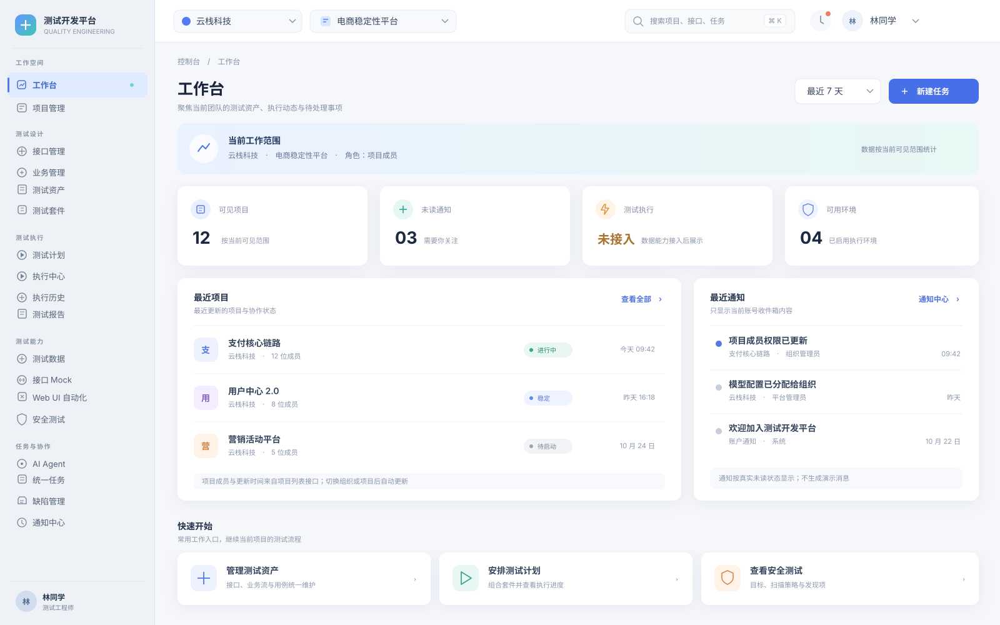
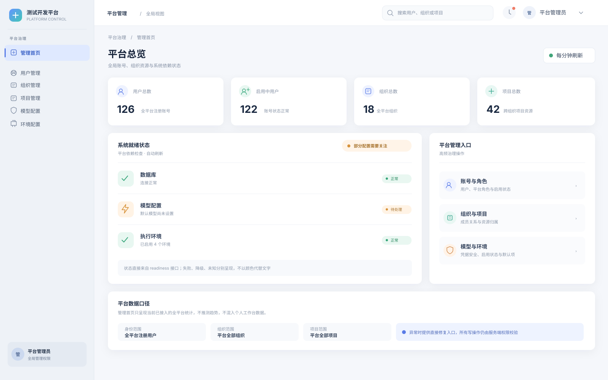
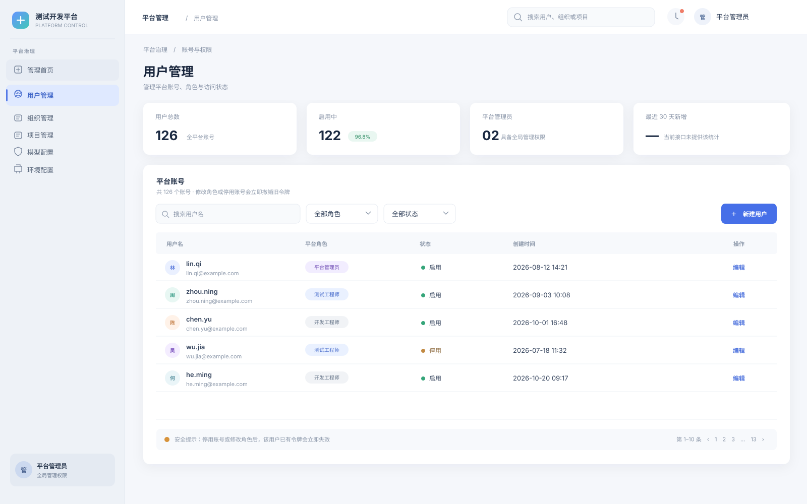

# 测试开发平台 UI 全面重构方案

**评审稿 · 2026-10-26**

这份方案针对现有 React + Ant Design 前端的两套入口：用户控制台 `/console/*` 与平台管理端 `/admin/*`。目标是先统一视觉语言和页面骨架，再按工作流改造各业务页。当前只交付设计提案与界面示意，不修改运行中的前端实现。

## 现状与设计判断

- 控制台已经包含工作台、项目、测试设计、测试执行、测试能力、Agent、任务和通知等多组入口；内容较多，侧栏和面包屑需要更清楚的层级与定位。
- 管理端与控制台目前共用接近 Ant Design 默认的布局表达。管理端实际只有六个主要页面，适合建立清晰的“平台治理”工作区，而不是复制用户工作台的结构。
- 项目已有全局 antd 主题入口、统一页面状态组件和通用表格等基础，可在保留依赖的前提下集中升级令牌与通用模板。
- 后端已经提供有统计口径的工作台数据和平台就绪检查。未接入的执行、报告能力明确返回“未接入”，重构后继续遵守该约定，不展示虚构趋势或零值。

## 视觉方向

采用“专业、克制、以测试流程为中心”的企业工作台风格：

| 层级 | 设计建议 |
|---|---|
| 导航 | 浅雾灰蓝侧栏（#EEF2F7），以细分隔线与内容区区分；常规文字使用深灰，当前项使用淡蓝底、品牌蓝文字和窄色条；分组可折叠，保留完整路由。 |
| 内容底色 | 浅灰蓝工作画布，白色内容卡片，降低大面积边框和默认灰块带来的拥挤感。 |
| 品牌色 | 蓝色用于主要动作和选中态；绿色表示正常，橙色表示待处理，红色表示异常。状态始终同时显示文字。 |
| 排版 | 保留中文系统字体与 8px 间距基线；建立统一标题、说明、元信息、表格文字层级。 |
| 组件 | 保留 Ant Design；统一按钮尺寸、输入框高度、标签、卡片、抽屉、表格密度和空态。圆角以 8–12px 为主。 |
| 主题 | 浅色作为方案主视图；继续支持系统深色偏好，并用同一组主题令牌定义暗色状态。 |

界面示意中的组织、项目、账号和数量只用于展示版式，最终页面仍以接口返回值为准。示意图里对尚未接入的执行数据保留了“未接入”状态。

## 图 1：用户控制台工作台

工作台突出当前组织与项目范围、项目/通知/环境等真实统计、最近项目和快捷入口。未接入的测试执行明确标记，不用趋势图填充空间。常用任务创建入口保持靠近页面标题，组织与项目切换留在顶部。

## 图 2：平台管理总览

平台总览将账号、组织、项目等全局计数与系统就绪状态分开呈现。异常项直接提供对应的管理入口；检查结果依据数据库、模型配置和执行环境的现有 readiness 数据展示。

## 图 3：平台用户管理

用户管理以搜索、角色/状态筛选和表格为主。账号角色与启用状态使用可扫读的标签；修改角色、停用账号涉及的令牌失效提示在确认操作附近展示。对接口未提供的新增趋势统计使用横线和说明，不推测数据。

## 页面结构与交互方案

### 用户控制台

- 将导航组织为“工作空间、测试设计、测试执行、测试能力、任务与协作”几个可折叠分组；保留当前功能和路由，不改变权限边界。
- 顶栏固定展示组织、项目、通知和账号入口；选择器有明确的当前值、搜索与清空状态。缩窄时允许折叠侧栏和收起次要控件。
- 每个页面统一使用“面包屑 + 标题/说明 + 主动作 + 可选元信息”页头，避免标题、按钮和筛选区在不同页面随意漂移。
- 工作台只放有数据来源的统计、最近项目、通知和常用入口。模块尚未接入时显示清晰提示与进入说明。
- 项目、接口、用例、套件、计划、任务等列表统一采用工具栏、筛选、结果数、表格和分页结构；详情页采用对象摘要、分区内容、固定主操作，长配置使用分组表单。
- 保留现有全局任务调度抽屉；复杂的执行过程、报告和安全扫描结果以更明显的步骤/时间线/证据区呈现，减少大块原始 JSON 成为默认视图。

### 平台管理端

- 通过独立的“平台治理”品牌区分平台级管理与项目内日常测试工作。
- 管理首页聚焦全平台用户、组织、项目、模型和环境统计，以及 readiness 检查；去掉不影响决策的重复说明卡片。
- 用户、组织、项目统一采用平台管理列表模板：标题、搜索/筛选、新建入口、密度合适的表格、详情抽屉或编辑弹窗。
- 模型与环境配置使用分组表单、配置状态和安全说明；密钥继续掩码显示，空值保留原凭据的规则保持不变。
- 管理操作继续由服务端鉴权；界面隐藏或禁用按钮只提供交互提示，不被视为权限控制。

### 登录与注册

- 桌面端采用居中的双栏卡片：左侧为测试工作流主题插画和产品说明，右侧放品牌标识、用户名/密码输入框、主登录按钮与注册入口。
- 注册页复用同一框架和插画，保留用户名、密码注册行为；当前注册不使用验证码。
- 窄屏下将插画区压缩为顶部横幅，表单改为单列；登录跳转、安全校验和账号错误提示保持原有逻辑。

## 改造范围与阶段

| 阶段 | 主要工作 | 交付结果 |
|---|---|---|
| 1. 设计系统与双端外壳 | 更新主题令牌、全局间距/字体/状态色；重做侧栏、顶栏、页头、响应式容器和登录/注册框架。 | 全站导航与基础视觉一致，深浅主题都有定义。 |
| 2. 控制台主路径 | 工作台、项目、测试资产、接口、套件、计划、执行中心、执行历史与报告。 | 常用测试流程使用统一列表/详情模式，重点信息更容易定位。 |
| 3. 平台管理 | 管理首页、用户、组织、项目、模型配置、环境配置。 | 账号治理和运行配置形成独立、完整的管理工作区。 |
| 4. 复杂能力与收尾 | 安全测试、Mock、测试数据、Web UI、Agent、任务、通知；补齐空态、错误态、暗色和窄屏细节。 | 所有现有路由完成视觉迁移，状态与操作反馈一致。 |

## 实施边界与验收标准

1. 保留现有路由、API 请求、数据模型和权限规则；实施前重新核对相关页面当前代码。
2. 不伪造测试执行、报告或趋势数据；聚合指标继续展示明确的统计口径。
3. 通过主题令牌实现颜色和尺寸，不在页面散落新的固定色值；保留 Ant Design 与现有深色偏好能力。
4. 关键动作有清楚的加载、成功、失败、确认反馈；表格、表单、抽屉、空态、错误态风格统一。
5. 桌面常用宽度下避免页面拥挤；平板和窄屏下侧栏、筛选条、表格操作仍可访问。
6. 状态不只靠颜色区分；菜单和表单可键盘操作，文本与交互对比度满足可读性。

## 评审后建议的推进顺序

先确认视觉方向、导航分组和示意中的信息层级；方向确认后从主题令牌与双端外壳开始实施，再按阶段迁移具体页面。功能路由和服务端权限保持原有约定。
