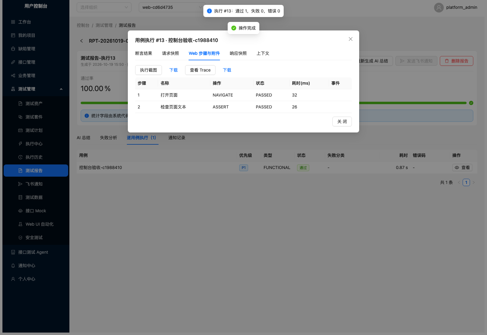

# Web UI Automation Phase 1 交付报告

交付日期：2026-10-19（Asia/Shanghai）。开发基线：`develop` 提交 `03d149c`；功能分支：`codex/web-ui-automation-phase1`。

## 1. 交付范围与验收结论

本期实现 Playwright Chromium Web UI 自动化模块，控制台入口为 `/console/web-ui`。
用例和步骤继续使用 `TestCase` / `TestStep`；执行复用 `RunService`、`TestCaseExecutor`、
`TestRun`、`CaseExecution`、Fixture / Data Factory、Mock 生命周期、ExecutionContext 和 Assertion Engine。
数据库只增加 Web 扩展配置与附件表，不另建运行体系，不开发 Mobile 或 Security 模块。

验证记录见 [测试摘要](web-ui-phase1/pytest-summary.txt)。真实浏览器已经验证两条链路：

1. 服务端验收：创建 Web 用例 → 配置七类步骤 → 解密测试账号 → 真实 HTTP 登录并建立 Cookie → 页面操作 → 主动失败断言 → 失败截图与 Trace → 保存既有 CaseExecution → 原有 Test Report 查询附件。
2. 控制台验收：登录平台 → 进入 Web 模块 → 新建和编辑 UI 步骤 → 人工确认 → 选择环境 → 调试执行 → 打开截图与 Trace 动作时序 → 查看正式报告中的 Web 步骤和附件。



## 2. 功能清单

| 能力 | 本期实现 |
|---|---|
| PlaywrightExecutor | 独立 Chromium 进程与 BrowserContext；操作/导航/总时长限制；异常清理；Web 专属进程内并发上限 2；截图、动作 Trace、步骤日志 |
| UI 用例管理 | TestCase 的 `WEB` 类型；TestStep 中加密保存结构化配置；创建、编辑、删除、步骤重排、revision 乐观锁与单例调试 |
| 步骤 | NAVIGATE、CLICK、FILL、SELECT、UPLOAD、WAIT、ASSERT；上传仅接收内存文件，单文件 ≤1MiB，单用例配置 ≤2MB |
| 定位器 | TEST_ID、ROLE + 可访问名称、LABEL、TEXT；显式 CSS / XPath 兜底；命名页面元素可复用 |
| 断言 | TEXT、VALUE、VISIBLE、COUNT、URL、TITLE；比较复用既有 Assertion Engine；支持断言值输出到业务运行时变量 |
| 登录态 | 测试账号、Cookie、Local Storage、JWT；人工完成飞书扫码后导入目标系统 storage_state；绑定执行环境、到期与撤销 |
| 敏感信息 | 凭据及步骤配置复用 shared.crypto；凭据只写、不回显；截图遮罩输入、iframe 和敏感元素；Trace 清除网络正文/DOM/源码并脱敏；附件加密落库 |
| 授权目标 | 执行使用项目出站 scheme/host/port 白名单，校验页面、子资源和重定向；阻止非 HTTP 导航、未授权目标、Service Worker 和 WebSocket |
| 测试执行 | 单例调试与既有测试计划共用同一编排函数；Fixture setup/cleanup、Data Factory 数据、Mock Context 激活/关闭继续生效 |
| 混合业务 | Business Action 可绑定 WEB 用例；同一 Business Flow 支持 API + WEB；输出进入 ExecutionContext，并复用 VariableRef 传递规则 |
| Agent | 复用平台 ProductionLLMProvider、业务流程和页面对象上下文；结构化输出经 Pydantic 校验，保存为未确认 AI 草稿；不向 Agent 提供确认和执行工具 |
| 人工门禁 | 确认指纹覆盖步骤、页面定位、用例版本和认证配置；变更后重新确认；直接通过通用计划执行也不能绕过门禁 |
| 前端 | 页面对象、步骤编辑器、登录态管理、Agent 草稿、业务绑定、调试、执行历史、截图与本地 Trace 事件查看 |
| 报告 | 沿用原有 Test Report；CaseExecution 快照保存 Web 步骤、错误定位及附件引用；混合流程聚合 Web 附件 |

## 3. 架构与兼容性

```text
Web 控制台 / Agent 草稿
  → WebUIService → TestCase + TestStep + WebCase
  → 人工确认当前指纹
  → RunService（计划或单例调试共用）
  → Fixture / Data Factory + Mock 生命周期
  → TestCaseExecutor 的 WEB 分支
  → 变量解析 + 加密认证状态 + PlaywrightExecutor
  → CaseExecution → 原 Test Report → 权限保护的附件查看
```

- 沿用 `/api/v1`、项目权限、三层角色、错误信封、JWT 和数据库事务 flag。
- 原有 `TestCaseExecutor.execute`、`execute_flow`、`run_action` 的对外签名保持兼容。
- 为单例调试抽出 RunService 内部编排函数，避免临时建套件/计划或复制 Fixture / Mock 流程。
- Web 页面对象及认证配置修改后，旧确认指纹失效。行级锁配合刷新实例检查 revision，避免并发覆盖。
- 原有 API / BUSINESS_FLOW / BUSINESS_ACTION 用例保留原分支，新增 WEB 分派采用延迟导入。
- 浏览器使用 Web 独立配额，不连接用户浏览器、ZAP 会话或 ZAP 进程。
- 项目成员选择执行环境时，只读取名称、ID 和启用状态，不放开环境管理端的凭据与默认请求头。
- 截图/Trace 下载经当前 JWT 与项目可见性检查，使用不透明附件 ID，响应禁止缓存。
- Trace 只保留脱敏动作时序；控制台本地查看与下载，不上传至外部 Trace Viewer。

## 4. 数据库迁移

迁移文件：`backend/alembic/versions/0012_web_ui.py`。

- `revision = "0012"`，`down_revision = "0011"`。
- 新增 `web_page_object`、`web_auth_profile`、`web_case`、`web_artifact` 四张表。
- 不修改原有测试、业务、Mock、Security 或报告表结构。
- 新表没有加入 `app/models/__init__.py`；0012 显式建表，并兼容 seed_admin 的 `stamp base` / `upgrade head` 重复初始化。
- 已在隔离 PostgreSQL 上验证空库升级、重复初始化、0012 → 0011 回滚和恢复升级。
- 回滚只移除四张 Web 扩展表；原有测试、安全、Mock、业务与报告表保留。历史 Web 扩展配置/附件随回滚删除。
- 同步更新 test_01 / test_10 / test_18 / test_22 的 head 断言；新 Web 迁移测试校验 0012。
- 验收使用独立测试数据库；没有重建或迁移正在使用的开发库。

## 5. API 入口

| 路径 | 用途 |
|---|---|
| `/projects/{project_id}/web-pages` | 页面对象列表与创建 |
| `/projects/{project_id}/web-pages/{page_id}`、`/web-pages/{page_id}` | 更新与删除 |
| `/projects/{project_id}/web-cases`、`/web-cases/{case_id}` | 结构化用例列表、创建、详情及删除 |
| `/projects/{project_id}/web-cases/{case_id}` | 原子更新用例和步骤顺序 |
| `/web-cases/{case_id}/confirm` | 人工确认当前 revision |
| `/web-cases/{case_id}/debug` | 复用既有编排执行单例 TestRun |
| `/projects/{project_id}/web-auth-profiles` | 仅元信息列表与只写认证创建 |
| `/projects/{project_id}/web-auth-profiles/{auth_id}`、`/web-auth-profiles/{auth_id}` | 整体替换与撤销认证 |
| `/projects/{project_id}/web-environments` | 最小环境候选信息与搜索 |
| `/projects/{project_id}/web-executions` | CaseExecution 历史分页，含混合业务的 Web 结果 |
| `/web-artifacts/{artifact_id}`、`/web-artifacts/{artifact_id}/events` | 授权附件下载与脱敏 Trace 动作事件 |
| `/projects/{project_id}/web-agent/draft` | 根据业务流程及页面对象生成未确认草稿 |
| `/business-actions/{action_id}/web-binding` | 同项目业务动作选择默认 WEB 通道 |

所有路径统一加 `/api/v1`。读需 viewer+，写、确认和执行需 member+；跨项目不可见资源返回 404。

## 6. 测试结果

- Web 验收：**19 项全部通过**；与既有 TestCaseExecutor 联合验收 **44 passed**，包含真实 Chromium 和控制台完整交互。
- 前端 `npm run typecheck`：通过。
- 前端 `npm run build`：通过；现有单包体积提示仍存在，未引入新的构建错误。
- 迁移/种子与控制台联合检查：**5 passed**，验证重复初始化与浏览器报告页面。
- 最终整库 pytest：**828 passed、27 failed、45 warnings**（214.62 秒）。27 项失败全部位于未提交、进行中的 `tests/test_28_zap_connector.py`；未修改该文件或 ZAP 实现。
- 最终平台全量（排除进行中的 ZAP 文件）：**760 passed、45 warnings**（215.17 秒），覆盖全部已有平台测试及最终 Web 源码。

Web 定向测试覆盖：七类步骤、六类定位、真实 HTTP 登录、Cookie/JWT 注入、人工 storage_state 复用、
账号与步骤加密、确认失效、过期 revision、通用测试计划门禁、Fixture/Data Factory、Mock 生命周期、
混合业务与输出、Agent 结构化草稿与脚本拒绝、权限/附件边界、超时释放、两个 Chromium 并发隔离、
迁移回滚，以及控制台创建到报告附件的实际点击流程。

```bash
cd backend
.venv/bin/python -m pytest tests/test_30_web_ui.py tests/test_31_web_ui_console.py -q
.venv/bin/python -m pytest tests/ -q

cd ../frontend
npm run typecheck
npm run build
```

## 7. 使用与人工扫码会话复用

安装与升级：

```bash
cd backend
.venv/bin/python -m pip install -r requirements.txt
.venv/bin/python -m playwright install chromium
.venv/bin/python -m alembic upgrade head
```

在项目中授权目标 scheme/host/port，选择平台环境，维护页面对象和稳定定位器。新增认证配置后，
通过 `${data.auth_username}` / `${data.auth_password}` 或 Fixture / Runtime 变量引用数据。
保存用例 → 审核步骤 → 人工确认 → 选择环境并调试；执行历史中查看错误、附件及正式报告。

飞书扫码由人工在独立浏览器完成，再导入目标测试系统的 Cookie/LocalStorage。
可在本机使用 Playwright 的 `codegen --save-storage` 保存登录后状态，关闭浏览器后导入生成的 JSON；
本模块只消费结构化 storage_state，不执行录制得到的脚本。状态文件包含凭据，使用后删除，不提交仓库。
该保存/复用方式见 [Playwright 官方说明](https://playwright.dev/python/docs/codegen#preserve-authenticated-state)。

## 8. 未完成项与明确边界

- 真实飞书租户扫码与外部实际 LLM 服务尚未联调：未提供对应测试账号/模型配置。人工会话复用和 LLM 结构化协议已通过可控测试。
- SELECT 按原生 select 的 value 选择；自定义下拉组件可通过 CLICK / WAIT / CLICK 的结构化步骤组合操作。
- 一期只支持 Chromium、单次隔离 Context、Cookie / LocalStorage/JWT；不提供 Firefox/WebKit、移动端、IndexedDB、Session Storage、持久浏览器池或录制脚本执行。
- Trace 主动移除了 DOM、网络正文和源码；因此提供动作时序与独立截图，不能按原始完整 Trace 回放页面 DOM。
- 并发上限为每个服务进程的 Web 配额；跨进程调度、队列、跨实例配额、附件自动过期清理未在一期实现。
- 需要登录态续期时由人工替换配置，并重新确认引用用例；不绕过 MFA、验证码或飞书扫码。
- 仍需功能负责人 review 后再合并至 develop；本次不自动合并或发布。
- 工作区正在开发的 ZAP 目录、测试及其 `shared/config.py` / `shared/errors.py` 改动保留原样，未纳入本次功能修改或提交。整库有 27 项 ZAP 失败，涉及 Fake Transport 返回、测试夹具参数及断言契约等，不能把整库状态标为全绿。

## 9. 修改文件

以下清单在交付前由 Git 变更生成，仅包括本次 Web UI 功能，不包含 ZAP 未提交文件。

- `.claude/skills/develop-this-project/SKILL.md`
- `README.md`
- `backend/alembic/versions/0012_web_ui.py`
- `backend/app/features/agent/tools/web_ui_tool.py`
- `backend/app/features/business/executors/business_flow_executor.py`
- `backend/app/features/business/services/binding_service.py`
- `backend/app/features/business/services/flow_service.py`
- `backend/app/features/test_management/executors/test_case_executor.py`
- `backend/app/features/test_management/schemas.py`
- `backend/app/features/test_management/services/run_service.py`
- `backend/app/features/web_ui/__init__.py`
- `backend/app/features/web_ui/models/__init__.py`
- `backend/app/features/web_ui/models/web_ui.py`
- `backend/app/features/web_ui/router.py`
- `backend/app/features/web_ui/runtime/__init__.py`
- `backend/app/features/web_ui/runtime/adapter.py`
- `backend/app/features/web_ui/runtime/playwright_executor.py`
- `backend/app/features/web_ui/runtime/policy.py`
- `backend/app/features/web_ui/schemas.py`
- `backend/app/features/web_ui/services/__init__.py`
- `backend/app/features/web_ui/services/web_ui_service.py`
- `backend/app/main.py`
- `backend/requirements.txt`
- `backend/tests/test_01_schema_and_seed.py`
- `backend/tests/test_10_business.py`
- `backend/tests/test_18_test_data_crud.py`
- `backend/tests/test_22_security_strategy.py`
- `backend/tests/test_30_web_ui.py`
- `backend/tests/test_31_web_ui_console.py`
- `docs/web-ui-automation-phase1-delivery-report.md`
- `docs/coding-conventions.md`
- `docs/web-ui-phase1/report-browser-verification.png`
- `frontend/src/App.tsx`
- `frontend/src/api/webUI.ts`
- `frontend/src/layouts/ConsoleLayout.tsx`
- `frontend/src/pages/console/BusinessManagement/BindingEditor.tsx`
- `frontend/src/pages/console/Reports/ReportDetail.tsx`
- `frontend/src/pages/console/WebUI/Artifacts.tsx`
- `frontend/src/pages/console/WebUI/Editors.tsx`
- `frontend/src/pages/console/WebUI/StepEditor.tsx`
- `frontend/src/pages/console/WebUI/index.tsx`
- `frontend/src/types/index.ts`

- `docs/web-ui-phase1/pytest-summary.txt`
